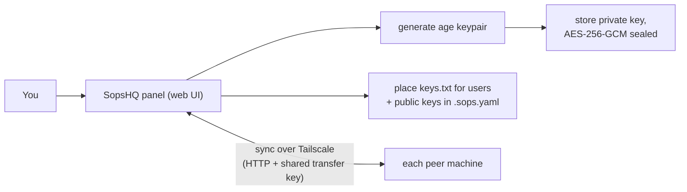

# SopsHQ

**A small, self-hosted control panel for managing SOPS/age encryption keys across
your machines.**

> [!WARNING]
> **This project is not maintained.** It is published as is, in case it is useful to
> someone. There are no releases, no support, and no one reads issues, pull requests or
> security reports. Build it from source, read the code before you trust it with real
> keys, and fork it freely.

SopsHQ is for people who use [SOPS](https://github.com/getsops/sops) and
[age](https://github.com/FiloSottile/age) to keep secrets encrypted in git. It:

- remembers **which key belongs to which project, which user can decrypt it, and which
  machine it lives on**;
- generates those keys and places them for you, on every machine;
- keeps your machines in sync over your private (Tailscale) network.

> [!IMPORTANT]
> SopsHQ is a **management plane**, not a decryption gateway. Once a key is placed
> on a machine, `sops -d` decrypts locally **even if SopsHQ is turned off**. SopsHQ
> never sits between you and your secrets.

## Contents

- [A 60-second primer](#a-60-second-primer)
- [What SopsHQ does](#what-sopshq-does)
- [What works](#what-works)
- [Requirements](#requirements)
- [Build from source](#build-from-source)
- [Install and run](#install-and-run)
- [Using the panel](#using-the-panel)
- [Updating](#updating)
- [Uninstalling](#uninstalling)
- [Security at a glance](#security-at-a-glance)
- [Documentation](#documentation)
- [Unfinished work and ideas](#unfinished-work-and-ideas)
- [License](#license)

## A 60-second primer

- **age** uses a **keypair**:
  - a **private key** (`AGE-SECRET-KEY-1...`): the secret; it **decrypts**. It lives in
    a file and is never shared.
  - a **public key** (`age1...`): **not** secret; it **encrypts**. You list it in a
    project's `.sops.yaml`.
- **SOPS** encrypts only the **values** in a config file (so `db_password: hunter2`
  becomes `db_password: ENC[...]`) and leaves the field names readable, so the file is
  safe to commit to git.

Doing this by hand across several machines and users is fiddly. SopsHQ automates the
bookkeeping and the placement.

## What SopsHQ does

- **Define a key once** in the web panel: give it a name, choose its type (one shared
  key per project, or one key per user), and assign it to projects (folders) and the OS
  users who may decrypt.
- **SopsHQ generates the age keypair**, stores the private key encrypted, and places
  it: it writes each user's private key file with the right permissions and updates
  each project's `.sops.yaml`.
- **Rotate a key** with one action: SopsHQ re-encrypts the affected secret files
  (`sops updatekeys`) and redistributes the new key.
- **Every machine, one source of truth.** Each machine in your cluster runs the panel,
  and they keep each other in sync over Tailscale. The common case is a Windows dev box
  plus a Linux server; any number of peers works.
- **Encrypted at rest.** Private keys, the record store, the replication log and the
  audit log are all sealed on disk under a key derived from your vault key, so the disk
  alone reveals nothing.



## What works

Everything below worked end to end on the author's Linux and Windows machines.

- **Core:** encrypted vault, sealed JSON store and replication log, sealed append-only
  audit log, CLI with a status dashboard and an interactive menu.
- **Web panel:** login with password plus TOTP, roles, keys, projects, machines and OS
  users, a read-only database view, a map of how the records relate, and the audit log.
- **Key engine:** generate keys, write `.sops.yaml`, place keys, rotate, and manage
  secret values per project or in shared sets.
- **Cluster:** multi-master replication and key transfer between machines over
  Tailscale.
- **Drift guard:** if a managed file (`keys.txt`, `.sops.yaml`, `secrets.yaml`) was
  edited outside SopsHQ, the next write pauses and shows a non-secret diff to adopt,
  overwrite or cancel.
- **Backups:** encrypted daily backups to a local folder, FTP or Telegram, and manual
  export and restore.
- **Notifications** to Telegram and Slack, and best-effort key-usage tracking through
  an optional `sops` shim.
- **Permission auditor (Linux):** an admin-only, read-only map of who can access what
  on the filesystem, with a daily drift digest. Off by default.

## Requirements

- **Go 1.27 or newer** to build (`crypto/mldsa` is used for release signatures).
- **`age-keygen`** and **`sops`** on `PATH`.
  - Linux: from your distribution, or the binaries published by each project.
  - Windows: `winget install getsops.sops FiloSottile.age`.
- **Linux:** the `acl` package (`setfacl`/`getfacl`); `sopshq setup` installs it when
  it is missing.
- **Tailscale** for machine-to-machine sync. A single machine needs nothing else.

The only third-party Go module is `rsc.io/qr`, for the TOTP enrollment QR code.

## Build from source

The root `VERSION` file is the single source of the version. Every build injects it, so
the panel footer shows the real number; a bare `go build` shows `dev`.

```sh
./build.sh           # Linux and Windows binaries into dist/
./build.sh --check   # go vet and go test first, then build
```

Without bash (for example in a Windows terminal), build one target by hand:

```sh
go build -ldflags "-X main.version=$(cat VERSION)" -o dist/ ./cmd/sopshq
```

`./start.sh` runs SopsHQ straight from source in the foreground (`go run`), for
development.

## Install and run

**Linux server.** One root command creates a dedicated `sopshq` service account, the
folders, a `PATH` link and a systemd unit (not enabled at boot), then walks you through
setting the vault key:

```sh
sudo ./dist/sopshq install --dry-run   # preview every path and change
sudo ./dist/sopshq install             # same as "sopshq setup"
sudo systemctl start sopshq            # starts LOCKED
sudo sopshq unlock                     # type the vault key; the panel comes up
sudo sopshq status                     # locked or unlocked, and the panel URL
```

The defaults are the binary in `/opt/sopshq`, data in `/srv/sopshq` and keys in
`/srv/sopshq-keys`. Put the data and key folders on an encrypted volume and pass their
paths with `--data` and `--keybase`; see the [Linux deployment guide](docs/deployment.md).

**Windows dev box.** SopsHQ runs as your own user, with no admin rights:

```sh
sopshq install -dir C:\SopsHQ
```

This sets up the vault and registers a Startup-folder launcher, so SopsHQ starts at
every logon and asks for the vault key in a console window. See the
[Windows deployment guide](docs/deployment-windows.md).

**Anywhere:**

- `sopshq` with no arguments shows a status dashboard: where the install is, whether it
  is stopped, locked or unlocked, every path it uses, and the exact commands to run it.
  When no install is found at all, it opens the interactive menu.
- `sopshq menu` offers the commands as a numbered menu, and `sopshq help` lists them.

**The vault never unlocks by itself:**

- a foreground `sopshq serve` asks for the vault key;
- a background `sopshq start`, or the systemd service, starts locked and waits for
  `sopshq unlock`;
- for an unattended start, set `SOPSHQ_VAULT_KEY`; it stays in the process and is never
  written to disk.

The panel is plain **HTTP** on `http://127.0.0.1:8770/` by default. Reach it on loopback
or over Tailscale, which encrypts the connection. Ports live in `config.jsonc` in the
data folder.

> [!WARNING]
> Never expose the panel or the agent port on a public interface.

## Using the panel

1. **Machines:** add this machine and click **Set as local**.
2. **OS users:** add the accounts that should hold keys.
3. **Projects:** add a project and set its folder on this machine.
4. **Keys:** define a key and click **Generate**.
5. In the project, **assign** the key to a machine and OS user.
6. **Dashboard:** click **Dry run (local)** to preview, then **Apply to this machine**.
   SopsHQ places the private keys and writes each project's `.sops.yaml`. `sops -e` and
   `sops -d` now work in that folder.

**Quick add** in the top bar does all of this in one form for a single secret. **Global**
holds shared sets: secrets defined once and shared with chosen users, each reading
them with their own key.

**A cluster** needs the same vault key and the same transfer key on every machine, and
each machine's Tailscale address entered on the others (Machines page). They then
replicate every 30 seconds.

**Backups, notifications and audit retention** are set up under Settings. Save the
backup password in your password manager: it is needed to restore and cannot be
recovered from the backup.

## Updating

Rebuild from source and run `sudo ./dist/sopshq install` again on Linux, or replace the
binary on Windows. Install is safe to re-run: it stops the running service first, and it
keeps your data.

`sopshq update`, which installs signed releases, is built in but **switched off**: no
signing key is embedded and this repository publishes no releases. A fork that wants
signed releases can turn it on; see [docs/releasing.md](docs/releasing.md).

## Uninstalling

**Linux:** run `sudo ./uninstall.sh --dry-run` from this repository to see the plan,
then `sudo ./uninstall.sh`.

- It asks before every decision, with no default answer.
- For the program, data and key folders it offers: move aside, delete, or keep. It lists
  the key files in the key folder before asking about that folder.
- Nothing changes until you type `proceed`.

The [deployment guide](docs/deployment.md#uninstall) has the details.

**Windows:** `sopshq uninstall-launcher` removes the Startup launcher. Then delete the
install folder by hand; see the [Windows guide](docs/deployment-windows.md#uninstall).

> [!WARNING]
> The data folder and the key folder may hold the only copy of your private keys.
> Export a backup, or copy the keys, before you delete them.

## Security at a glance

| Concern | How SopsHQ handles it |
|---|---|
| Private keys at rest | AES-256-GCM under a key derived from your vault key (PBKDF2-HMAC-SHA384, 600,000 iterations, fixed salt, so the same vault key gives the same key on every machine) |
| Store, replication log, audit log | AES-256-GCM under a store key derived from the vault key; readable only after unlock |
| Vault key | entered at start, held in memory only, never written to disk or logs, never auto-unlocked at boot |
| Panel traffic | plain HTTP on loopback or Tailscale (WireGuard); not for public interfaces |
| Machine-to-machine traffic | plain HTTP over Tailscale, every request authenticated by a shared transfer key |
| Login | password hash plus TOTP, roles, lockout after repeated failures |
| Audit | every action logged by name or UUID, never a secret value |

The full model, including what SopsHQ does not protect against, is in
[docs/architecture/security.md](docs/architecture/security.md).

## Documentation

- [Linux deployment guide](docs/deployment.md): installing, running and removing
  SopsHQ on a Linux server.
- [Windows deployment guide](docs/deployment-windows.md): the same on a Windows dev box.
- [Architecture](docs/architecture/README.md): the design, key placement, replication,
  storage, backup and recovery.
- [Terminology](docs/terminology.md): the words SopsHQ uses.
- [Releasing](docs/releasing.md): how a fork sets up signed releases.
- [Security policy](docs/SECURITY.md).

## Unfinished work and ideas

None of this is built. It is listed so a fork knows where the edges are.

**Never tested for real**

- The release workflow and `sopshq update`'s automatic restore after a failed update.
- `uninstall.sh` beyond its stubbed test harness (`scripts/test_uninstall.sh`); its
  `~/.bashrc` edit runs only as root.

**Ideas**

- **Secrets broker:** apps ask SopsHQ for a secret instead of running `sops`, with the
  sops files kept as a fallback. This would put SopsHQ in the decrypt path, the opposite
  of today's design.
- **Network-level interception:** stop a process running as the same user from reading
  another app's secrets.
- **Multi-user roles and approval workflows** for teams.
- **Windows code signing** for `sopshq.exe`: Windows Defender can block the unsigned
  binary.
- **A multi-user Windows Startup launcher.**
- **Chained commands** such as `sopshq start unlock`.

## License

GNU Affero General Public License v3.0 or later. See [LICENSE](LICENSE).
