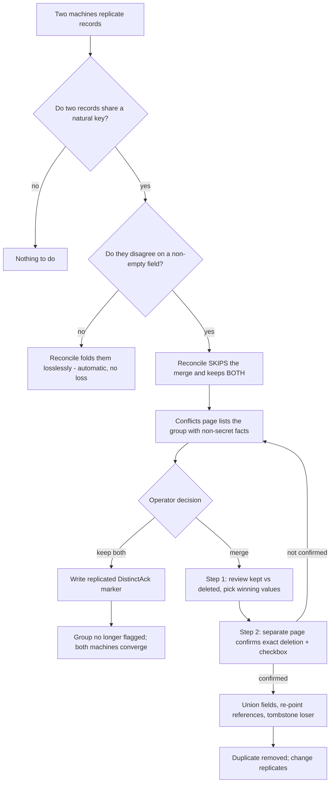

# Conflict resolution - resolving the duplicates SopsHQ keeps on purpose

This document explains, in plain language, what happens when SopsHQ finds **two records
that look like the same thing but disagree on a value**, why it refuses to merge them
automatically, and how an operator resolves each one safely. Every term is defined on
first use. It uses the plain-language terms from [`../terminology.md`](../terminology.md):
where the SOPS tool says "recipient" for a public key listed in an encrypted file, this
document says **public key**.

It builds directly on two neighbours:

- [Replication](replication.md) - how two machines copy each other's records.
- [Cluster peer identity](peer-identity.md) - how duplicate **machine** records heal
  themselves, and the new-vs-reinstall confirmation for a brand-new machine.

**Two kinds of conflict share the `/conflicts` page.** This document covers
**duplicate records** - two SEPARATE records (different ids) that describe the same
thing but disagree. The page also lists **field conflicts** - ONE record whose SAME
field two machines changed to different values at once (for example a key's note
edited on both). Field conflicts come from [per-field merge](replication.md#10a-per-field-merge-so-two-machines-can-edit-one-record-at-once);
they are resolved by the same two-step, double-confirmed pick described below, but
they delete no record - they simply write the winning value. The rest of this
document is about duplicate records.

---

## 1. Why duplicates that disagree are kept, not merged

SopsHQ runs on more than one machine, and the machines **replicate** (copy each other's
records). Two machines can independently create records that describe the same thing - the
same project by name, the same account on the same machine, the same public key. Most of
the time these are truly identical and SopsHQ folds them together automatically with **no
loss**: identical records collapse, a list (readers, project paths) is unioned, and a value
fills a field the survivor left empty. This automatic, always-safe folding is the
**reconcile pass** (see [peer identity](peer-identity.md)).

But sometimes the two records **disagree on a real value** - two records for the same
public key hold *different* sealed private halves; the same project points at a *different*
folder on the same machine; the same account names a *different* keystore. Folding one away
would **silently delete** that value. SopsHQ never does that. When merging would lose a
non-empty field, the reconcile pass **skips the merge and keeps BOTH records**. The rule:

> Never destroy data to de-duplicate. If a merge would drop a value, keep both records and
> let a human decide - showing exactly what would be deleted, and confirming it twice.

That leaves duplicates sitting in the database. **This document is the operator-facing flow
that resolves them.**

## 2. What counts as a conflict

A **conflict group** is two or more live records that share a **natural key** (the thing
that makes them "the same") but disagree on at least one non-empty field. The natural key
per record kind:

| Record kind             | Natural key (what makes two "the same")     | Can they be genuinely distinct? |
|-------------------------|---------------------------------------------|---------------------------------|
| Key                     | the public key                              | yes - keep both allowed         |
| Project                 | the project name                            | yes                             |
| OS user                 | machine + username                          | yes                             |
| Machine                 | the machine name                            | yes                             |
| Map view                | the view name                               | yes                             |
| Backup settings         | the machine (one record per machine)        | **no** - merge only             |
| Notification settings   | the machine (one record per machine)        | **no** - merge only             |

The per-machine **settings** kinds can only ever have **one** record per machine, so "keep
both" makes no sense for them - the only resolution is to merge and pick which value wins.

**Detection is read-only and exact.** The code that finds conflict groups
(`keysvc.DetectConflicts`) reuses the *very same* "do these disagree?" tests the reconcile
pass uses to decide what to skip, and replays the same survivor-then-fold sequence on a
throwaway copy. So the set it surfaces is precisely the set the lossless pass leaves intact
- never more, never less. It writes nothing.

**Only non-secret facts are shown.** For each record the page shows things that help tell
them apart - machine name, keystore path, project folder, advertised address, "sealed
password present: yes", "telegram channel set: yes", when it was created and which machine
it came from - and marks which field differs. It **never** shows a sealed private key, a
password, a token, or any secret value. A differing secret is surfaced by *presence and
provenance* only ("sealed private key present, from linux-server").

## 3. The two resolutions

### Merge into one (deletes a duplicate - confirmed twice)

Merging folds the group into **one** surviving record and removes the duplicate(s). Because
this deletes data, it is a **two-step, double-confirmed** flow:

1. **Review (step 1)** - the Conflicts page shows, for the group, which record is **kept**
   and which is **removed**, and offers a radio button per genuinely-differing field so the
   operator picks the winning value. Every field only one record set, and every reference
   (key grants, project paths, account and machine references), is preserved automatically.
2. **Confirm deletion (step 2)** - submitting the picks opens a **separate** page that
   restates *exactly* which record will be permanently deleted ("Permanently delete record X
   on machine Y. This cannot be undone.") and requires an explicit checkbox.
3. **Execute** - only the step-2 page can reach the execute endpoint, which independently
   refuses unless the confirmation checkbox is present. So a deletion is impossible without
   passing both confirmations.

On execute (`keysvc.ResolveMerge`): the survivor gains every losslessly-mergeable field,
the operator's chosen value is applied for each conflicting field, **every reference is
re-pointed onto the survivor** (assignments' key/project/user/machine ids, a project's paths,
global-set readers, the per-machine settings' machine id, and - if this node's own machine
record is the one absorbed - the running node's local machine id), duplicate assignments are
removed, and finally the loser(s) are tombstoned (a soft delete that replicates). Nothing
that was not shown and confirmed is ever dropped.

### Keep both (deletes nothing)

If the records are genuinely **different things** that happen to share a natural key, the
operator clicks **Keep both**. SopsHQ writes a small **replicated marker** (a `DistinctAck`
record: the entity kind plus the record ids) that says "these are intentionally distinct".
The Conflicts page then stops surfacing that group, and because the marker replicates like
any other record, **the other machine converges on the same decision**. Keep both deletes
nothing, so it needs only a single confirmation. If a *third* record later appears sharing
the same natural key, the older marker no longer covers the enlarged group and the conflict
surfaces again for a fresh decision - it is never silently swallowed.

Keep both is refused for the per-machine settings kinds (backup, notifications), where two
records cannot both be valid.

### Machines integrate with the existing flow

A brand-new machine that appears while you already have a peer is still handled by the
**new-vs-reinstall** confirmation on the Machines page (see [peer identity](peer-identity.md))
- that is not duplicated here. What the Conflicts page adds for machines is the case of two
**confirmed** same-name machine records that disagree on a value (address, port, OS,
version): the operator merges and picks, or keeps both. A machine still awaiting the
new-vs-reinstall decision is left to the Machines page and is not double-surfaced here.

## 4. The flow at a glance

## 5. References survive a merge on the other machine (the merged-into redirect)

Two machines act independently, so one can create a **grant** (an assignment, or a
global-set membership) that names a record the *other* machine merges away before the two
have synced. To make sure that grant is never lost, a merge does not simply delete the
duplicate:

- When any duplicate record is removed - by the automatic lossless dedup OR an operator
  conflict merge - its tombstone is stamped with a durable **merged-into** pointer to the
  surviving record (`Meta.MergedInto`; the same idea the machine-identity flow already used,
  now available on every record kind). That pointer replicates like any field.
- **Every** reconcile pass then re-points any reference that still names a merged-away
  record onto its live survivor: an assignment's key / project / OS-user id, and a
  global-set's reader membership. A membership pointing at a merged-away account **moves**
  to the survivor - it is never silently dropped.
- The orphaned-assignment prune is merge-aware: a grant whose parent was **merged** is
  **re-pointed, not pruned**. Pruning only ever removes a grant whose parent is truly,
  terminally deleted (a tombstone with no merged-into survivor).

So the sequence "machine A merges k1 <- k2; machine B, not yet synced, creates a grant
against k2" ends - after B syncs and reconciles - with B's grant pointing at the survivor
k1. Nothing dangles, nothing is pruned.

## 6. No secondary field is dropped by the automatic merge either

The automatic lossless merge folds a duplicate away only when doing so loses nothing. Every
field is covered: a field only one record set is filled into the survivor (or a set is
unioned - project paths, global-set readers, the per-event notification toggles); and a
field both records set to **different** non-empty values BLOCKS the automatic merge and
surfaces the duplicate as a conflict for the operator to resolve (with a pick). This covers
the sealed credentials and paths, and also the secondary fields: a notification record's
per-event toggle map, a backup record's archive filename shape (base name, date format,
date position), a project's note, and a key's type. A key's display **name** is the one
deliberate exception: the same public key adopted under two labels on two machines is one
identity, so the names fold (the survivor keeps its own) rather than blocking convergence
with a cosmetic conflict. Otherwise the net rule holds for the automatic path exactly as
for the operator path: **no field with a differing non-empty value is dropped without
appearing in a conflict.**

## 7. Who can resolve

Viewing the Conflicts list is available to any logged-in user. **Resolving** a conflict -
merging (which deletes a record and chooses which sealed credential survives) or keep-both -
is **admin-only**, matching the backup and notification settings surfaces it can act on.

## 8. Safety properties

- **No silent loss.** Detection surfaces exactly what the lossless pass keeps; a merge only
  deletes after two explicit confirmations that name what is removed; every reference is
  moved before the delete.
- **No secret is ever shown or logged.** The page shows only non-secret facts and
  provenance; a merge copies a chosen sealed value without unsealing it; audit rows carry
  entity kind and record UUIDs only (`conflict_merge`, `conflict_keep_both`).
- **Deterministic and convergent.** Every decision is a normal replicated store write
  (merge = tombstones + a survivor update; keep both = a `DistinctAck`), so both machines
  reach the same state. Resolution is **only** ever the confirmed operator action - SopsHQ
  never auto-resolves a real conflict.

## 9. Known limits

- A reference is re-pointed once the machine holding it has synced the merged-away record's
  tombstone (which carries the merged-into pointer) and run a reconcile pass. Until that
  sync arrives the reference still names the record locally, which is correct - the record
  is still live there. The re-point is convergent and idempotent, so once the tombstone
  lands the reference moves to the survivor and stays there.
