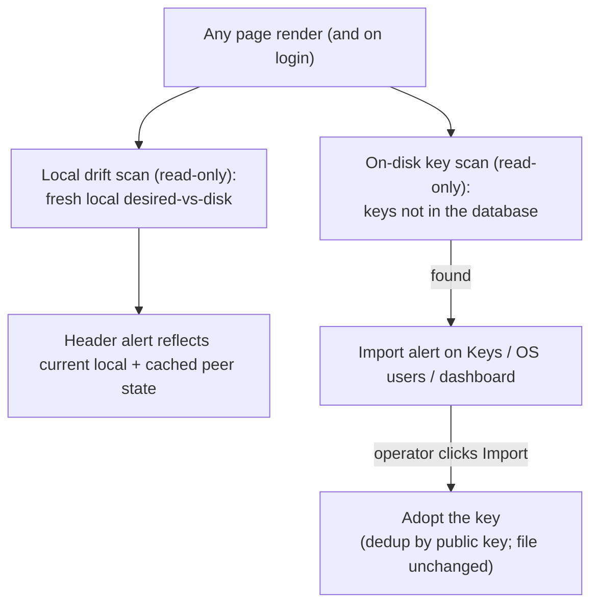
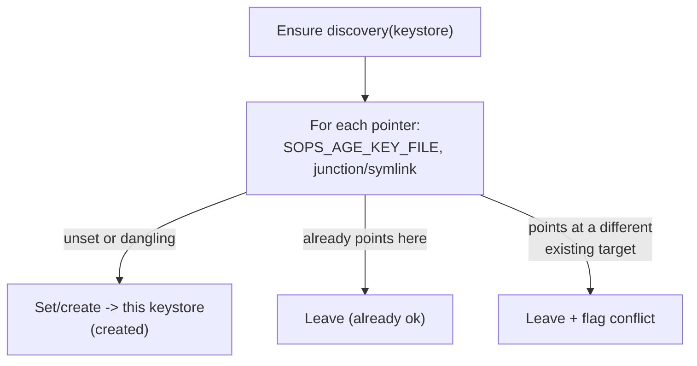

# Keys: reconcile and discovery

This part explains how the panel keeps its view of this machine's keys current, how it
finds keys on disk that it does not track yet, and how it repairs the pointers sops uses
to find a key. The placement rules are in [keys](keys.md); peer drift and the reconcile
pass between machines are in [reconcile and drift](reconcile-drift.md).

## Contents

- [Local state is always fresh](#local-state-is-always-fresh)
- [Drift messages](#drift-messages)
- [Resolving a drift row](#resolving-a-drift-row)
- [Changing a project folder](#changing-a-project-folder)
- [Importing keys found on disk](#importing-keys-found-on-disk)
- [The scans change nothing](#the-scans-change-nothing)
- [Ensuring discovery](#ensuring-discovery)
  - [The two pointers](#the-two-pointers)
  - [Why repair is needed](#why-repair-is-needed)
  - [What the repair does](#what-the-repair-does)
  - [Discovery status on the OS users page](#discovery-status-on-the-os-users-page)
  - [Restart after a change](#restart-after-a-change)

## Local state is always fresh

- After every action, and on login, the panel re-reads disk and the database and
  recomputes what it shows. There is no manual step for local state.
- Local drift is computed on every page render, not read from a cache. The scan is
  read-only and covers this machine only: it checks key stores and project folders and
  reads `.sops.yaml` and the secrets metadata.
- It is combined with peer drift, which a background task refreshes.
- So a stale entry disappears on the next page. For example, a `.sops.yaml` line for a
  project the operator just deleted is gone, because the deleted project is no longer
  in the database the scan reads.
- "Sync now" only pulls a peer machine's database changes.

## Drift messages

- A `.sops.yaml` mismatch names each public key by its key name where SopsHQ holds one,
  else by a short `age1...` prefix. For example: *"the secrets config lists public key
  'adopted-alice-2' (age1csf...) that this project does not include, and is missing
  public key 'billing' (age1r8x...)"*.
- A file not written yet reads *"no .sops.yaml at <path> yet"*.
- When the key on disk and the expected key are two identities of the **same** account,
  the message says so (*"... the same account 'alice', which can decrypt either"*)
  instead of calling one missing and one extra.
- Only public keys are ever shown, never a private value.

## Resolving a drift row

Every drift row can be resolved from the Drift page. The actions need the same login
level as Apply, are CSRF-protected and are audited. For a public-key mismatch:

- **Match to the on-disk keys** (recommended): points the project at the public keys the
  config already uses, and removes the project's alternate key. The difference clears
  with no reader dropped, and with no re-key when the config already matches.
  - Matching keys SopsHQ already holds needs only the Apply login level.
  - Adopting a key it does not hold yet imports a private key into the vault, so it is
    admin-only.
- **Adopt readers** (admin-only): adds the extra public keys on disk to the project's own,
  so nobody who can decrypt today loses access, then rewrites the config to the union.
  It fails closed, re-keying nothing, if it cannot read the public keys on disk.
- **Re-key to desired:** rewrites the config to only the project's assigned public keys
  and re-keys the secrets. It drops the extra keys, with a warning that names them.
- A missing `.sops.yaml` offers **Apply**, which writes it.

Notes:

- A project's own page offers the same **Match to the on-disk keys** action when its
  config differs.
- Each action stamps the file it writes, so the next scan clears the row. Because these
  are explicit operator choices on the file that drifted, they bypass the
  [write guard](keys-write-guard.md), the same way its Overwrite choice does.

## Changing a project folder

Changing a project's **local** folder moves its managed files instead of leaving them
behind.

- A confirm screen shows the old and new folder and exactly what will be written and
  removed.
- SopsHQ moves the `.sops.yaml` it generated (recognised by its header) and a
  `secrets.yaml` it tracks, byte for byte, never regenerated. It removes them from the
  old folder, moves their stamps, and points the record at the new folder.
- A hand-written `.sops.yaml` is never moved or deleted.
- Every check runs before anything moves, so the move either happens in full or not at
  all. It stops when:
  - a file was changed outside SopsHQ (the reconcile screen appears);
  - the new folder is not writable;
  - a **different** `.sops.yaml` or `secrets.yaml` already sits in the new folder, so its
    data is never overwritten.
- A **peer** machine's folder change is only recorded. That machine moves its own files
  on its next Apply or reconcile, because SopsHQ touches only the local disk.

## Importing keys found on disk

- A read-only scan walks each local OS user's keystore and lists any private key in
  `keys.txt` whose public key SopsHQ does not track yet.
- The Keys page, the OS users page and the dashboard show *"Found N key(s) on disk not in
  your database"*, with an **Import** button per keystore.
- Import uses the same adopt step as adding an OS user, so it never creates a second
  record for a public key already held.
- An account that already has a key in SopsHQ is not listed, and a key SopsHQ already
  tracks is never listed.
- A keystore with only `keys.pub` (no `keys.txt`) is shown for awareness, as public-only
  key files with no private key to import. Adopting a key seals its private half, and a
  public key alone has nothing to seal.

## The scans change nothing

Both scans only read files and the database. Nothing is placed, no `keys.txt` or
`secrets.yaml` is written, and no discovery pointer is touched. Writes happen only when
the operator clicks **Import**, **Apply** or **Fix discovery**.

## Ensuring discovery

### The two pointers

A key is only useful if `sops`, and the apps that call it, can **find** it. That rests on
two pointers per account:

- **`SOPS_AGE_KEY_FILE`**, the environment value that names the key file. On Windows it
  is persisted at User scope with `setx`. On Linux it is the `export` line under the
  `# sopshq:sops-age` marker in `~/.bashrc`.
- **The junction or symlink** at the location sops checks by default. On Windows it is a
  junction `%USERPROFILE%\.sops` to the keystore folder. On Linux it is a symlink
  `~/.config/sops/age/keys.txt` to the real `keys.txt`.

### Why repair is needed

- Wiring from scratch always writes both pointers.
- The reuse path keeps what is already on disk. After a database reset that can leave
  discovery unwired without any warning: no junction or symlink, and a
  `SOPS_AGE_KEY_FILE` left by an earlier install. On a fresh machine the key then cannot
  be found.

### What the repair does

The repair only fixes what is missing or broken, can run any number of times, and never
overwrites a pointer set on purpose:

| Pointer | Unset, or its target is missing | Already points here | Points at a different, existing target |
| --- | --- | --- | --- |
| `SOPS_AGE_KEY_FILE` | **set** it to `<base>/keys.txt` | leave it | **leave it** and report a conflict |
| junction or symlink | **create** it to the keystore | leave it | **leave it** and report a conflict |

> [!NOTE]
> `SOPS_AGE_KEY_FILE` holds one value per account. On a machine with several keystores
> it can name only one; the others rely on the default junction or symlink, or on a
> per-command override. The repair fixes that one value and the one default link, and
> reports a conflict rather than fighting over a value another keystore owns.

### Discovery status on the OS users page

- Each account shows its effective `SOPS_AGE_KEY_FILE` (or `(unset)`), whether the
  junction or symlink exists and where it points, and a verdict:
  - "sops can find this key";
  - "NOT wired" (nothing points at this keystore);
  - "conflict - points elsewhere";
  - "n/a - reached via ACL", for another account's store under the
    [shared keybase root](keys.md#shared-keybase-root).
- **Fix discovery** runs the repair for that account and reports what it created, left
  alone or flagged. It is CSRF-protected and needs the same login level as wiring.
- The status shows the value as it is saved now, not the one the panel inherited at
  start:
  - On Windows the panel's own environment goes stale after any `setx`, so the status
    reads the saved User-scope value from the registry with a read-only query.
  - On Linux the value lives in `~/.bashrc`, which the status reads directly.

### Restart after a change

A saved `SOPS_AGE_KEY_FILE` only reaches a program when it **starts**. SopsHQ itself and
any running app keep the old value until restarted, so the panel tells the operator to
restart them.
