# Keys: rotation and the everyday flow

This part covers how a key is rotated safely and the day-to-day steps to define, place
and use a key on one machine. The placement rules are in [keys](keys.md); the words are
defined in [terminology](../terminology.md).

## Contents

- [Rotation](#rotation)
- [Everyday flow: define, place, and use a key](#everyday-flow-define-place-and-use-a-key)
  - [The three records](#the-three-records)
  - [Steps](#steps)

## Rotation

```mermaid
stateDiagram-v2
  [*] --> active
  active --> rotating: start rotation
  rotating --> rotating: gen+1; add new public key;\nsops updatekeys; push new private key
  rotating --> active: drop old public key;\nsops updatekeys; retire old gen
  active --> retired: decommission
```



- Rotation has two phases. The new key is added beside the old one and the secrets are
  re-keyed; only then is the old public key dropped. Secrets are never undecryptable
  part way through.
- The key's status records the rotation stage, so an interrupted rotation can resume.
- For per-user keys, adding or removing a user is just a public-key change plus
  `sops updatekeys`, with no full rotation.
- Every step is previewed (dry run), confirmed and audited.

## Everyday flow: define, place, and use a key

### The three records

- A **key** is an age keypair. Its **public key** (`age1...`) goes into a project's
  `.sops.yaml`. Its **private key** (`AGE-SECRET-KEY-1...`) is placed in an OS user's
  key store so that account can decrypt.
- A **project** is a folder, which may live at a different path on each machine.
- An **assignment** says: *this key, for this OS user, on this machine, in this
  project.* At **Apply** time an assignment:
  1. writes the private key into that user's key store;
  2. lists the key's public key in the project's `.sops.yaml`.

Deleting the project or the OS user an assignment points at removes the assignment too;
see [keeping assignments consistent](keys-safe-wiring.md#keeping-assignments-consistent).

```mermaid
sequenceDiagram
  participant You
  participant Panel as SopsHQ panel
  participant age as age-keygen
  participant FS as local filesystem
  participant sops
  You->>Panel: Define key, click Generate
  Panel->>age: age-keygen
  age-->>Panel: public key age1... + private AGE-SECRET-KEY...
  Panel->>Panel: seal private key in the vault
  You->>Panel: Assign key -> machine + OS user; set project path
  You->>Panel: Apply (to this machine)
  Panel->>FS: write keys.txt (owner-only) + keys.pub
  Panel->>FS: write project/.sops.yaml (public keys)
  You->>sops: sops -e secrets.yaml  (encrypts to public key)
  You->>sops: sops -d secrets.yaml  (decrypts with placed key)
```

### Steps

1. Designate this machine: Machines, then Set as local.
2. Add the OS users who hold keys, each with a key-store folder.
3. Add the project and set its folder path.
4. Define the key: `shared` (one keypair per project, placed for several users) or
   `per_user` (one keypair owned by one user). Generate it, or let SopsHQ generate it on
   first use.
5. Assign it.
6. Apply. Try **Dry run (local)** first.

After Apply, use `sops` as usual in the project folder: `sops secrets.yaml` to edit,
`sops -d secrets.yaml` to read. One OS user may hold several project keys; Apply writes
them all into one `keys.txt`.
