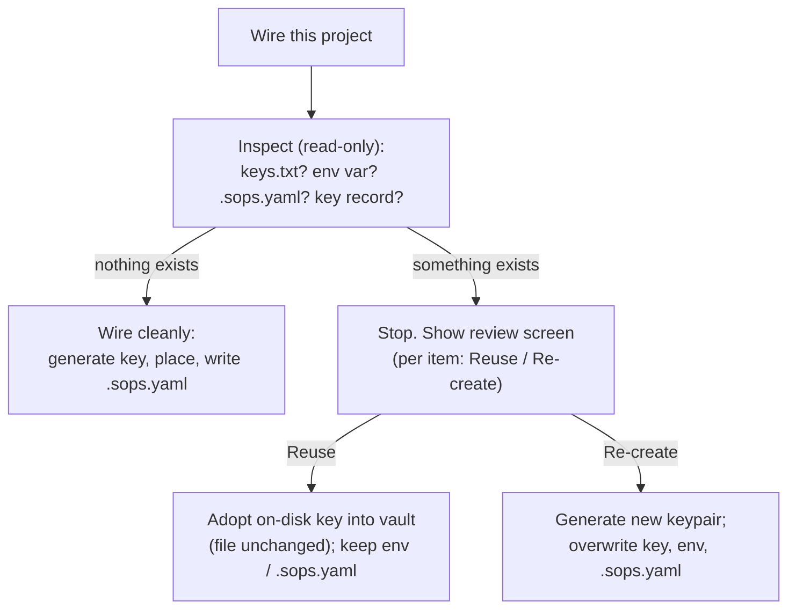

# Keys: safe wiring and the key lifecycle

This part explains how SopsHQ wires a project without overwriting keys or configs that
already exist, how it adopts existing state anywhere in the app, and how a key is
generated, renamed and deleted. The placement rules are in [keys](keys.md).

## Contents

- [Why wiring never overwrites silently](#why-wiring-never-overwrites-silently)
- [What counts as already existing](#what-counts-as-already-existing)
- [Reuse or re-create](#reuse-or-re-create)
- [Reusing a key never drops a reader](#reusing-a-key-never-drops-a-reader)
- [Reuse matches the on-disk config](#reuse-matches-the-on-disk-config)
- [An OS user must exist first](#an-os-user-must-exist-first)
- [Adopting existing state anywhere in the app](#adopting-existing-state-anywhere-in-the-app)
- [The key lifecycle](#the-key-lifecycle)
  - [Status on the Keys page](#status-on-the-keys-page)
  - [Generate on first use](#generate-on-first-use)
  - [Rename](#rename)
  - [Delete](#delete)
- [Keeping assignments consistent](#keeping-assignments-consistent)

## Why wiring never overwrites silently

A real machine may already use SOPS: a key placed by hand, a `SOPS_AGE_KEY_FILE`
pointing at another project's key, a hand-written `.sops.yaml`. Overwriting any of these
can make **other** projects' secrets undecryptable.

So before placing anything, SopsHQ inspects the machine without changing it. If it finds
existing state, it stops and asks the operator, per item, to **reuse** or **re-create**
it.

## What counts as already existing

- a non-empty `<base>/keys.txt`;
- a persisted `SOPS_AGE_KEY_FILE` that points somewhere other than that `keys.txt`;
- a project `.sops.yaml`;
- a SopsHQ key record already assigned to the project.

## Reuse or re-create

**Reuse** is the safe default. It adopts what is there:

- The on-disk private key is sealed into the vault as a key record. Its public key is
  derived with `age-keygen -y`, with the private key passed on stdin only.
- The file on disk stays byte-identical, so secrets encrypted to it stay decryptable.
- A kept `SOPS_AGE_KEY_FILE` is not re-pointed, and a kept `.sops.yaml` is not
  rewritten.

**Re-create** is an explicit, confirmed overwrite:

- A new keypair replaces the on-disk key. This can orphan secrets encrypted only to the
  old key.
- The environment value is re-pointed and `.sops.yaml` is regenerated.

## Reusing a key never drops a reader

The key choice and the `.sops.yaml` choice are separate, so "reuse the key, re-create
`.sops.yaml`" is possible. SopsHQ makes sure that combination never locks anyone out:

- Whenever it writes `.sops.yaml` while the key is reused, it first adds every public
  key that already protects the secrets on disk. It only **adds** this project's key.
- It reads those public keys from two places:
  - every `age1...` token in the on-disk `.sops.yaml`, whatever its YAML layout and
    across all `creation_rules`;
  - the sops metadata in the encrypted `secrets.yaml` and `secrets.*.yaml` files,
    which is the real record of who can decrypt.
- If the files clearly name public keys but SopsHQ cannot read them, it **fails
  closed**: `.sops.yaml` is not rewritten and the operator sees an error.
- The review screen defaults the `.sops.yaml` choice to reuse. It warns that re-create
  rewrites the reader list, and that only re-creating the **key** can lock out the old
  key.

## Reuse matches the on-disk config

A key store can hold several identities of one account, for example `adopted-alice` and
`adopted-alice-2`. Reuse does not pick one at random:

- When the project folder already has a `.sops.yaml` or encrypted secrets that name
  public keys, SopsHQ assigns the project **exactly** those public keys, read the same
  way as above.
- Each public key is matched to a key SopsHQ already holds. If only its private half is
  in the account's key store, that key is adopted.
- A public key SopsHQ has no key for stays on disk, never dropped, and is recorded in the
  audit log.
- So the project's desired keys equal what the config already uses, and no false drift
  appears.
- A fresh folder, with no config to match, adopts the single private key on disk.

## An OS user must exist first

Wiring places a private key into an OS user's key store, so it needs an OS user on this
machine. SopsHQ never creates one as a side effect, because which account holds a key is
a security choice. With none recorded, wiring stops and tells the operator to add an OS
user first (OS users, then Add).

## Adopting existing state anywhere in the app

The same adopt logic runs wherever the operator points SopsHQ at something already on
disk, so the panel matches the disk even after a database reset:

- **Adding an OS user imports the keys already in its keystore.**
  - This happens when the keystore holds a `keys.txt` and SopsHQ holds no key for that
    user yet.
  - Every identity in the file is adopted as an `adopted-<user>` key, with duplicates
    removed by public key, and assigned to the user on this machine. The file is not
    changed.
  - Adopting them all matters: a later Apply rebuilds `keys.txt` from the vault, so it
    writes every key back instead of keeping one and orphaning secrets encrypted to the
    others.
- **The project page offers Import when a setup already exists.** If the project's
  local folder has a `.sops.yaml`, or the target keystore holds a key, the page shows
  "Import the existing setup", which goes through the review above. "Generate a key" is
  offered only when there is nothing to adopt.
- Importing a key found by the [on-disk scan](keys-reconcile.md#importing-keys-found-on-disk)
  and adopting a hand-added key on the [reconcile screen](keys-write-guard.md) use the
  same adopt step.

## The key lifecycle

### Status on the Keys page

Each key shows its public key and a status line, so an unused key stands out:

- "Unused - no keypair or key files yet": defined, no keypair, used nowhere.
- "Keypair created; not placed on any machine yet": a keypair exists but the key is
  assigned nowhere.
- Otherwise, each `user -> <keystore>/keys.txt` location it is placed at.

Each row offers **Generate** (before a keypair exists) or **Rotate** (after), **Rename**
and **Delete**.

### Generate on first use

- A key gets its keypair automatically the first time it is used: when it is assigned
  to a project, or when a secret set is created for an account that holds it. The
  operator never has to generate a key first.
- Generation only adds: it seals a new private key and never overwrites an existing
  one. A key that already has a keypair is left alone.
- It is audited by key name.
- The **Generate** button stays for operators who prefer to generate ahead of time.

### Rename

- Rename changes the key's **name** only. The keypair is unchanged, and SopsHQ finds
  keys by UUID or public key, never by name.
- The new name appears in the `.sops.yaml` comment block on the next Apply. A rename
  never shows as drift, because drift compares public keys, not comments.
- The name must be non-empty and unique among live keys, ignoring case. A deleted key's
  name can be reused.

### Delete

- Delete is refused while a **live** assignment still points at the key, so a project's
  secrets are never stranded. An assignment is live when its project (if it has one) and
  its OS user both still exist.
- An assignment whose project or user is already gone points at nothing, so it does not
  block. Removing a key that only a deleted project used just works.

## Keeping assignments consistent

An assignment only makes sense while both ends exist. SopsHQ keeps them clean in three
ways, each a soft delete (tombstone) that replicates like any delete:

- **Deleting a project** removes every assignment for that project. Other projects'
  assignments, and an adopted key that belongs to no project, are untouched.
- **Deleting an OS user** removes that account's assignments. Other accounts are
  untouched.
- **The background reconcile pass** removes any assignment whose project or user is
  already gone, so a leftover record clears itself. It writes only when it finds one,
  and it never removes a project-less placement whose OS user still exists.
