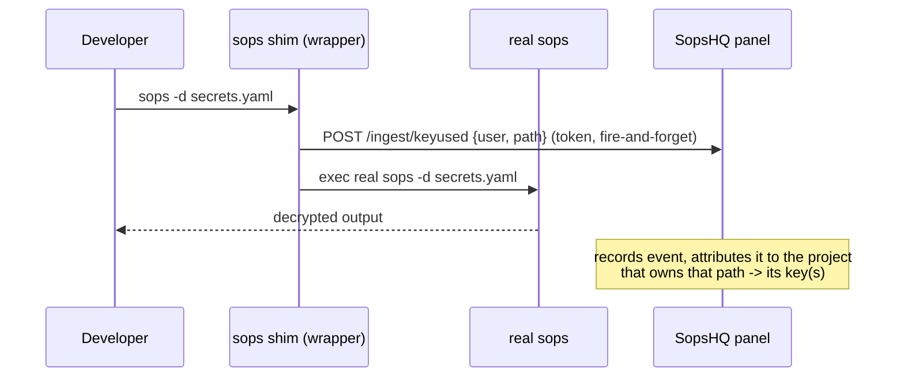

# Keys: usage tracking (best-effort)

This part covers the optional count of how often, and when, a key was used to decrypt.
The placement rules are in [keys](keys.md).

## Contents

- [How it works](#how-it-works)
- [Limits](#limits)
- [Attribution](#attribution)
- [The ingest token](#the-ingest-token)
- [Installing the shim](#installing-the-shim)
- [Where it shows](#where-it-shows)

## How it works

SopsHQ is a management plane and never sees a local `sops -d`. Usage is therefore
**reported voluntarily**: a machine runs an optional `sops` **shim**, a thin wrapper
that tells SopsHQ "someone just ran sops on this file" and then runs the real `sops`.

- Decrypt calls are reported; encrypt and re-key calls are skipped.
- A wrong or missing token is rejected (HTTP 403) and records nothing.

## Limits

> [!IMPORTANT]
> This is **best-effort and bypassable**. Anyone can call the real `sops` directly, copy
> the private key, or decrypt in their own code, and the shim sees none of it. Treat the
> numbers as a usage *signal*, not an audit-grade count. An enforceable count needs a
> model where the key never leaves a server (a KMS or remote-decrypt backend).

Usage is also per machine: each machine reports and stores its own.

## Attribution

- Each event carries the file path.
- SopsHQ matches it to the local project whose folder contains it, then to the keys
  assigned to that project.
- An event that matches no project shows as *unattributed* on the Usage page.

## The ingest token

- When `sopshq serve` starts it prints the ingestion URL and the token file path,
  `<data dir>/ingest.token`.
- The token only allows appending a usage note, never key access, so the file is
  written with mode 0644.
- On a `sopshq setup` install the data folder itself is 0700, so in practice only the
  service account and root can read the token.

## Installing the shim

**From the panel:** on the Usage page, *Install usage shim*.

- SopsHQ writes the bundled wrapper scripts into `<data dir>/shim` and puts that folder
  first on your user `PATH`.
- It sets `SOPSHQ_PANEL_URL` and `SOPSHQ_INGEST_TOKEN_FILE` for your user: in
  `HKCU\Environment` on Windows, in a marked block in `~/.bashrc` on Linux.
- It is per user (no admin), can be run again safely, and *Uninstall* reverses every
  change.
- Open a new terminal afterwards so the `PATH` change takes effect.

**By hand:**

- Install the wrapper from `shims/`: `sops-wrapper.sh` for Linux and macOS, or
  `sops-wrapper.ps1` with the `sops.cmd` launcher for Windows.
- Put it earlier on `PATH` than the real `sops`, and set `SOPSHQ_PANEL_URL` and
  `SOPSHQ_INGEST_TOKEN_FILE`.
- The real `sops` is found automatically (the next `sops` on `PATH` that is not the
  wrapper). Or set `SOPSHQ_REAL_SOPS`, or rename the real binary to `sops.real`.
- Run it as the normal user, never with `sudo`, because decrypting uses that user's
  own key store.

## Where it shows

- the Keys page, in a *Used (best-effort)* column;
- the Usage page, as recent events.
