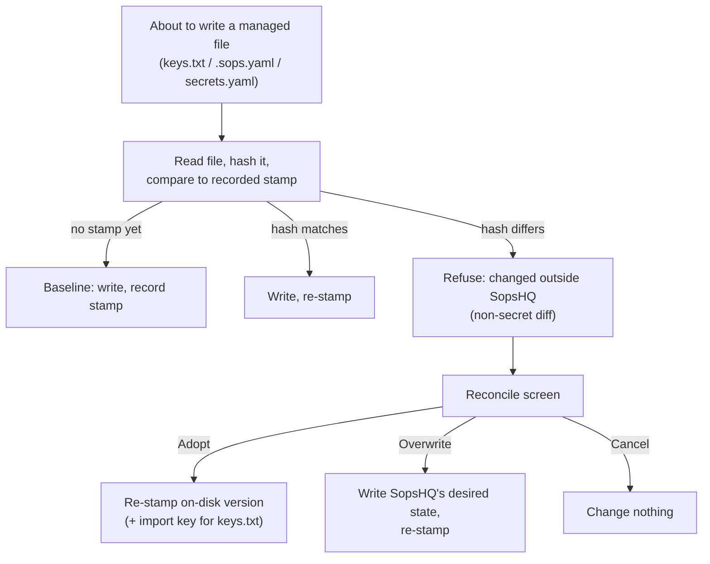

# Keys: the write guard

This part explains how SopsHQ refuses to overwrite a managed file that somebody changed
outside SopsHQ. [Safe wiring](keys-safe-wiring.md) protects the first write to a project;
the write guard applies the same rule to every later write. The placement rules are in
[keys](keys.md).

## Contents

- [What it guards](#what-it-guards)
- [How it works](#how-it-works)
- [The reconcile screen](#the-reconcile-screen)
- [The stamp file](#the-stamp-file)
- [How it differs from drift](#how-it-differs-from-drift)

## What it guards

- an OS user's key store (`keys.txt`);
- a project's `.sops.yaml`;
- a project's `secrets.yaml`.

## How it works

Each time SopsHQ writes one of these files it records a **stamp**: a SHA-384 hash of the
content and, for a `secrets.yaml`, the secret **names** it last saw. Before the next
write it hashes the file again and compares:

- **Hash matches:** the file is as SopsHQ left it, so the write goes ahead and the stamp
  is renewed.
- **No stamp yet** (a file SopsHQ never tracked, or the first write): the current
  content becomes the baseline, the write goes ahead and a stamp is recorded. This is
  why the guard does not break existing installs.
- **Hash differs:** somebody edited the file outside SopsHQ. The write is **refused**
  and SopsHQ reports what changed, with no secret in it:
  - for `.sops.yaml`, the public keys added or removed against the desired set;
  - for `secrets.yaml`, the secret names added or removed (the file is decrypted to read
    names only, never values);
  - for `keys.txt`, a short note.

## The reconcile screen

A refused write opens a reconcile screen with three choices:

- **Adopt:** stamp the version on disk so SopsHQ tracks it. For a key store, the
  hand-added key is also imported into the vault through the same reuse path wiring
  uses.
- **Overwrite:** write SopsHQ's desired state, then stamp it.
- **Cancel:** change nothing.

Each choice is admin-only, CSRF-protected and audited by target and action.

## The stamp file

- Stamps live in `<data dir>/stamps.json` on each machine.
- They hold no secrets. A SHA-384 hash is one-way, so stamping a `keys.txt` leaks
  nothing, and secret names are not values.
- They describe this machine's files, so they are never replicated. Each machine keeps
  its own.

## How it differs from drift

- [Drift](keys-reconcile.md#local-state-is-always-fresh) is a read-only comparison of
  desired state and disk, at the level of public keys and placement. It reports.
- The write guard works on the file hash, so it catches any change, including a
  hand-added secret value that drift does not model. It blocks writes.
- Drift tells you the picture is off; the guard stops a write from erasing a hand edit.
- The guard acts only at write time. It does not watch files.
