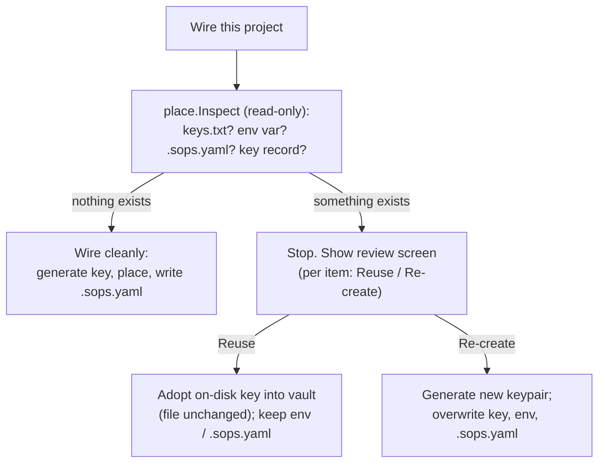
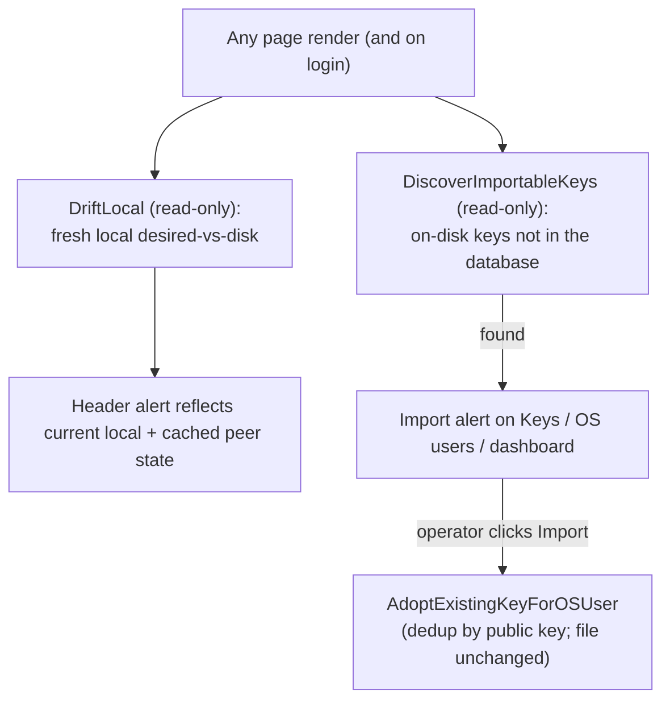
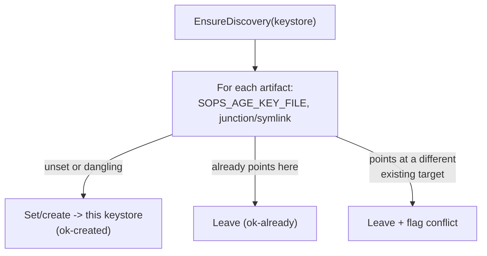
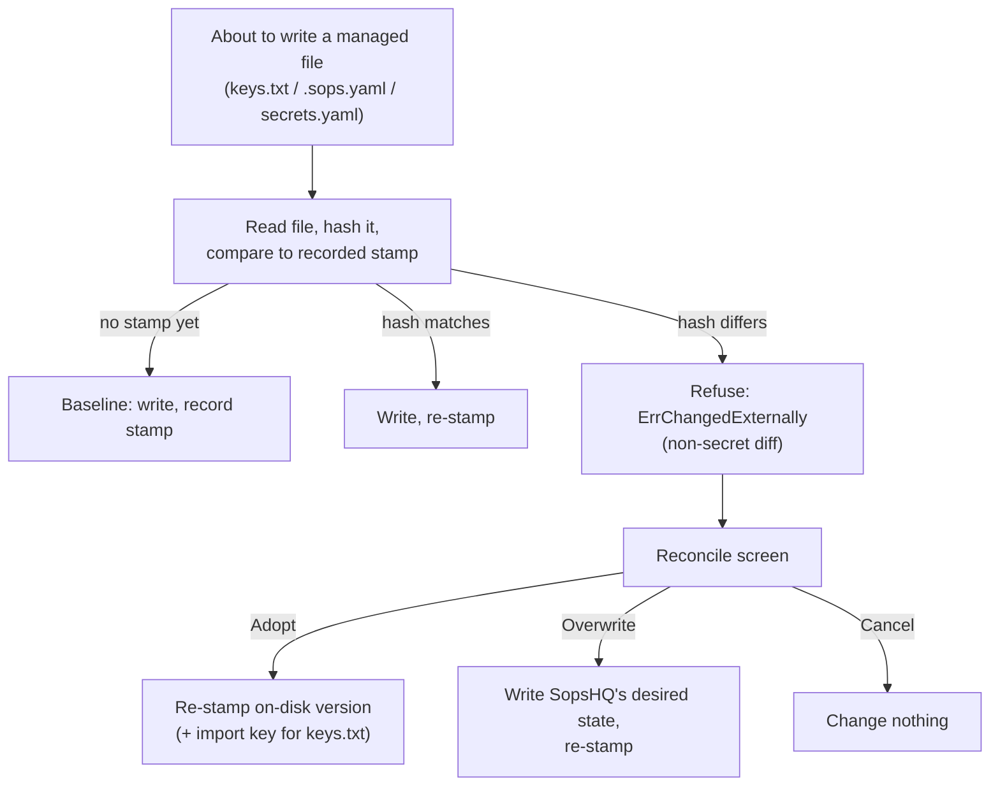
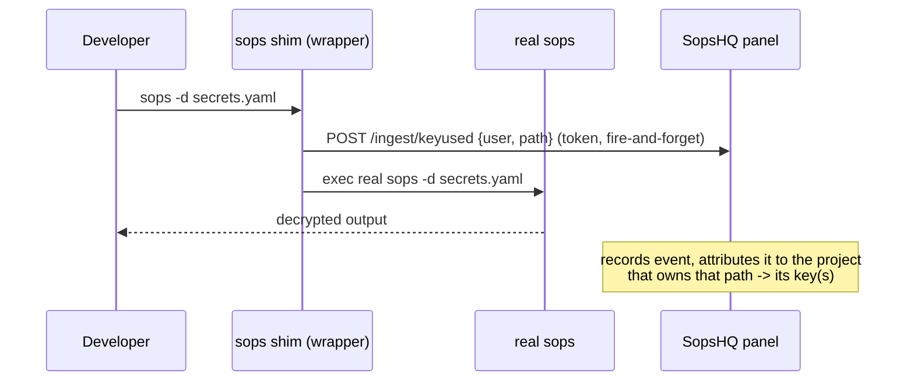

# Keys: placement, rotation, everyday flow, and usage

This part covers how SopsHQ writes keys to disk without clobbering existing state, how
it rotates them safely, the day-to-day flow of defining and using a key, and the
best-effort usage tracking. For the overview, start at the
[architecture index](README.md).

## 8. Key placement contract

SopsHQ places keys where `sops` and `age` already look for them, so a key placed by
SopsHQ and one placed by hand can coexist:

- **Linux** (unprivileged): write `<base>/keys.txt` (0600) and `<base>/keys.pub`
  (0644). For a **self** placement (the account SopsHQ itself runs as) also wire sops
  discovery in that account's OWN home: add `SOPS_AGE_KEY_FILE` under the
  `# sopshq:sops-age` marker in `~/.bashrc` and symlink
  `~/.config/sops/age/keys.txt` -> the key. A placement for ANOTHER user (a cross-user
  placement into the shared keybase root, below) writes the key store + the POSIX ACL
  grant and STOPS: it never reads or writes that user's home. SopsHQ needs no root or
  sudo for either case.
- **Windows**: write `keys.txt`/`keys.pub` on the chosen volume; `icacls` to
  owner-only; junction `%USERPROFILE%\.sops` -> the store; persist
  `SOPS_AGE_KEY_FILE` at User scope.

A single OS user may be assigned several project keys (the "one shared keypair per
project" model, with the user in several projects). age/sops support multiple
identities in one key file, so SopsHQ writes ALL of a user's assigned private keys
into their `keys.txt` (one per line) and `sops -d` tries each. Placement is therefore
grouped per user - it writes the user's full set at once rather than per assignment -
and drift is satisfied when a key is AMONG those in the store.

The keystore folder defaults to sops's standard location, `~/.config/sops/age` (on
Windows `%AppData%\sops\age`), so an account **with a home** works with no explicit
`SOPS_AGE_KEY_FILE`: `sops` finds `keys.txt` there on its own. The operator can point
the keystore at any other folder instead - in particular a folder on an **encrypted
drive** (tick "store the private key on a secure drive"), so the key is unreadable
until the volume is unlocked and sops "fails closed" otherwise. In the secure-drive
case the real `keys.txt` lives on the encrypted folder and the default
`~/.config/sops/age/keys.txt` becomes a symlink to it (created by the existing Linux
discovery step for an account with a home), so both the zero-config default and an
explicit `SOPS_AGE_KEY_FILE` resolve to the same file.

### Shared keybase root

By default each OS user's key store lives under that user's home. As an alternative,
the operator can put **every** user's key store under ONE shared directory - for
example `/srv/sopshq-keys/` on an encrypted volume - so SopsHQ manages all users'
keys without root and without writing into other accounts' home directories. On
Linux that directory is owned by the SopsHQ service account and each store is gated
with POSIX ACLs; on Windows the same layout applies with **no ACL step** (the
machine runs SopsHQ as one account, which owns the subtree through ordinary NTFS
inheritance), and the folder must exist before `serve` starts:

```
/srv/sopshq-keys/            <- neutral path (encrypted volume recommended), owned by the SopsHQ service account
  alice/    keys.txt
  mailsvc/  keys.txt
```

This is turned on by setting **`keybase_root`** in the config file (an absolute path).
It is **machine-local** (never replicated), so each machine may use a different root or
none. An OS user created with a BLANK keystore path while a root is configured is stored
with an **empty `key_base`** - a "root-derived" user - and its store is computed as
`<keybase_root>/<username>/keys.txt`. Because the stored `key_base` is empty, nothing
machine-local ever replicates: a root-derived user that syncs to a peer is resolved
against THAT peer's own `keybase_root` (or, if the account is not the peer's, left for
the peer to manage). Existing users that already have an explicit `key_base` are
unchanged.

The recommended deployment runs SopsHQ as a **dedicated unprivileged service account**
(for example `sopshq`) that OWNS the keybase root. SopsHQ runs with no root and no sudo;
the only privileged step is a **one-time root bootstrap** that creates the root and
hands it to that account. `sopshq setup` does this; the running service (`serve` and
the panel) never creates the root itself. Without setup, create it once as root:

```
sudo mkdir -p /srv/sopshq-keys && sudo chown sopshq /srv/sopshq-keys && sudo chmod 0711 /srv/sopshq-keys
```

After that bootstrap the `sopshq` account owns the tree, so it writes every user's key
store and runs `setfacl` on its own files **without root** - cross-user key placement is
fully unprivileged.

The recommended way to create the `sopshq` account and this bootstrap is
`sudo sopshq setup`, which sets up the full **three-path layout** (binary at
`/opt/sopshq`, data base at `/srv/sopshq`, keybase root at `/srv/sopshq-keys`)
and wires `keybase_root` into the config. See the [deployment guide](../deployment.md).

The root is `0711` (traverse, not list): an enrolled user can descend into their own
subfolder to reach their key, but no local user can `ls` the root and read every enrolled
username. Read on the root is never required.

**Per-user access via POSIX ACLs.** The key files stay owned by the SopsHQ account
(0600). So each user can still read their OWN key - and only their own - SopsHQ applies
POSIX ACLs with `setfacl` after writing `keys.txt`:

- `--x` (traverse only) on the root for that user, so they can descend into their own
  subfolder but cannot list or read a sibling's;
- `r-x` on their own subfolder (enter + list it);
- `r--` on their `keys.txt` (read their own key);
- a **default** `r--` on their subfolder, so a file created later by SOPS's
  temp-file+rename inherits the grant.

A **shared (global) secret set** placed into a root-derived key store lives at
`<keybase_root>/<username>/global/<set>/` - directories the SopsHQ account creates `0700`.
So the recipient can traverse in and read their own copy, SopsHQ grants the same shape of
ACL on those dirs: `r-x` (traverse + read) on `global/` and `global/<set>/`, a **default**
`r--` on both so a later `secrets.yaml`/`.sops.yaml` rewrite inherits the grant, and `r--`
on the secret files. This runs only for root-derived recipients; a per-home user's global
set lives under their own home and needs no ACL.

SopsHQ then runs `getfacl` to VERIFY the grants are actually present. `setfacl`/`getfacl`
are executed with a fixed argument list (never a shell), and the username and paths are
validated first, so no value can be re-parsed as a command. **If ACLs cannot be applied**
- `setfacl`/`getfacl` missing, the filesystem lacks ACL support, or a permission error -
placement **fails loud**: it returns the exact `setfacl`/`sudo` remediation commands and
marks the key store not-managed rather than leaving an unreadable key behind. The local
drift check re-verifies these grants and reports a root-derived store whose ACLs were
removed, so Apply never trusts an unreachable key.

Discovery wiring is **self-only**. Because a cross-user placement never touches the
target user's home, SopsHQ does NOT write a `~/.bashrc` export or a
`~/.config/sops/age` symlink for another user (that would be a foreign-home write and
would need root). Those users reach their key through the POSIX ACL grant and run
`sops` with **explicit** key and secrets paths - or set
`SOPS_AGE_KEY_FILE=<keybase_root>/<username>/keys.txt` themselves (for example in their
own systemd unit). The panel reflects this: a cross-user (root-derived) key store shows
its discovery state as **"n/a - reached via ACL"**, never a "not wired" error, and it
offers no "Fix discovery" button for that store. Home discovery wiring runs only when
the placement is for the account SopsHQ itself runs as; that self case keeps the
`~/.bashrc` export + `~/.config/sops/age/keys.txt` symlink so cron/systemd resolve the
key with no environment variable. On Windows `keybase_root` works as a plain keys folder with
the same `<root>\<user>\keys.txt` layout, but without the per-user ACLs: one account
runs SopsHQ and owns the whole tree.

`keybase_root` is set at install/setup time and is also editable later, on the Settings
page's "Keys root folder" panel: it persists to `config.jsonc` and updates the running
service, and changing it moves no key already placed.

`.sops.yaml` is generated by SopsHQ (a small writer, no YAML library), listing the
assigned public keys with a `# user` comment per line and a "do not hand-edit" header.

### OS-account / keystore setup (Mode A - print-commands only)

Adding an OS user prepares its keystore, and SopsHQ does this **without ever running
as root**. It reads account facts with `getent passwd <user>` (unprivileged): does the
account exist, and what is its `/etc/passwd` home? From that it decides what it can do
itself and what only root can do, and for the latter it **prints the exact `sudo`
commands** for the operator to run - it never executes them (this is "Mode A"; modes
that use root or a sudoers allowlist were rejected).

- **Account with a usable home** - the keystore defaults under that home
  (`~/.config/sops/age`) or any chosen folder; SopsHQ places the key and wires
  discovery as usual.
- **Homeless service/daemon account** (home `/nonexistent` or missing) - the
  `~/.config/sops/age` default does not resolve, so the account needs an **explicit,
  account-owned** keystore (for example `/etc/<service>/keys`). SopsHQ prints
  `sudo mkdir -p <keybase> && sudo chown <acct>:<acct> <keybase> && sudo chmod 700
  <keybase>`, and the account's program points `SOPS_AGE_KEY_FILE` at
  `<keybase>/keys.txt`.
- **Account that does not exist yet** - SopsHQ prints
  `sudo useradd -m -d /home/<acct> <acct>` (create it with a home), then the keystore
  commands above.
- **Keystore on another account's home** - only root can create the default-location
  symlink there, so SopsHQ prints `sudo ln -s <real keys.txt> <default keys.txt>`.

The account checks are Linux-only (they use `getent`); on Windows the keystore is just
a folder path secured by an ACL and no account commands are printed. The exact command
strings and the symlink create-vs-print decision live in `internal/keysetup` (pure,
unit-tested), and the OS-users page renders the resulting steps per account.

### Safe wiring: never clobber pre-existing state

A real machine may already use SOPS - a key placed by hand, a `SOPS_AGE_KEY_FILE`
pointing at another project's key, a hand-authored `.sops.yaml`. Overwriting any of
these can make OTHER projects' secrets undecryptable. So **wiring never overwrites
silently**. Before placing anything, SopsHQ runs a NON-destructive inspection
(`place.Inspect`) and, if it finds pre-existing state, STOPS and asks the operator,
per item, to **reuse** or **re-create** it:

- **Reuse** (the safe default) ADOPTS what is there. For a key, the on-disk private
  key is sealed into the vault as a Key record and its public key is derived
  with `age-keygen -y` (the private key is fed on stdin only); the file on disk is
  left byte-identical, so secrets encrypted to it stay decryptable. A kept
  `SOPS_AGE_KEY_FILE` is not re-pointed; a kept `.sops.yaml` is not rewritten.
- **Re-create** is an explicit, confirmed overwrite: a brand-new keypair replaces
  the on-disk key (which can orphan secrets encrypted only to the old one), the
  env var is re-pointed, and `.sops.yaml` is regenerated. This is the old behavior,
  now opt-in.

**Reuse and re-create are coherent - reusing a key never silently drops a reader.**
The key choice and the `.sops.yaml` choice used to be independent, so "reuse key +
re-create `.sops.yaml`" could rewrite `.sops.yaml` from only the adopted key and DROP a
second public key the secrets were already encrypted to (locking that reader out). Now,
whenever `.sops.yaml` is (re)written while the key is REUSED, SopsHQ first UNIONS in
every public key that already protects the secrets on disk
(`keysvc.unionExistingRecipients`), so no key that can currently open the secrets is
dropped - it only ADDS this project's key. Reader extraction is deliberately
**layout-agnostic and authoritative**: it harvests every `age1...` recipient token from
the on-disk `.sops.yaml` regardless of YAML shape (inline `age: a,b`, a folded scalar
`age: >-`, a block sequence `age:` / `- a` / `- b`) and across ALL `creation_rules`, AND
from the sops metadata block of the encrypted `secrets.yaml` / `secrets.*.yaml` - which
is the real record of who can currently decrypt. If the on-disk state clearly signals
recipients but none can be read (a shape SopsHQ cannot parse), it **fails closed**:
`.sops.yaml` is not rewritten and the operator sees an error, rather than a silent
reduction that would lock a reader out. The review screen defaults the `.sops.yaml`
choice to reuse and warns, in plain language, that re-create rewrites the reader set and
that only re-creating the KEY (not the `.sops.yaml`) can lock out the old key.

**Reuse matches the on-disk config - it does not pick an arbitrary identity.** A key
store can hold SEVERAL identities of one account (`adopted-alice`, `adopted-alice-2`).
When a reused project's folder already has a `.sops.yaml` (or encrypted secrets) that
names public keys, SopsHQ assigns the project EXACTLY those public keys, harvested from
the on-disk state with the same layout-agnostic, authoritative scan described above
(`keysvc.reuseKeysMatchingDisk`). Each harvested public key is resolved to the Key already
in custody (dedup by public key via `keyByRecipient`), or - when only its private half
sits in the OS user's key store - adopted read-only into custody; a public key SopsHQ has
no key for is left on disk (never dropped) and recorded in the audit. The result is that
the project's desired public keys equal what the config already uses, so a plain reuse of
a multi-identity account produces NO phantom "the config uses one identity, the project is
set to another" drift. A fresh folder (no config to match) keeps the original behaviour:
adopt the single on-disk private key.

### System-wide adoption: point at existing state anywhere, not just the wire button

Safe wiring adopts state at the "Wire this project" moment. The same adopt logic runs
wherever the operator points SopsHQ at something that already exists on disk, so the
panel reflects on-disk reality across the whole app after a database reset:

- **Adding an OS user imports the key(s) already in its keystore.** If an OS user is
  added with a keystore base that already holds `keys.txt`, and no key is in that user's
  custody yet, SopsHQ imports the on-disk private key(s) as `adopted-<user>` Key records
  and records an Assignment linking each to the user + machine - without changing the
  file. A key store may hold SEVERAL identities (age tries each); ALL are adopted (deduped
  by public key), so a later Apply, which rebuilds the user's `keys.txt` from the vault,
  writes them all back instead of overwriting the file with one key and orphaning secrets
  encrypted to the others. The keys then show up on the Keys page and are usable at once
  (`keysvc.AdoptExistingKeyForOSUser`).
- **The project page offers Import when a setup already exists.** When an un-wired
  project's local folder already has a `.sops.yaml` (or the target keystore holds a
  key), the page shows "Import the existing setup" - which routes through the safe
  reuse/re-create review above and adopts the existing key - instead of the plain
  "generate a key" prompt. Generate is offered only when there is genuinely nothing to
  adopt.

All of these run through one shared adopt helper (`recordAdoptedKey`), which the
external-change `keys.txt` reconcile path (below) also reuses, so import is defined in
exactly one place.

The **Keys page** shows, per key, its public key plus a loud lifecycle line so an
unused key is unmistakable:

- **Unused - no keypair or key files yet** when the key is defined but has no keypair
  and is used nowhere.
- **Keypair created; not placed on any machine yet** when the keypair exists but the
  key is assigned nowhere.
- otherwise each `user -> <keystore>/keys.txt` location it is placed at (from the key's
  assignments); a shared key placed for several accounts lists several.

**Generate on first use.** A key does not need its keypair until it is first put to use,
so SopsHQ mints one automatically the moment the key is used - when it is assigned to a
project, or when a shared (global) set is created for a user who holds that key. The
operator never has to pre-generate a key to unblock those actions. Generation is
additive (it seals a NEW private half into the vault and never overwrites an existing
one) and idempotent (an already-generated key is left untouched); it is audited by key
name. The manual **Generate** button remains for operators who prefer to pre-generate.

Each row also carries actions: **Generate** (only before a
keypair exists) or **Rotate** (after), **Rename**, and **Delete**. **Rename** changes
the key's NAME (a human label) only - the public/private key is unaffected, callers
resolve a key by UUID or public key (never by name), and the new label is written into
`.sops.yaml` as a per-line comment on the next Apply. A rename never registers as
drift, because drift compares public keys, not comments. The new name must be
non-empty and unique among live keys (case-insensitive); a deleted key's name is free
to reuse.

**Delete** is guarded so it can never silently strand a project's secrets. A key is
refused deletion while a **live** assignment still points at it - "live" meaning the
assignment's project (when it has one) and its OS user both still exist. An assignment
whose project or user has already been removed is a **dangling** record and does NOT
block: it points at nothing, so deleting the key harms nothing. This is why removing a
key that only a since-deleted project used just works.

**Referential integrity of assignments.** An assignment only makes sense while both ends
of it exist, so SopsHQ keeps the set clean three ways, all via soft-delete (tombstone) so
each cleanup replicates to the other machine like any delete:

- **Cascade on project delete.** Deleting a project tombstones every assignment that
  referenced THAT project, in the same step. Other projects' assignments and a user's
  project-less key placement (an adopted key, `ProjectID == ""`) are untouched.
- **Cascade on OS-user delete.** Deleting an OS user tombstones that account's assignments
  (a key grant means nothing without the account that would hold the key). Other accounts'
  assignments are untouched.
- **Self-healing prune.** The background reconcile pass tombstones any assignment whose
  project or user is already gone, so a dangling record left by an older delete clears
  itself on the next run. It is read-mostly and idempotent (it writes only when an orphan
  is present). A project-less placement whose OS user is still live is never pruned.

What counts as "already exists": a non-empty `<base>/keys.txt`; a persisted
`SOPS_AGE_KEY_FILE` whose value points somewhere other than that `keys.txt`; a
project `.sops.yaml`; or a SopsHQ key record already assigned to the project.

**Prerequisite - an OS user must exist first.** Wiring places a private key into an
OS user's key store, so it needs an OS user on this machine. SopsHQ never invents one
as a side effect (the OS user is a deliberate security choice). If none is recorded,
wiring stops with a clear message telling the operator to add an OS user first
(OS users -> Add), then wire.



### Continuous local reconcile + on-disk key discovery

The panel keeps LOCAL state honest without a manual "Sync now": after every action -
and on login - it re-reads disk and the database and recomputes what it shows, so the
screen always reflects current reality.

- **Local drift is computed fresh on every page render** (`Server.livePending`), not
  read from a cache. It runs `keysvc.DriftLocal` (read-only: it stats key stores and
  project folders and parses `.sops.yaml` / secrets metadata for THIS machine only)
  and combines it with the background-refreshed PEER drift. So a stale entry - for
  example a `.sops.yaml` public-key line for a project the operator just deleted -
  disappears on the very next page, because the deleted project is simply no longer in
  the database the fresh scan reads. "Sync now" still exists, but only for pulling a
  PEER machine's database changes; local state never depends on it.
- **Drift messages are specific and name the exact public key.** A `.sops.yaml`
  public-key mismatch is spelled out by KEY NAME where SopsHQ holds one (else a short
  `age1...` prefix): e.g. *"the secrets config lists public key 'adopted-alice-2'
  (age1csf...) that this project does not include, and is missing public key 'billing'
  (age1r8x...)"*; a not-yet-written file reads *"no .sops.yaml at <path> yet"*. When the
  on-disk key and the expected one are two identities of the SAME account (read from the
  key<->OS-user assignments via `accountByPublic`), the message says so - *"... the same
  account 'alice', which can decrypt either"* - instead of the missing/extra wording, which
  is reserved for genuinely different accounts. Only public keys are ever shown, never a
  private value.
- **Every drift row is resolvable from the Drift page** (`POST /drift/resolve`, same
  login level as Apply, CSRF-guarded, audited). For a public-key mismatch the recommended
  action is **Match to the on-disk keys** (`keysvc.MatchProjectToDisk`): it points the
  project at the public keys the config already uses - assigning the on-disk key(s) (via
  `keyByRecipient`, or adopting one from a local key store) and removing the project's
  desired-only alternate - so the difference clears with no reader dropped and, when the
  config already matches, no re-key of the secrets. Adopting a key not yet in custody is
  admin-only (it imports a private key into the vault, gated via
  `MatchProjectToDiskImportsKey`); matching keys already held needs only the Apply login
  level. The row also keeps **Adopt readers** (admin-only) - take the extra on-disk public
  key(s) into the project IN ADDITION to its own so nobody who can currently decrypt loses
  access, then rewrite the config to the union; it FAILS CLOSED (re-keying nothing) if the
  on-disk public keys cannot be read - and **Re-key to desired**, which rewrites to only the
  project's assigned public keys and re-keys the secrets, dropping the extra key(s) with a
  warning that names them. A missing `.sops.yaml` offers **Apply** (write it). A project's
  own page shows the same **Match to the on-disk keys** call to action when its config's
  public keys differ, instead of a bare Apply. Each action re-stamps the file, so the fresh
  `DriftLocal` clears the row. These are explicit operator choices, so they bypass the
  pre-write guard (they are ACTING on the file that drifted) but re-stamp the result,
  exactly like reconcile Overwrite.
- **Changing a project's LOCAL folder MOVES its managed files** rather than stranding
  them. `addProjectPath` detects a changed local path and, after a confirm screen that
  shows old -> new and exactly what will be written/removed, calls
  `keysvc.MoveLocalPath`: it moves the SopsHQ-generated `.sops.yaml` (verified by its
  managed header) and a SopsHQ-tracked `secrets.yaml` (byte-for-byte, never regenerated),
  removes them from the old folder, moves their stamps, and points the record at the new
  folder. A **hand-authored** `.sops.yaml` is never moved or deleted. All guard and
  writability checks run BEFORE any move, so a file changed outside SopsHQ, an unwritable
  new folder, or a conflicting file already at the new path stops the move with no partial
  state (an external change surfaces the reconcile screen; a DIFFERENT `.sops.yaml` OR
  `secrets.yaml` already at the new path blocks the move so its data is never
  overwritten). A PEER machine's path change
  is recorded only - that machine moves its own files on its next apply or reconcile,
  since SopsHQ touches the local filesystem alone.
- **On-disk keys not yet tracked are surfaced for one-click Import**
  (`keysvc.DiscoverImportableKeys`). A read-only scan walks each local OS user's
  keystore and lists any age private key in `keys.txt` whose public key is not already
  a Key in the database (deduped by public key via `keyByRecipient`). The Keys page,
  the OS users page, and the dashboard show an alert - *"Found N key(s) on disk not in
  your database"* - with an **Import** button per keystore. Import runs the SAME
  dedup-safe adopt path as adding an OS user (`AdoptExistingKeyForOSUser`), so it never
  mints a duplicate for a public key already held. A user that already has a key in
  custody is not listed (Import would be a no-op there), and a key the database already
  tracks is never listed as importable.
- **A `keys.pub`-only keystore is shown for awareness, not offered for Import.**
  Adopting a key seals its PRIVATE half into the vault; a public key alone has nothing
  to seal, so a keystore that holds only `keys.pub` (no `keys.txt`) is reported as
  *"present on disk, no private key to import"* rather than as importable.

Both scans are strictly **read-only**: they stat and read files and the database and
compute view state. Nothing is placed, no `keys.txt` / `secrets.yaml` is written, and
no discovery pointer (`SOPS_AGE_KEY_FILE`, junction/symlink) is touched. The only
writes happen when the operator explicitly clicks **Import**, **Apply**, or **Fix
discovery**.



### Ensure discovery: repair a missing pointer without clobbering a real one

Placing a key writes `keys.txt`, but a key is only useful if `sops` (and the apps
that call it) can FIND it. That "finding" relies on two per-account **discovery
artifacts**:

- **`SOPS_AGE_KEY_FILE`** - the environment value that names the key file directly
  (Windows: persisted at User scope with `setx`; Linux: the `export` line under the
  `# sopshq:sops-age` marker in `~/.bashrc`).
- **the junction/symlink** - a shortcut at the location `sops` looks by default
  (Windows: a junction `%USERPROFILE%\.sops` -> the keystore folder; Linux: a symlink
  `~/.config/sops/age/keys.txt` -> the real `keys.txt`).

The from-scratch wire always writes both. But the **reuse/adopt** path deliberately
keeps what is already on disk - and on a machine that was rewired after a database
reset, that could leave discovery UNWIRED with no signal: no junction/symlink, and a
`SOPS_AGE_KEY_FILE` present only because a prior install set it. On a truly fresh
machine the key then becomes undiscoverable.

`place.EnsureDiscovery` fixes this. It is **idempotent** and **repair-only**: for each
artifact it converges only what is missing or broken and it never overwrites a
deliberate different setup. Per artifact, given the keystore folder:

| Artifact | Unset / dangling (target missing) | Already points here | Points at a different, existing target |
| --- | --- | --- | --- |
| `SOPS_AGE_KEY_FILE` | **set** it to `<base>/keys.txt` | leave (`ok-already`) | **leave** + report `conflict` |
| junction / symlink | **create** it -> the keystore | leave (`ok-already`) | **leave** + report `conflict` |

So calling it in the reuse/adopt path is safe: a pointer the operator set on purpose
is reported as a `conflict` for them to resolve, never clobbered, while a genuinely
missing junction/symlink or an unset/stale env var is repaired so the key is findable.
The routine returns a NON-secret per-artifact report (`ok-created` / `ok-already` /
`conflict` / `error`); the DECISION is a pure function split from the side effect, so
the risky `setx`/`mklink`/symlink calls stay thin and the decision is unit-tested with
plain structs (no test ever touches the real environment or home).

The **OS-users page** shows this as a per-account **Discovery** status: the effective
`SOPS_AGE_KEY_FILE` (or `(unset)`), whether the junction/symlink exists and where it
points, and a one-word verdict - *"sops can find this key"*, *"NOT wired - apps cannot
find this key"*, or *"conflict - points elsewhere"*. A **Fix discovery** button
(CSRF-guarded, same login level as wire/place) runs `EnsureDiscovery` for that account
and flashes what it created, left, or flagged.

The `SOPS_AGE_KEY_FILE` the status shows (and the value the repair decision compares
against) is the **live persisted** value, not the one the panel process inherited at
launch. On Windows the panel keeps the environment it started with, so after any
`setx` - including Fix discovery's own - the process env is stale; the status reads
the live User-scope value straight from the registry (`reg query HKCU\Environment /v
SOPS_AGE_KEY_FILE`, a fixed-argv query, never a write) so it reflects the change at
once. On Linux the persisted value already lives in a file (`~/.bashrc`) that the
status reads directly, so no such staleness exists. Because the read shells out to
`reg.exe`, it is gated behind the same test-only `effectsDisabled` switch as the
`setx`/`mklink` effects: under `go test` the value comes from the process env instead,
so the suite never queries the real registry.

Note that persisting `SOPS_AGE_KEY_FILE` only changes what a program sees the next
time it STARTS. An already-running program - SopsHQ itself, or any app that reads the
key - keeps its old value until it is restarted, so the panel tells the operator to
restart SopsHQ and the affected apps for a new value to apply.

> [!NOTE]
> `SOPS_AGE_KEY_FILE` is a SINGLE per-account value. On a machine hosting several
> keystores it can name only one of them at a time; the others rely on the default
> junction/symlink or on a per-invocation override. EnsureDiscovery reflects this - it
> repairs the one env pointer and the one default-location link, and reports a conflict
> rather than fighting over a value another keystore legitimately owns.



### Write-time external-change guard + reconcile

Safe wiring (above) protects the FIRST touch of a project. The write-time guard
extends the same "never clobber what we did not write" rule to EVERY later managed
write, for three file kinds: an OS user's key store (`keys.txt`), a project's
`.sops.yaml`, and a project's `secrets.yaml`.

How it works. Each time SopsHQ writes one of these files it records a **stamp** - a
SHA-384 hash of the file content (plus, for a `secrets.yaml`, the set of secret
NAMES last seen) - in a machine-local sidecar, `<data dir>/stamps.json`. Before the
NEXT write, SopsHQ re-reads the file and compares its hash to the stamp:

- **Hash matches** the stamp -> the file is exactly as SopsHQ left it -> the write
  proceeds, then re-stamps.
- **No stamp yet** (a file SopsHQ has never tracked, e.g. on an existing install or
  the very first write) -> treat the current content as a baseline: proceed and
  record a stamp. This is why turning the guard on does not break existing installs
  or the first Apply after an upgrade.
- **Hash differs** from the stamp -> the file changed on disk since SopsHQ wrote it,
  so **somebody edited it outside SopsHQ**. The write is REFUSED and SopsHQ returns a
  typed `ErrChangedExternally` carrying a NON-secret diff: for `.sops.yaml` the
  public keys added/removed versus the desired set, for `secrets.yaml` the secret
  NAMES added/removed versus the recorded name-set (the file is decrypted on demand
  to read names only, never values), and for `keys.txt` a short note. The panel turns
  that into a **reconcile** screen with three choices - **Adopt** (re-stamp the
  on-disk version so SopsHQ tracks it; for a key store, also import the
  manually-added key into the vault via the same REUSE path wiring uses),
  **Overwrite** (re-assert SopsHQ's desired state, then re-stamp), or **Cancel**.
  Each decision is admin-only, CSRF-protected, and audited by target + action.

**The sidecar holds no secrets and is never replicated.** A SHA-384 hash is one-way,
so stamping a `keys.txt` (which contains a private key) leaks nothing; names are
documentation, not values. The stamps describe THIS machine's files, so - unlike the
records in `internal/store` - they are never sent to a peer; each machine keeps its
own `stamps.json`.

**Relationship to `DriftLocal`.** `keysvc.DriftLocal` is a READ-ONLY, on-demand
comparison of desired state versus disk at the public-key/placement level (it drives
the dashboard's "changes need applying" alert). The write-time guard is
complementary and orthogonal: it is HASH-level (it catches any change, including a
hand-added secret value or general tampering that drift does not model) and it GATES
writes rather than just reporting. Drift tells you the picture is off; the guard
stops a write from silently erasing a hand-edit. Surfacing external changes
proactively on the dashboard (deeper `DriftLocal` integration) and continuous file
watching are not part of this guard; it acts at write time.



---

## 9. Rotation

```mermaid
stateDiagram-v2
  [*] --> active
  active --> rotating: start rotation
  rotating --> rotating: gen+1; add new public key;\nsops updatekeys; push new private key
  rotating --> active: drop old public key;\nsops updatekeys; retire old gen
  active --> retired: decommission
```



`Key.status` records the rotation stage so an interrupted rotation is resumable.
For per-user keys, adding/removing a user is just a public-key change plus
`sops updatekeys` (no full rotation). Every step is previewed (dry-run), confirmed,
and audited.

---

## 12. Everyday flow: define, place, and use a key

This is the day-to-day flow on a single machine, in plain language.

- A **key** is an age keypair. Its **public key** (`age1...`) goes into a
  project's `.sops.yaml`; its **private key** (`AGE-SECRET-KEY-1...`) is placed in an
  OS user's key store so they can decrypt.
- A **project** is a folder (it may live at a different path on each machine).
- An **assignment** says: *this key, for this OS user, on this machine, within this
  project.* At **Apply** time an assignment (1) writes the private key into that
  user's key store and (2) lists the key's public key in the project's `.sops.yaml`.
  Deleting the project or the OS user that an assignment points at removes the
  assignment too (cascade), so it never dangles - see "Referential integrity of
  assignments" above.

```mermaid
sequenceDiagram
  participant You
  participant Panel as SopsHQ panel
  participant age as age-keygen
  participant FS as local filesystem
  participant sops
  You->>Panel: Define key, click Generate
  Panel->>age: age-keygen
  age-->>Panel: public key age1... + private AGE-SECRET-KEY...
  Panel->>Panel: seal private key in the vault
  You->>Panel: Assign key -> machine + OS user; set project path
  You->>Panel: Apply (to this machine)
  Panel->>FS: write keys.txt (owner-only) + keys.pub
  Panel->>FS: write project/.sops.yaml (public keys)
  You->>sops: sops -e secrets.yaml  (encrypts to public key)
  You->>sops: sops -d secrets.yaml  (decrypts with placed key)
```

**Steps:** designate this machine (Machines -> Set as local) -> add the OS users who
hold keys (with a key-store base) -> add the project and set its folder path -> define
the key (`shared` = one keypair per project, placed for several users; `per_user` =
one keypair owned by one user) and **Generate** -> **Assign** it -> **Apply** (try
**Dry run** first). After Apply, use `sops` normally in the project folder
(`sops secrets.yaml` to edit, `sops -d secrets.yaml` to read). A single OS user may be
assigned several project keys; Apply writes them all into one `keys.txt`.

Rotation is a safe two-phase operation (see [Section 9](#9-rotation)): the new key is
added alongside the old, secrets are re-keyed, then the old public key is dropped - so
secrets are never undecryptable mid-rotation.

---

## 13. Key-usage tracking (best-effort)

SopsHQ can show "how many times a key was used (decrypted) and when" - but because it
is a management plane and never sees a local `sops -d`, this works only by **voluntary
reporting**: a machine runs an optional `sops` **shim** (a thin wrapper) that tells
SopsHQ "someone just ran sops on this file."

> [!IMPORTANT]
> This is **best-effort and bypassable**. Anyone can call the real `sops` binary
> directly, copy the private key, or decrypt in their own code - none of which the
> shim sees. Treat the numbers as a usage *signal*, not an audit-grade count. An
> enforceable count needs a different model where the key never leaves a server (a
> KMS / remote-decrypt backend). It is also per-machine: each machine reports and
> stores its own usage.



**Attribution:** the event carries the file path; SopsHQ matches it to the local
project whose folder contains it, then to the keys assigned to that project. Events
that match no project show as *unattributed* on the Usage page.

**Setup:** when `sopshq serve` starts it prints the ingestion URL and the token file
path (`ingest.token`, world-readable on purpose - it only authorizes appending a
usage note, never key access).

**Installing it - the easy way (panel):** on the **Usage** page, *Install usage
shim*. SopsHQ materializes the embedded wrapper scripts into `<data dir>/shim`,
prepends that directory to your user `PATH`, and sets `SOPSHQ_PANEL_URL` and
`SOPSHQ_INGEST_TOKEN_FILE` for your user (Windows: `HKCU\Environment`; Linux: a marked
block in `~/.bashrc`). It is per-user (no admin), idempotent, and *Uninstall* reverses
every change. Open a new terminal afterwards so the `PATH` change takes effect.

**By hand:** install the shim from `shims/` (`sops-wrapper.sh` for Linux/macOS,
`sops-wrapper.ps1` + the `sops.cmd` launcher for Windows): put the wrapper earlier on
`PATH` than the real `sops` and set `SOPSHQ_PANEL_URL` and `SOPSHQ_INGEST_TOKEN_FILE`.
The real `sops` is **auto-discovered** (the next `sops` on `PATH` that is not the
wrapper), or set `SOPSHQ_REAL_SOPS` explicitly / rename the real binary to
`sops.real`. Run it as the normal user (never `sudo`, since decrypt uses that user's
own key store).

Decrypt calls are reported; encrypt/rekey calls are skipped. A wrong or missing token
is rejected (HTTP 403) and records nothing.

It surfaces on the **Keys** page (a *Used (best-effort)* column) and the **Usage**
page (recent events).
