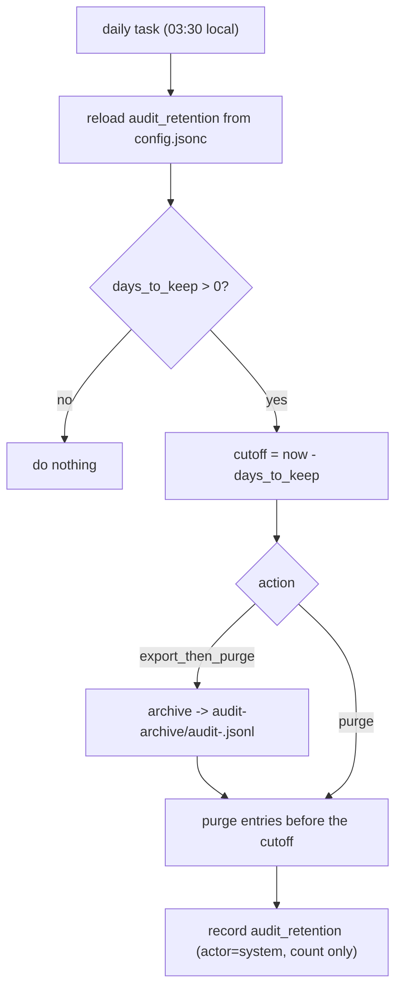

# The admin panel

This part describes the web interface: how it is built, the pages that need more than a
glance (DB, Map, Permissions, Settings), and audit-log retention. For the overview, start
at the [architecture index](README.md).

## Contents

- [How the panel is built](#how-the-panel-is-built)
- [Form field identity](#form-field-identity)
- [Layout and theme](#layout-and-theme)
- [Tables](#tables)
- [DB view](#db-view)
- [Map view](#map-view)
- [Permission auditor](#permission-auditor)
- [Dashboard and Settings](#dashboard-and-settings)
- [Conflicts page](#conflicts-page)
- [Audit-log retention](#audit-log-retention)

## How the panel is built

- **Server-rendered.** Pages are Go `html/template`, styled with **Bootstrap 5**.
- **No CDN and no build step.** Bootstrap (CSS, and its JavaScript bundle with Popper),
  jQuery, DataTables and Select2 are vendored under `internal/web/static/vendor/` and
  served by the panel itself, because the panel may be offline. They are the published
  builds, so nothing is compiled. They are web assets, not Go modules, so they add no Go
  dependency; their licences are in `THIRD_PARTY_NOTICES.md`.
- **Small own code.** `app.css` adds the app-shell layout and a few helpers; `app.js`
  (sidebar, theme, confirm dialogs, folder browser, secret reveal, reuse picker, form
  toggles) and `dt.js` (tables) are progressive enhancement.
- **Names only.** Like every panel surface, pages show names and metadata only: never a
  private key, the vault key, a TOTP secret, or a decrypted value, except the value the
  operator explicitly reveals.

## Form field identity

- Only the sign-in and first-run setup forms use `type="password"` or a site-login
  `autocomplete` token, so a browser or password manager offers to save nothing else.
- Every other secret field (transfer key, tokens, webhook, FTP and backup secrets, secret
  values) is a `type="text"` field drawn as dots by the `.secret-field` class, with
  autocomplete off and `data-1p-ignore`.
- Every field has a label and an id unique on its page.
- `internal/web/form_fields_test.go` checks these rules over every template, so a new
  field that breaks them fails the build.

## Layout and theme

- **App shell.** A fixed top header and a fixed left sidebar; the sidebar narrows the
  page rather than covering it. On a phone (768px wide or less) the sidebar becomes an
  overlay that closes on an outside click.
- **Header.** A button that shows or hides the sidebar, the brand, a theme toggle, and
  the account menu (username, the Security page at `/account`, Sign out).
- **Sidebar.** It links every page. Permissions, Secrets and Users show for admins only.
- **Theme.** Light or dark, following the operating system by default. The toggle
  overrides it, and the choice is kept in the browser's `localStorage`
  (`sopshq-theme`) and applied before the first paint, so the page never flashes the
  wrong theme. The sidebar's collapsed state is kept the same way (`sopshq-sidebar`).
- **Icons** are inline SVG, because the source is ASCII-only.

## Tables

Any table marked `class="... dt"` becomes a DataTable:

- column sorting and a search box;
- a header cell marked `no-sort` opts out of sorting, and one marked `filter` gains a
  Select2 drop-down filter;
- each table is wrapped in a Bootstrap card and scrolls sideways on a narrow screen.

## DB view

The **DB** page (`/db`) is a read-only place to browse every record type at once.

- **Tabs.** One table per type: Keys, Projects, Machines, OS users and Assignments for
  everyone, plus Users and Secrets for admins only.
- **One source of truth.** Each table comes from the same store reads the individual
  pages use; the Secrets tab uses the value-free secrets catalog.
- **Admin data stays with admins.** Users and Secrets data is gathered only when the
  viewer is an admin, so another user's response never carries it.
- **No values.** The Secrets tab has no value column and no reveal button.
- **Hidden tabs.** A table on a hidden tab measures zero width, so each tab's columns are
  resized when that tab is first shown.

## Map view

The **Map** page (`/map`) is a nested tree of how the records relate, next to the flat
DB tables.

- **Views.** Every view is a grouping order, for example *Project, Machine, Path, Secret
  name*, so the same records can be browsed in whatever order is useful.
- **Layout.** Two panes, stacked on narrow screens: a tree on the left (expand, collapse,
  select a leaf) and a read-only detail pane on the right. A project leaf links to its
  page.
- **Built-in views** (Projects, Machines, Users, Keys, Secrets) are fixed in the code, so
  the page is useful immediately.
- **Custom views** are stored as a replicated `MapView` record. The Map editor
  (admin-only) names a view, orders its grouping levels and picks the leaf level; views
  can be renamed, re-ordered and deleted.
- **The tree builder is pure** (`internal/mapview`). It joins the records into flat rows
  and groups them level by level. A level with no valid join from the levels before it
  is skipped, so an odd order gives a smaller tree, never an error.
- **Routes.** `GET /map` and `GET /map/tree?view=<id>` need a login; the editor's POSTs
  are admin-only and CSRF-protected.
- **Names and ids only.** The tree carries record names and ids, and secret names only
  when a view groups by secret name, never a value.

## Permission auditor

The **Permissions** page (`/permmap`) is an admin-only, read-only audit of who can
access what across this Linux machine's filesystem. Where the Quick add pre-flight asks
"can this account read this folder?", the auditor maps every path under chosen roots.

- **Collector (Linux only).** It runs the standard tools (`find -printf`, `getfacl -R -p`,
  `getcap -r`), reads their output as UTF-8, and merges it by path.
- **Flags.** From each entry it rebuilds the octal mode and sets these flags:
  - `world_writable`;
  - `has_acl`: any named principal;
  - `acl_override`: a named principal beyond the owner and owning group;
  - `suid_sgid`;
  - `dangerous`: setuid or setgid, or a world-writable path that is not a sticky folder.

  The parser and flag rules are pure and tested on every platform; only live collection
  needs Linux.
- **Off by default, with a dedicated scan account.** It stays disabled until the operator
  creates a locked-down Linux account (no login, no SSH) that a tight `sudoers` rule
  allows to run only the collectors. The page prints the exact commands. **Enable** is
  refused unless that account exists and can run them, and each scan runs as it
  (`sudo -n -u <account>`).
- **Sealed, machine-local, never replicated.** The latest scan and the operator-set
  baseline are stored as gzip-JSONL under `<data dir>/permmap`, sealed with the same key
  as the rest of the data at rest. The map reveals the whole filesystem layout, so it
  never enters the replicated store.
- **Routes.** All admin-only, POSTs CSRF-protected: the page, a filtered list, lazy tree
  children, the change-since-baseline diff, and the scan, baseline, enable, disable and
  config actions. Scans and diffs are audited by counts only, never by path.
- **Drift.** A daily task re-scans and, once a baseline is set, sends a count summary
  through the notifier (`perm_drift`, off by default). It never changes a permission, and
  the baseline changes only when the operator clicks **Set baseline**.

## Dashboard and Settings

- **Dashboard.** Resource counts and the apply controls, with a per-item results panel
  below the buttons: each key placed, project wired, secret file re-keyed, and each skip
  with its reason. A dry run shows exactly what an apply would do.
  - "Apply to this machine" and "Push to all machines" are disabled when nothing is
    pending.
  - Every action button has a tooltip, and Force re-apply asks for confirmation.
- **Settings** (`/settings`) holds machine-local configuration that is not day-to-day
  work:
  - the paths this machine uses (config, data folder, vault, audit log, and the `sops`
    and `age-keygen` binaries);
  - the backup panel: schedule, whether a backup password is set, destinations, last
    run, and the admin-only password and **Back up now** controls;
  - the audit-retention policy (below).

## Conflicts page

The **Conflicts** page (`/conflicts`) lists the duplicate records the lossless reconcile
pass leaves intact, and the same-field conflicts found during replication. Each is
resolved by a double-confirmed merge or a replicated keep-both; see
[conflict resolution](conflict-resolution.md).

## Audit-log retention

The audit log (`data/audit.jsonl`) is append-only and can grow without bound, so SopsHQ
can trim it. Every trim rewrites the file atomically and records itself in the log (who,
and how many entries, never a value).

- **Manual.** The Audit page has an admin-only card with **Purge all** and **Purge up to
  a date** (to the end of that local day), plus a date-range filter on the Time column
  that only hides rows.
- **Automatic.** Settings stores a per-machine policy in `config.jsonc` under
  `audit_retention` (`days_to_keep`, `action`). Each machine keeps its own history, so
  the policy lives in the config file rather than the replicated store.
  - A daily task at 03:30 local time re-reads the policy and removes entries older than
    the limit.
  - With `export_then_purge` (the default) it first archives them to
    `<data dir>/audit-archive/audit-<timestamp>.jsonl`; with `purge` it deletes them.
  - A failed run is logged and the schedule continues.
  - **The daily task starts only when a positive day limit is set when `serve` starts.**
    After setting the first limit, restart `serve`. Later changes to the days or the
    action apply without a restart.

