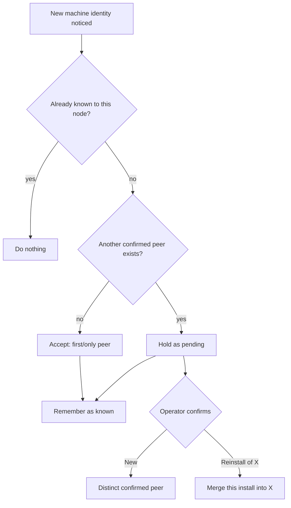

# Cluster peer identity and convergent de-duplication

This document explains how SopsHQ makes sure that **each physical machine is exactly one
record** across the whole cluster, how it tells a new machine apart from a reinstall of an
existing one, and how duplicate records of every kind heal without a human cleaning up.
Every term is defined on first use. For the overview, start at the
[architecture index](README.md).

## Contents

- [Why this exists](#why-this-exists)
- [The canonical machine id](#the-canonical-machine-id)
- [Add peer, and the new-versus-reinstall question](#add-peer-and-the-new-versus-reinstall-question)
- [How the decision converges](#how-the-decision-converges)
- [Reinstall merge: what re-points](#reinstall-merge-what-re-points)
- [Lossless-only de-duplication of everything else](#lossless-only-de-duplication-of-everything-else)
- [Panel logins are not cluster records](#panel-logins-are-not-cluster-records)
- [Idempotent and self-healing](#idempotent-and-self-healing)
- [Known edges](#known-edges)

## Why this exists

SopsHQ runs on more than one machine, and the machines **replicate** (copy each other's
records) so all of them see the same projects, keys and accounts. Each machine also lets
the operator add the others by address.

So two independent facts about the same real machine, its own record and a record typed
in by address, can become **two different records**, and replication copies both to every
machine. This document is the design that prevents that and heals duplicates that already
exist.

The rule everything below serves:

> One physical machine = one record, on every machine, forever. It is reached
> automatically, the same way, whichever machine you look at.

## The canonical machine id

Every install generates a stable, random **node id** once, in its config, and keeps it for
life. A machine's **own** record, its *canonical* record, uses that node id as its record
id.

- A machine's identity is decided by the machine itself, needs no coordination, and is
  the same id on every peer, because they all replicate that one record.
- A **reinstall** generates a **new** node id, so a rebuilt machine looks like a
  *candidate* new machine. That is exactly when SopsHQ should stop and ask whether it is
  new or a reinstall.

A record the operator typed in by address (the **Add peer** button) before the real
machine has synced is a **placeholder**: it names a machine but is not that machine's own
record. When the real machine syncs in, the placeholder **merges into** the canonical
record with the same name, without asking, because the two are unambiguously the same
machine.

These fields on the machine record carry this:

| Field | Meaning |
|-------|---------|
| `canonical` | This is a node's **own** record (its id is that node's identity). |
| `pending` | A newly noticed identity awaiting the operator's *new or reinstall* decision. |
| `confirmed` | The identity has been decided (accepted, kept as a reinstall survivor, or grandfathered). It is on the replicated record, so **every** machine sees the decision. |
| `merged_into` | This tombstoned record was absorbed into the record whose id this holds. |

## Add peer, and the new-versus-reinstall question

Adding a peer can never create a second record for a machine that already exists.

- **A duplicate name** (ignoring case) is rejected outright.
- **The first (or only) peer** is accepted without a prompt: there is nothing yet for it
  to be a reinstall *of*.
- **A genuinely new identity**, added by address or brought in by sync, is held
  **pending** when at least one other **confirmed** peer already exists. The Machines page
  then asks one question:

  > New machine, or a reinstall of an existing one?

  - **New** keeps it as a separate, confirmed machine.
  - **Reinstall of X** merges the new install into the existing peer **X**. X's identity
    survives, and every reference that pointed at the new install (keys, projects, OS
    accounts, assignments) moves to X, so there is no duplicate record. If the machine
    confirming is itself the reinstalled one, it also rewrites its own stored identity
    to X.

Only machines use this confirmation. Everything else de-duplicates without asking
([below](#lossless-only-de-duplication-of-everything-else)).

## How the decision converges

The confirmation must reach the same answer on every machine, although the operator
clicks the button on only one.

**Only the operator resolves a pending machine.** The reconcile pass never does it on its
own. So two machines can never race to opposite decisions: the operator's one decision is
an ordinary record write that replicates to the others.

**The decision is kept in two places:**

- **On the replicated record**, as the `confirmed` flag, which every machine sees.
- **Privately on each machine**, in a small acknowledged-peers file (`peers_ack.json`),
  which never replicates.

**When a machine is flagged pending:**

- On its very first run, a machine grandfathers every record it already has, marking them
  confirmed. Those are established machines, not new arrivals, so settled peers are never
  re-opened.
- After that, a peer is flagged pending only when it is neither confirmed nor already
  acknowledged on this machine, and another confirmed peer exists.
- Because the confirmation is visible to the whole cluster, a fresh machine that joins
  later, with no local memory of an established peer, does not prompt for it again.
- A peer is flagged at most once and the flag is cleared only by the operator, so the
  machines never flip-flop.

### Re-pointing waits for the tombstone

A raced decision cannot attach records to the wrong machine, because of how a merge is
split into two steps:

1. **The merge step only tombstones the loser**, with a `merged_into` pointer. It does not
   move the loser's references at that moment.
2. **The reconcile pass moves references**, and only off a record that is currently
   tombstoned.

So if two machines make opposite decisions on the same pending peer and the "new machine"
decision wins by last-writer-wins, the machine comes back **live** and still owns its own
OS accounts, assignments and global sets; they were never moved to the machine it was
briefly merged into. The confirm actions also refuse once the peer is no longer pending,
which closes the window in the realistic order of events (the first decision has
replicated before the second click).

## Reinstall merge: what re-points

When a machine record (the *loser*) merges into another (the *survivor*), every reference
to the loser moves to the survivor, so nothing is orphaned:

| Reference | Moved from loser to survivor |
|-----------|------------------------------|
| `OSUser.machine_id` | yes |
| `Assignment.machine_id` | yes |
| `Project.paths[].machine_id` | yes; a path identical to one the survivor already has is dropped, a different path is kept |
| `GlobalSet.machine_id` | yes |
| `BackupSettings.machine_id` | yes (the machine's backup schedule follows it) |
| `NotificationSettings.machine_id` | yes (the machine's alert channels follow it) |
| the node's own stored machine id | yes, when the loser was this node's own record |

Map views carry no machine id, so there is nothing to move there.

- **The survivor fills its gaps from the loser**, notably the advertised Tailscale address
  and port, so a placeholder the operator typed an address into hands that address to the
  canonical record.
- **The loser is then tombstoned** (soft-deleted) with `merged_into` pointing at the
  survivor, so the merge replicates like any delete and every machine follows the same
  pointer.

## Lossless-only de-duplication of everything else

Projects, keys, global sets and OS accounts cannot be two different things when they
collide on their natural identity, so their duplicates fold together automatically, with
no prompt, in the same reconcile pass. A fixed rule picks the survivor, so every machine
picks the same one:

| Record | Same when they share | Survivor |
|--------|----------------------|----------|
| Project | name (ignoring case) | smallest id; paths and assignments fold in |
| Key | public key | smallest id; assignments fold in; a survivor without the private half inherits it |
| GlobalSet | machine and name (ignoring case) | smallest id; readers fold in |
| OSUser | machine and username (Windows ignores case; Linux does not) | smallest id; assignments and set memberships fold in |
| BackupSettings | machine (one per machine) | smallest id; configured fields fold in |
| NotificationSettings | machine (one per machine) | smallest id; configured channels fold in |
| MapView | name (ignoring case) | smallest id, only when the layout is identical |

**After any merge, assignments are tidied:**

- Assignment rows that became identical (same key, project, machine and OS account)
  collapse to one.
- An assignment whose project or OS account has been **deleted** (a tombstone with no
  merge pointer) is pruned, so no grant dangles.
- An assignment whose parent is merely **not synced yet** (an unknown id, no tombstone) is
  kept, so a partial sync that delivers an assignment before its records never destroys a
  valid grant.

**The merge is lossless only: reconcile never destroys data to de-duplicate.** An
automatic merge runs only when it cannot lose anything:

- identical records collapse;
- lists (readers, project paths) are unioned;
- a value fills a field the survivor left **empty**.

If the two records disagree on any **non-empty** field, the merge is **skipped** and
**both** records are kept. Such fields include a sealed credential, key material, an OS
account's key-store base, a project's path for the **same** machine, a backup destination,
a notification channel, a machine's advertised address, and a saved map layout. The full
field rule is in [conflict resolution](conflict-resolution.md#no-field-is-dropped-by-the-automatic-merge).

Resolving a real conflict means deleting or overwriting a value, so it is left to an
explicit, operator-confirmed flow on the Conflicts page. Because the lossless rules and the
conflict test are the same everywhere, every machine performs the same merges and skips the
same conflicts, and the cluster still converges.

## Panel logins are not cluster records

A panel login (the username, password hash, sealed two-factor secret and recovery-code
hashes for signing in to the admin panel) is a **per-machine credential**, not a shared
record.

- Each machine has its own operator login, so two machines both having an admin named
  "alice" is expected, not a duplicate.
- Logins are stored on the machine that created them and **never replicate**: they do not
  enter the oplog, and a login record arriving from a peer is ignored. So one machine's
  admin never appears on another.
- Reconcile does not touch them. A duplicate username is still refused when it is created
  on the same machine.
- If an operator is locked out (a lost password and no working recovery code),
  `sopshq reset-admin -user NAME` restores or resets that machine's login with a new
  password.

## Idempotent and self-healing

The reconcile pass runs when `serve` starts, after every change, and once a minute.

- It is **idempotent**: with nothing to do it only reads, and once the records are settled
  it writes nothing more, so it never churns.
- The survivor rule is fixed (the smallest id, or the canonical record) and every change is
  an ordinary replicated write, so all machines converge on the same records.
- A store that already holds duplicates heals on the next run, with no manual step.

## Known edges

- **A double confirmation on two machines at once.** Confirming the SAME pending peer on
  two machines within the replication delay, before either decision reaches the other, can
  still race. The refuse-when-not-pending check closes the window in the realistic order
  (the first decision replicates before the second click). A human confirms on one
  machine, so this edge is theoretical.
- **Deleting a machine by hand.** The Delete button writes a plain tombstone and moves no
  references; it is for retiring a machine, not merging one. Use the reinstall
  confirmation to fold one machine's identity into another.
- **Two canonical records with the same name are never merged automatically.** Each is a
  machine's own record, so the new-versus-reinstall prompt or the Conflicts page resolves
  them.
