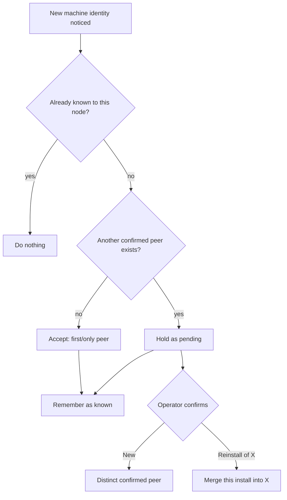

# Cluster peer identity and convergent de-duplication

This document explains how SopsHQ guarantees that **each physical machine is exactly
one record** across the whole cluster, how it tells a brand-new machine apart from a
reinstall of an existing one, and how duplicate records of every kind heal themselves
without a human having to clean up. It is written so a non-technical reader can follow
it; every term is defined on first use.

## Why this exists

SopsHQ runs on more than one machine, and the machines **replicate** (copy each
other's records) so both see the same projects, keys, and users. Each machine also
lets the operator add the others by address. Two independent facts about the same
real machine can become **two different records**, and replication then copies both to
every machine, so two machines can end up as four records. This document is the design
that prevents that and heals existing duplicates.

The rule everything below serves:

> One physical machine = one record, on every machine, forever - reached
> automatically, the same way, no matter which machine you look at.

## The canonical machine id

Every install generates a stable, random **node id** once (in its config) and keeps it
for life. A machine's **own** record - its *canonical* record - uses that node id as
its record id. So:

- A machine's identity is decided by the machine itself, needs no coordination, and is
  the same id on every peer (they all replicate that one record).
- A **reinstall** generates a **new** node id, so a rebuilt machine looks like a
  *candidate* new machine - which is exactly when we want to stop and ask the operator
  whether it is genuinely new or a reinstall.

A record the operator typed in by address (the **Add peer** button) before the real
machine has synced is a **placeholder**: it names a machine but is not that machine's
own canonical record. When the real machine syncs in, the placeholder **merges into**
the canonical record that shares its name - silently, because a placeholder and a
canonical record with the same name are unambiguously the same machine.

Three fields on the machine record carry this:

| Field | Meaning |
|-------|---------|
| `canonical` | This is a node's **own** record (its id is that node's identity). |
| `pending` | A newly-noticed identity awaiting the operator's *new vs reinstall* decision. |
| `confirmed` | The identity has been decided (accepted, kept as a reinstall survivor, or grandfathered). Recorded on the replicated record so **every** machine sees the decision. |
| `merged_into` | This (tombstoned) record was absorbed into the record whose id this holds. |

## Add peer, and the new-vs-reinstall question

Adding a peer can never create a second record for a machine that already exists:

- A **duplicate name** (case-insensitive) is rejected outright.
- A **genuinely new identity** - added by address, or brought in by sync - is held
  **pending** when at least one other **confirmed** peer already exists. The Machines
  page then asks one question:

  > New machine, or a reinstall of an existing one?

  - **New** keeps it as a distinct, confirmed machine.
  - **Reinstall of X** merges the new install into the existing peer **X**: X's
    identity survives and every reference (keys, projects, OS users, assignments) that
    pointed at the new install re-points to X. The rebuilt machine takes over the
    existing peer with **no duplicate record**. If the machine confirming is itself the
    reinstalled one, it rewrites its own stored local identity to X.

- The **first (or only) peer** is accepted with no prompt - there is nothing yet for it
  to be a reinstall *of*.

Only machines use this confirmation. Everything else de-duplicates silently (below).

### How the decision converges (the subtle part)

The confirmation must reach the same answer on every machine even though the operator
clicks the button on only one. Two ideas make that work:

1. **The reconcile pass never *resolves* a pending machine by itself** - only the
   operator does (by clicking New or Reinstall). So two machines can never race to
   opposite decisions; whichever machine the operator uses, that one decision is a
   normal record write that replicates to the others.

2. **The decision is written on the replicated record (a `confirmed` flag) and also
   remembered privately by each machine** (a small local acknowledged-peers file, never
   replicated, exactly like the replication watermarks). On its very first run a machine
   "grandfathers" every record it already has - those are trusted, established machines,
   not new arrivals - marking them confirmed so upgrading to this version never re-opens
   settled peers. A peer is flagged pending only when it is **neither confirmed (visible
   to every machine) nor already acknowledged locally**, and another confirmed peer
   exists. Because the confirmation is cluster-visible, even a fresh machine that joins
   later and has no local memory of an established peer will not re-prompt for it. And
   because flagging is one-directional (a peer is flagged at most once and the flag is
   cleared only by the operator), the machines never flip-flop.

**Tombstone-driven re-pointing (why a raced decision cannot mis-attach records).** When
a machine is merged, the merge step *only* tombstones the loser with a `merged_into`
redirect - it does **not** move the loser's references there and then. Moving references
is owned by the reconcile pass, and it moves them only *off a record that is currently
tombstoned*. So if two machines make opposite decisions on the same pending peer and the
"new machine" decision wins by last-writer-wins (the loser comes back **live**), the
resurrected machine still owns its own OS users, assignments, and global sets - they were
never eagerly re-attached to the machine it was briefly merged into. The confirm actions
additionally refuse once the peer is no longer pending, which closes the window in the
realistic ordering (the first decision has replicated before the second click).

## Reinstall merge: what re-points

When a machine record (the *loser*) merges into another (the *survivor*), every
reference to the loser moves to the survivor, so nothing is orphaned:

| Reference | Moved from loser to survivor |
|-----------|------------------------------|
| `OSUser.machine_id` | yes |
| `Assignment.machine_id` | yes |
| `Project.paths[].machine_id` | yes (a duplicate path for the survivor is dropped) |
| `GlobalSet.machine_id` | yes |
| `BackupSettings.machine_id` | yes (the machine's backup schedule follows it) |
| `NotificationSettings.machine_id` | yes (the machine's alert channels follow it) |
| the node's own stored local machine id | yes, when the loser was this node's own record |

(Map views carry no machine id - they are not machine-scoped - so there is nothing to
move there.)

The survivor also inherits any useful field the loser had and it lacked - notably the
advertised Tailscale address and port, so a placeholder the operator typed the address
into hands that address to the canonical record it merges into. The loser is then
**tombstoned** (soft-deleted) with `merged_into` pointing at the survivor, so the merge
replicates like any delete and every machine follows the same redirect.

## Lossless-only de-duplication of everything else

Projects, keys, global sets, and OS users cannot be two different things when they
collide on their natural identity, so their duplicates fold together automatically - no
prompt - in the same reconcile pass, on a deterministic rule so every machine picks the
same survivor:

| Record | Same when they share | Survivor |
|--------|----------------------|----------|
| Project | name (case-insensitive) | smallest id; paths and assignments fold in |
| Key | public key | smallest id; assignments fold in; a metadata-only survivor inherits the sealed private half |
| GlobalSet | machine + name (case-insensitive) | smallest id; recipient users fold in |
| OSUser | machine + username (Windows: case-insensitive; Linux: case-sensitive) | smallest id; assignments and set memberships fold in |
| BackupSettings | machine (one per machine) | smallest id; configured fields fold in |
| NotificationSettings | machine (one per machine) | smallest id; configured channels fold in |
| MapView | name (case-insensitive) | smallest id, only when the layout is identical |

After any merge, assignment rows that became identical (same key + project + machine +
OS user) collapse to one, and an assignment whose project or OS user has been **deleted**
(a tombstone is present) is pruned - so no grant is duplicated and none dangles. An
assignment whose parent is merely **not yet synced** (an unknown id, no tombstone) is
kept, so a partial sync that delivers an assignment before its records never destroys a
valid grant.

**The merge is lossless-only: reconcile never destroys data to de-duplicate.** An
automatic merge runs only when it cannot lose anything - identical records collapse, a
set (recipients, project paths) unions, and a value fills a field the survivor left
**empty** (the survivor gains, loses nothing). If the two records disagree on any
**non-empty** field - a sealed credential, key material, an OS user's key-store base, a
project's path for the **same** machine, a backup destination, a notification channel, a
machine's advertised address, or a saved map layout - the merge is **skipped** and
**both** records are kept intact. Resolving such a real conflict (which means deleting or
overwriting a value) is deferred to an explicit, operator-confirmed flow; the automatic
pass never does it. Because the lossless rules and the conflict test are deterministic,
every machine performs the same automatic merges and skips the same conflicts, so the
cluster still converges to the same set of records.

**Panel logins are not cluster records.** A panel login (the username, password hash,
sealed two-factor secret, and recovery-code hashes for signing in to the admin panel) is
a **per-machine credential**, not a shared record. Each machine has its own operator
login, so two machines both having an admin named "alice" is expected, not a duplicate.
Panel logins are therefore **machine-local**: they are stored on the machine that created
them and are **never replicated** - they do not enter the replication log, and a
panel-login record arriving from a peer is ignored - so one machine's admin can never
appear on another. Reconcile does not touch them at all. Duplicate usernames are still
refused at create time on the same machine. If an operator is ever locked out (a lost
password with no working recovery code), `sopshq reset-admin -user NAME` restores or
resets that machine's login with a new password.

## Idempotent and self-healing

The reconcile pass runs at startup, after every change, and once a minute. It is
**idempotent**: with nothing to do it only scans; once the records are settled it
writes nothing further, so it never churns. Because the survivor rule is deterministic
(smallest id / the canonical record) and every change is a normal replicated write, all
machines converge to the same single set of records - and a store that already holds
duplicates (the "four records for two machines" mess) heals on the next run without any
manual step.

## Known edges

- A **simultaneous double-confirm** of the SAME pending peer on two machines, within the
  replication delay (before either decision reaches the other), can still race. The
  refuse-when-not-pending guard closes the window in the realistic ordering (the first
  decision replicates before the second click). A human confirms on one machine, so this
  is a theoretical edge, not an operational one.
- **Deleting a machine by hand** (the Delete button) is a plain tombstone with no
  reference re-pointing - it is meant for retiring a machine, not merging one. Use the
  reinstall confirmation to fold one machine's identity into another.
- On a store's **very first reconcile after upgrade**, two canonical records that already
  share a name are left as they are (not auto-merged); the new-vs-reinstall prompt is the
  path for resolving same-named machines from then on.
