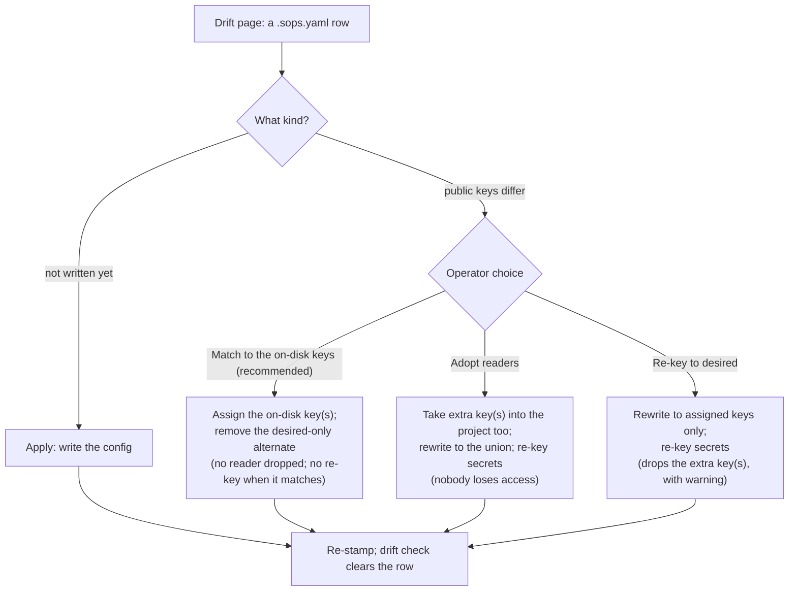
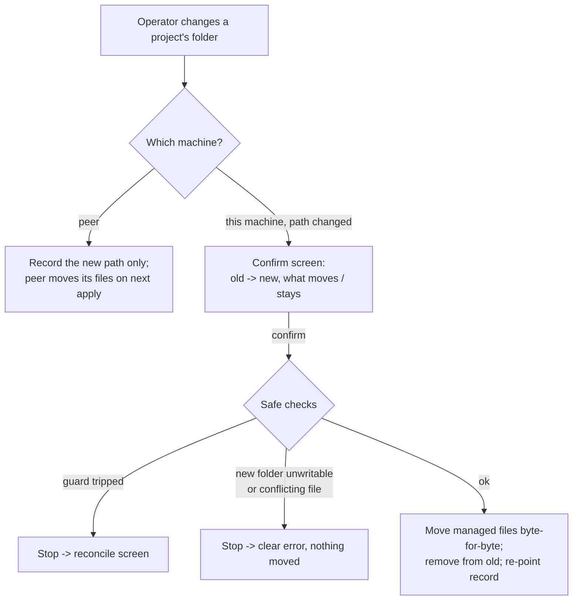

# Drift, reconcile, and folder moves

This document explains three related things SopsHQ does to keep the files it manages
honest when the world changes underneath it:

- **Drift:** noticing when the files on disk no longer match what SopsHQ intends.
- **Resolve:** fixing that gap safely, with one click, from where it is shown.
- **Folder moves:** moving a project's managed files when its folder changes, instead of
  leaving old files behind.

It uses the plain-language terms from [`../terminology.md`](../terminology.md). The
mechanics of the write-time guard and of finding keys on disk are in
[the write-time change guard](keys-write-guard.md) and
[continuous local reconcile](keys-reconcile.md); this document covers what the operator
sees and the safe choice behind each button. For the overview, start at the
[architecture index](README.md).

## Contents

- [What drift means](#what-drift-means)
  - [Drift messages name the exact difference](#drift-messages-name-the-exact-difference)
  - [Same account, different identity](#same-account-different-identity)
  - [Reuse assigns the keys the config already uses](#reuse-assigns-the-keys-the-config-already-uses)
  - [Pruning orphaned assignments](#pruning-orphaned-assignments)
- [Resolving drift with one click](#resolving-drift-with-one-click)
  - [Match to the on-disk keys](#match-to-the-on-disk-keys)
  - [Adopt readers](#adopt-readers)
  - [Re-key to desired, and Apply](#re-key-to-desired-and-apply)
  - [How a re-key decrypts](#how-a-re-key-decrypts)
- [Moving a project's folder](#moving-a-projects-folder)
- [How this relates to the write-time guard](#how-this-relates-to-the-write-time-guard)

## What drift means

Every project has an intended set of **public keys**: the keys SopsHQ has decided should
be able to read that project's secrets. SopsHQ writes that set into the project's
`.sops.yaml`, the small config that tells sops who can decrypt.

**Drift** is any gap between that intention and the real files on THIS machine:

- a private key that was assigned but never placed in its OS account's key store;
- a `.sops.yaml` whose public keys no longer match the intended set (someone edited it by
  hand, or a key was rotated on another machine);
- a `.sops.yaml` that has not been written yet.

Drift detection only reads: it checks files and reads the database. It never shows a
private key or a secret value, only public keys and file paths.

### Drift messages name the exact difference

A drift message says WHAT is wrong, by key NAME where SopsHQ knows one (otherwise a short
`age1...` prefix):

- *"the secrets config lists public key 'adopted-alice-2' (age1csf...) that this project
  does not include"*: an extra key is on disk.
- *"the project is missing public key 'billing' (age1r8x...)"*: an intended key is absent
  from disk.
- *"no .sops.yaml at C:\proj\.sops.yaml yet"*: the file has not been written.

### Same account, different identity

One account's key store (its `keys.txt`) can hold SEVERAL age identities, for example
`adopted-alice` and `adopted-alice-2`, both belonging to the account **alice**. Age tries
each identity, so alice can decrypt a secret encrypted to EITHER one.

So when the public key on disk and the one a project expects are two identities of the SAME
account, that is an identity switch, not a lost reader, and the message says so:

- *"the secrets config uses public key 'adopted-alice-2' (age1csf...); this project is set
  to public key 'adopted-alice' (age1ajj...) - the same account 'alice', which can decrypt
  either"*.

How SopsHQ decides:

- It finds which account a public key belongs to from the **assignments** that link a key
  to an OS account (an adopted key is assigned to the account it was adopted for; a project
  key to the accounts granted it).
- The alarming *"missing X / lists extra Y"* wording is kept only when the two keys belong
  to genuinely DIFFERENT accounts, so a real lost reader still stands out.
- A public key that maps to more than one account is treated as ambiguous, and the precise
  wording is kept rather than guessing "same account".

### Reuse assigns the keys the config already uses

Onboarding a project whose folder ALREADY has a `.sops.yaml` (or encrypted secrets) does
not pick an arbitrary key from the store. It reads the public keys that config already uses
and assigns the project EXACTLY those (see [safe wiring](keys-safe-wiring.md)). So a plain
reuse of a multi-identity account does not create the identity-switch drift above: the
intended set equals what is on disk from the start.

### Pruning orphaned assignments

Alongside drift detection, the background reconcile pass keeps the assignments consistent.

- **What it removes.** An assignment whose project or OS account has been deleted (a
  tombstone with no merge pointer).
- **What it keeps.**
  - an assignment whose parent is not synced yet (an unknown id);
  - an assignment whose parent was merged into another record (it is re-pointed instead;
    see [conflict resolution](conflict-resolution.md#references-survive-a-merge-on-the-other-machine));
  - a key placement with no project (an adopted key) while its OS account is live.
- **When it runs.** When `serve` starts, after each change, and once a minute (see
  [peer identity](peer-identity.md#idempotent-and-self-healing)). It writes only when an
  orphan exists, and each removal replicates like any delete.
- **Why it matters.** A key that only a since-deleted project used becomes deletable on the
  next run, with no manual step.

## Resolving drift with one click

Every `.sops.yaml` drift row on the **Drift** page carries its own resolve action, so the
operator is never stuck with a change they cannot clear. The actions post to
`/drift/resolve` (CSRF-protected) and are audited by project name.

| Situation | Button | What it does | Who can still decrypt after |
| --- | --- | --- | --- |
| Public keys differ | **Match to the on-disk keys** (recommended) | Points the project at the public keys the config already uses. Re-keys nothing when the config already matches. | Everyone the config already lists; no reader is dropped. |
| Extra public key on disk | **Adopt readers** | Adds the extra keys to the project, rewrites the config to the union, and re-keys the secrets. | Everyone who could before, plus the project's own keys. |
| Extra public key on disk | **Re-key to desired** | Rewrites the config to ONLY the project's assigned keys and re-keys, dropping the extras. | Only the assigned keys; the dropped keys can no longer decrypt, and the warning names them. |
| `.sops.yaml` not written yet | **Apply** | Writes the config for the project's assigned public keys. | The project's assigned keys. |

These are explicit operator choices, so they ACT on the file that drifted rather than
stopping at the write-time guard the way a background write would. They re-stamp the result
afterwards, so the next drift check clears the row and later outside edits are still
caught.

### Match to the on-disk keys

- **What it does.** Assigns the key or keys on disk, removes the project's desired-only
  alternative, and writes and re-keys only if the config does not already match.
- **Guarantee: no reader is dropped.** The keys it removes from the project were never on
  disk, so no secret is encrypted to them. For an identity switch, the removed key is the
  same account's other identity, which still decrypts through the one on disk.
- **When to use it.** It is the right fix for a same-account identity mismatch, and it
  avoids a plain **Apply**, which would rewrite a matching config and could drop a reader
  that is on disk.
- **Access.** It can adopt an on-disk key not yet held by SopsHQ; that case is admin-only.
  Matching keys already held needs only the normal login level.
- A project's own page offers the same action when its config's public keys differ.

### Adopt readers

- **What it does.** It finds every public key already protecting the project (in
  `.sops.yaml` and in the encrypted secrets' metadata, in any YAML layout). For each one
  not yet in the project, it reuses the key SopsHQ already holds or adopts it from a local
  key store, then adds a project assignment.
- **Guarantee: no reader is dropped.**
- **Refuses when** a public key on disk cannot be matched to a private key SopsHQ can see.
  It changes nothing rather than leave a half-adopted key; the operator imports that key
  first, or chooses Re-key to desired.
- **Fails closed** when the files show signs of public keys but SopsHQ cannot read any of
  them (an unfamiliar format): it refuses and re-keys nothing, so it can never re-encrypt
  the secrets without a reader.
- **Access.** Admin-only, because it can import an unknown on-disk private key into the
  vault, the same custody-sensitive step as the external-change reconcile.

### Re-key to desired, and Apply

- **Re-key to desired** drops the extra readers on purpose; the warning names them.
- **Apply** writes a config that does not exist yet.
- Both stay at the normal login level.

### How a re-key decrypts

Every re-key first DECRYPTS the secrets as they are encrypted right now, then encrypts them
to the new public-key set.

- To decrypt, SopsHQ gives `sops` EVERY assigned key it can unseal from the vault, not one
  guessed key, so `sops` finds whichever key fits the file.
- Those private keys reach `sops` only through a scrubbed `SOPS_AGE_KEY` child environment
  (see [secret values](secrets.md#encrypt-and-forget)); they are never written to disk or
  logged.
- The set the secrets end up encrypted to is decided only by the rewritten `.sops.yaml`.

## Moving a project's folder

A project stores one folder per machine (the same project lives at different paths on
Windows and Linux), and SopsHQ writes that project's `.sops.yaml` into it. When the
operator CHANGES a folder that is already set, SopsHQ treats it as a **move**: the files it
manages follow to the new folder, so the old folder is not left with a stray `.sops.yaml`.

### What moves, what does not

Only files SopsHQ itself manages move:

- **the generated `.sops.yaml`**, recognised by its header line (`# Generated by SopsHQ`).
  A hand-written `.sops.yaml` (no such header) is never moved or deleted.
- **a tracked `secrets.yaml`**: one with a content stamp, because SopsHQ wrote or tracked
  it. An untracked secrets file is left alone.

The move:

- copies the file byte for byte (it is moved, not regenerated);
- removes it from the old folder;
- moves its content stamp to the new path;
- points the project record at the new folder.

The age private key is unaffected: it lives in the OS account's key store, not in the
project folder.

### Confirm first, and safe stops

Nothing moves silently. Saving a changed local folder first shows a **confirm screen** that
lists old and new, and exactly what will be written and removed.

All checks run BEFORE any file is touched, so the move stops cleanly, with nothing half
done, when:

- the old managed file was changed OUTSIDE SopsHQ (the write-time guard trips): the move
  stops and shows the reconcile screen, so the operator resolves it first;
- the new folder cannot be created or written to;
- a DIFFERENT managed file already sits at the new path (a `.sops.yaml`, or a
  `secrets.yaml` whose bytes differ from the one being moved). SopsHQ will not overwrite
  it, because that would destroy unrelated encrypted data; the operator moves or removes
  that file first.

### Local only; peers move their own files

SopsHQ can only touch the LOCAL machine's filesystem. Changing the folder for a PEER
records the new path only; that machine moves its own managed files the next time it
applies or reconciles. The page says so when a peer's path is changed.

## How this relates to the write-time guard

The [write-time guard](keys-write-guard.md) stops a background write from overwriting a
file that changed outside SopsHQ, and offers Adopt, Overwrite or Cancel.

- The drift actions and the folder move are the operator-started counterparts: the
  operator chose to act on a specific file, so they proceed and re-stamp.
- They still refuse to run over an unresolved outside change: a folder move whose source
  changed hands off to the same reconcile screen.

Together they enforce one rule everywhere: SopsHQ never silently erases something it did
not write.
