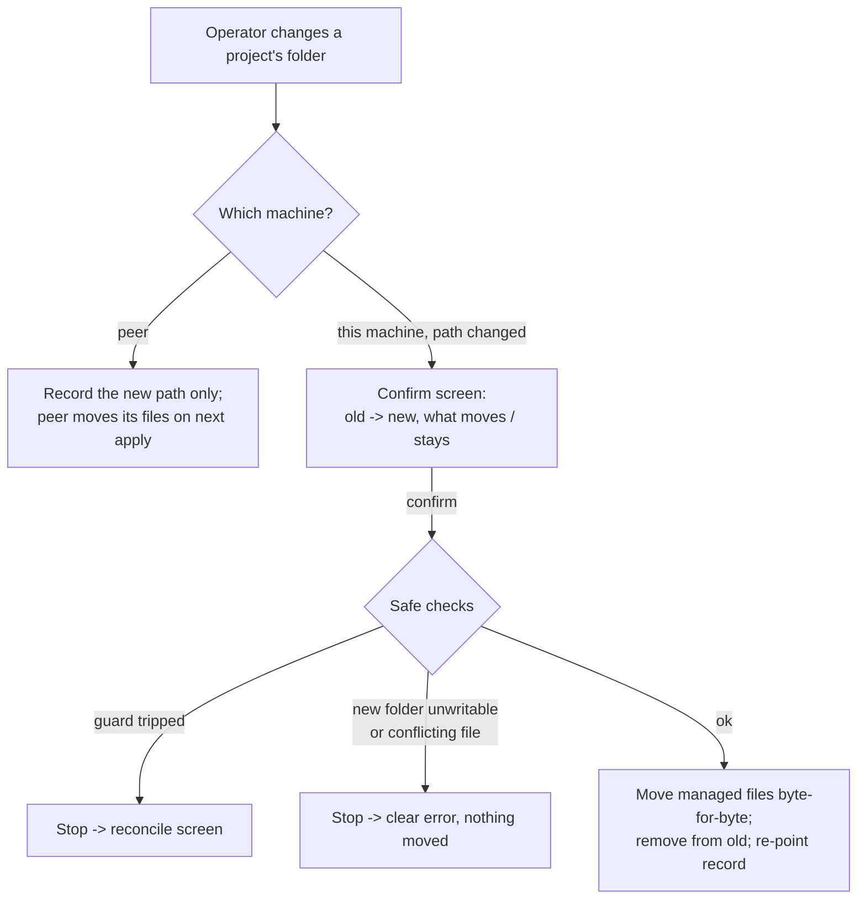

# Drift, reconcile, and folder moves

This document explains, in plain language, three closely related things SopsHQ does
to keep the files it manages honest when the world changes underneath it:

1. **Drift** - noticing when the files on disk no longer match what SopsHQ intends.
2. **Reconcile / resolve** - fixing that gap safely, with one click, from where it is
   shown.
3. **Folder moves** - relocating a project's managed files when its folder path
   changes, instead of leaving old files behind.

It uses the plain-language terms from [`../terminology.md`](../terminology.md): where
the SOPS tool says "recipient" for a public key listed in an encrypted file, this
document says **public key**.

The mechanics of the write-time guard and the on-disk key discovery scan live in
[`keys.md`](keys.md); this document focuses on what the operator sees and the safe
choices behind each button.

---

## 1. What "drift" means

Every project has an intended set of **public keys** - the keys SopsHQ has decided
should be able to read that project's secrets. SopsHQ writes that set into the
project's `.sops.yaml` file (the small config that tells SOPS who can decrypt).

**Drift** is any gap between that intention and the real files on THIS machine:

- a private key that was assigned but never placed in its OS user's key store;
- a `.sops.yaml` whose public keys no longer match the intended set (someone
  hand-edited it, or a key was rotated on the other machine);
- a `.sops.yaml` that has not been written yet.

Drift detection (`keysvc.DriftLocal`) is strictly **read-only**: it stats files and
reads the database. It never shows a private key or a secret value - only public keys
and file paths.

### Self-healing prune of orphaned assignments

Alongside drift detection, the background reconcile pass (`refreshPending`, which runs at
startup, after each mutation, and on a one-minute tick) keeps the assignment set
referentially consistent. It tombstones any assignment whose project or OS user no longer
exists - a "dangling" record an earlier delete could leave behind - via
`keysvc.PruneOrphanedAssignments`. The prune is read-mostly and idempotent: it writes only
when an orphan is present, and a tombstoned assignment leaves the live set so it is never
re-processed. A project-less key placement (an adopted key, `ProjectID == ""`) whose OS
user is still live is kept. Each pruned tombstone replicates to the other machine like any
delete. This is what lets a key that only a since-deleted project used become deletable on
the next run without a manual step (see [`keys.md`](keys.md), "Referential integrity of
assignments").

### Messages name the exact difference

A drift message spells out WHAT is wrong, by key NAME where SopsHQ knows one (falling
back to a short `age1...` prefix), so the operator does not have to guess:

- *"the secrets config lists public key 'adopted-alice-2' (age1csf...) that this
  project does not include"* - an extra key is on disk.
- *"the project is missing public key 'billing' (age1r8x...)"* - an intended key is
  absent from disk.
- *"no .sops.yaml at C:\proj\.sops.yaml yet"* - the file has not been written.

### Same account, different identity - not a lost reader

One person's key store (their `keys.txt`) can hold SEVERAL age identities - for example
`adopted-alice` and `adopted-alice-2`, both belonging to the account **alice**. Because
age tries each identity, alice can decrypt a secret encrypted to EITHER one. So when the
public key on disk and the one a project expects are two identities of the SAME account,
that is an identity switch, not a loss of access - and the message says so:

- *"the secrets config uses public key 'adopted-alice-2' (age1csf...); this project is
  set to public key 'adopted-alice' (age1ajj...) - the same account 'alice', which can
  decrypt either"*.

SopsHQ decides which account a public key belongs to from the **assignments** that link a
key to an OS user (an adopted key is assigned to the account it was adopted for; a project
key is assigned to the accounts granted it). The alarming *"missing X / lists extra Y"*
wording is kept ONLY when the two keys belong to genuinely DIFFERENT accounts, so a real
loss of a reader still stands out. A public key that maps to more than one account is
treated conservatively as ambiguous (the precise wording is kept rather than guessing
"same account").

### Reuse assigns the keys the config already uses

Onboarding a project whose folder ALREADY has a `.sops.yaml` (or encrypted secrets) does
NOT pick an arbitrary key from the store: it reads the public keys that config already
uses and assigns the project EXACTLY those (see [`keys.md`](keys.md), "Reuse matches the
on-disk config"). That is why a plain reuse of a multi-identity account no longer creates
the identity-switch drift above in the first place - the desired set is made equal to what
is on disk from the start.

---

## 2. Resolving drift with one click

Every `.sops.yaml` drift row on the **Drift** page carries its own resolve action, so
the operator is never stuck with a change they cannot clear. The actions POST to
`/drift/resolve` (CSRF-protected, same login level as Apply) and are audited by
project name.

| Situation | Button | What it does | Who can still decrypt after |
| --- | --- | --- | --- |
| Public keys differ | **Match to the on-disk keys** (recommended) | Points the project at the public keys the config already uses: assigns the on-disk key(s) and removes the project's desired-only alternate. When the config already matches, it re-keys NOTHING (a pure no-op re-key); otherwise it writes the matched set and re-keys to it. | Everyone the config already lists - no reader is dropped. |
| Extra public key(s) on disk | **Adopt readers** | Takes the extra public key(s) into the project IN ADDITION to its own, then rewrites the config to the union and re-keys the secrets. | Everyone who could before, plus the project's own keys - nobody is dropped. |
| Extra public key(s) on disk | **Re-key to desired** | Rewrites the config to ONLY the project's assigned public keys and re-keys the secrets, dropping the extras. | Only the project's assigned keys - the dropped key(s) can no longer decrypt (the warning names them). |
| `.sops.yaml` not written yet | **Apply** | Writes the config for the project's assigned public keys. | The project's assigned keys. |

**Match to the on-disk keys never drops a reader.** The keys it removes from the project
are desired-only keys that were never on disk, so no secret is encrypted to them (and for
an identity switch, the removed key is the same account's other identity, which still
decrypts via the on-disk one). It is the right primary fix for a same-account identity
mismatch, and it avoids a plain **Apply** that would rewrite a matching config and could
drop an on-disk reader. Because it can adopt an on-disk key not yet in custody, that
custody-sensitive case is admin-only; matching keys already held needs only the Apply
login level. A project's own page shows this same call to action when its config's public
keys differ, instead of a bare Apply.

**Adopt readers never drops a reader.** It scans for every public key already
protecting the project (both `.sops.yaml` and the encrypted secrets metadata, in any
YAML layout), and for each one not yet part of the project it either reuses the key
SopsHQ already holds or adopts it from a local key store, then adds a project
assignment. If a public key on disk cannot be matched to a private key SopsHQ can see,
Adopt readers refuses (changing nothing) rather than leaving a half-adopted key that
nobody can decrypt for - the operator imports that key first, or chooses Re-key to
desired. It also **fails closed**: if the on-disk state signals public keys but SopsHQ
cannot read any of them (an unfamiliar format), it refuses and re-keys nothing, so it
can never re-encrypt the secrets WITHOUT a reader.

**How a re-key decrypts.** Every re-key first has to DECRYPT the secrets as they are
CURRENTLY encrypted (to whichever subset of the assigned keys is on disk right now),
then re-encrypt to the new public-key set. To decrypt, SopsHQ hands `sops` EVERY
assigned key it can unseal from the vault - not one guessed key - so `sops` can always
find the one that fits the file, no matter which keys it was last encrypted to. Those
private keys are supplied only through a scrubbed `SOPS_AGE_KEY` child environment (see
the system overview) and are never written to disk or logged; the new set the secrets
end up encrypted to is decided purely by the rewritten `.sops.yaml`.

**Adopt readers is admin-only.** Because it can import an unknown on-disk private key
into the vault (the same custody-sensitive step as the external-change reconcile), it
requires an admin session. Re-key to desired and Apply stay at the Apply login level.

Because these are explicit operator choices, they ACT on the very file that drifted
(they do not stop at the write-time guard the way a background write would), but they
re-stamp the result afterward, so the next drift check clears the row and future
outside edits are still caught.

---

## 3. Moving a project's folder

A project stores one folder per machine (the same project lives at different paths on
Windows and Linux). SopsHQ writes that project's `.sops.yaml` into that folder.

When the operator CHANGES an already-set folder to a different one, SopsHQ treats it as
a **move**, not just a re-point: the files SopsHQ manages follow to the new folder, so
the old folder is not left with a stranded `.sops.yaml`.

### What moves, what does not

Only files SopsHQ itself manages are moved:

- the **generated `.sops.yaml`** - identified by its header line
  (`# Generated by SopsHQ`). A **hand-authored** `.sops.yaml` (no such header) is NEVER
  moved or deleted; SopsHQ leaves it exactly where it is.
- a **SopsHQ-tracked `secrets.yaml`** - one that has a content stamp (SopsHQ has
  written or tracked it). An untracked secrets file is left alone.

The move copies the file BYTE-FOR-BYTE (it is moved, not regenerated), removes it from
the old folder, moves its content stamp to the new path, and points the project record
at the new folder. The age private key is unaffected - it lives in the OS user's key
store, not in the project folder.

### Confirm first, and safe stops

Nothing moves silently. Saving a changed local folder first shows a **confirm screen**
that lists old -> new and exactly what will be written and removed. All checks run
BEFORE any file is touched, so the move stops cleanly - with no partial or destructive
state - when:

- the old managed file was changed OUTSIDE SopsHQ (the write-time guard trips): the
  move stops and surfaces the reconcile screen so the operator resolves it first;
- the new folder cannot be created or written to;
- a DIFFERENT managed file already sits at the new path - either a `.sops.yaml` or a
  `secrets.yaml` whose bytes differ from the one being moved. SopsHQ will not overwrite
  it (that would destroy unrelated encrypted data); the operator moves or removes that
  file first.

### Local only; peers reconcile themselves

SopsHQ can only touch the LOCAL machine's filesystem. Changing the folder for a PEER
machine records the new path only; that machine moves its own managed files the next
time it applies or reconciles. The UI states this when a peer path is changed.

---

## 4. How this relates to the write-time guard

The **write-time guard** (see [`keys.md`](keys.md)) stops a background write from
silently clobbering a file that changed outside SopsHQ, offering Adopt / Overwrite /
Cancel. The drift-resolve actions and the folder move are the OPERATOR-INITIATED
counterparts: the operator has chosen to act on a specific file, so they proceed and
re-stamp, but they still refuse to run over an unresolved outside change - a folder
move whose source changed externally hands off to the same reconcile screen. Together
they enforce one rule everywhere: SopsHQ never silently erases something it did not
write.
