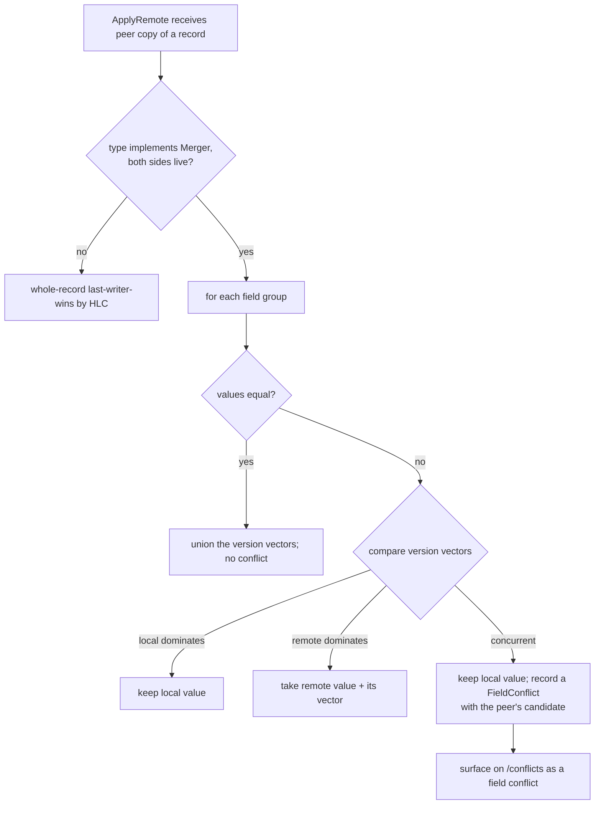

# Replication

This part explains how the peer machines converge on the same records without copying
the database file. For the overview, start at the [architecture index](README.md).

## 10. Replication

Each local mutation is HLC-stamped and appended to the oplog. A node periodically
pulls the peer's oplog events past a stored per-peer watermark over the
transfer-token-gated sync channel (`GET /v1/oplog?since=N`; plain HTTP whose
confidentiality comes from the network - Tailscale/WireGuard or an SSH tunnel, see
[security](security.md)) and applies them with last-writer-wins
(`store.ApplyEvent` -> `ApplyRemote`). A node's oplog holds only its OWN
locally-originated mutations (applying a peer event does not re-log it), so pulling
never echoes back and the two converge without loops. Independent concurrent edits
are resolved deterministically and the conflict is surfaced in the audit log
(`replication_conflict`). Tombstones propagate deletes. With a handful of peer nodes
and rare, human-driven writes, eventual consistency via LWW is sufficient - no
Raft/consensus.

## 10a. Per-field merge (so two machines can edit one record at once)

Plain last-writer-wins copies a record WHOLE: the newer copy overwrites the older
copy entirely. That silently loses data when two machines edit DIFFERENT fields of
the same record at the same time - machine 1 edits a key's note while machine 2
rotates the same key, and one edit vanishes. SopsHQ never loses data silently, so
that is not acceptable.

A record type may instead opt in to **per-field merge** by implementing
`model.Merger`. Today only `Key` does. Such a record is split into named **field
groups** - sets of fields that move together atomically:

| Group     | Fields                                  |
|-----------|-----------------------------------------|
| `name`    | Name                                    |
| `type`    | Type                                    |
| `note`    | Note                                    |
| `keypair` | Recipient + PrivSealed + Generation (atomic - a rotation never splits) |
| `status`  | Status                                  |
| `owner`   | OwnerUserID                             |

Each group carries a small **version vector** in `Meta.FieldVV`: a map of
`node id -> update counter`. When a machine changes a group it bumps only its own
counter (so the new value causally dominates the value it replaced, but stays
concurrent with any change the other machine made that it has not yet seen).

`ApplyRemote` then merges a peer's copy group by group:

- values equal -> converge the vectors (take the componentwise max), nothing to do;
- one vector **dominates** the other -> take the dominant side's value (a CAUSAL
  update - no conflict);
- neither dominates AND the values differ -> a genuine **same-field divergence**:
  keep the LOCAL value untouched and record a machine-local `FieldConflict` holding
  the peer's candidate. Never overwrite.

Version vectors capture causality exactly, so a causal edit never looks like a
conflict and a real conflict is never mistaken for causal. This was chosen over an
HLC+watermark heuristic because it is provably correct, and this path is
data-safety-critical.

**Surfacing and resolving a same-field conflict.** Both machines detect the same
divergence independently (each applies the other's event), so each records its own
`FieldConflict` row - a MACHINE-LOCAL record that never replicates. Both machines
show it on `/conflicts` as a "field" conflict: the two candidate values (a secret
group like `keypair` shows only provenance + the public recipient, never the private
key). The operator resolves it with the SAME two-step, double-confirmed pick used for
duplicate-record merges: choose the winning value, confirm on a second screen. The
choice is written with a version vector that **dominates both candidates**, so it
replicates and the other machine adopts it and clears its own row - convergence with
no further prompt. Re-applying any event is a no-op (idempotent).

**Backward-readable.** A record written before this feature has no `FieldVV`. When a
group has no vector on BOTH sides the merge falls back to whole-record
last-writer-wins by `Meta.Updated` - the previous behavior - so old records load and
merge with no reset or migration. Deletes/tombstones and machine merges also keep the
whole-record path; per-field merge applies only to two live records.

**Shared vault key requirement.** Sealed private-key blobs replicate verbatim and
can be opened on the peer only if both nodes derive the SAME data key. Because the
vault key is derived from the vault key + a FIXED app-wide salt (not a random
per-machine one), this needs nothing more than **the same vault key on both
machines** - there is no salt or KDF parameter to exchange. Linking a machine into the
cluster is therefore: set the same vault key, set the same **transfer key** (the shared
secret that authenticates the agent, stored vault-sealed per machine), and add each
machine on its peers by its Tailscale address (Machines page). Replication then pulls
each peer's oplog over HTTP, authenticated by the transfer key.
