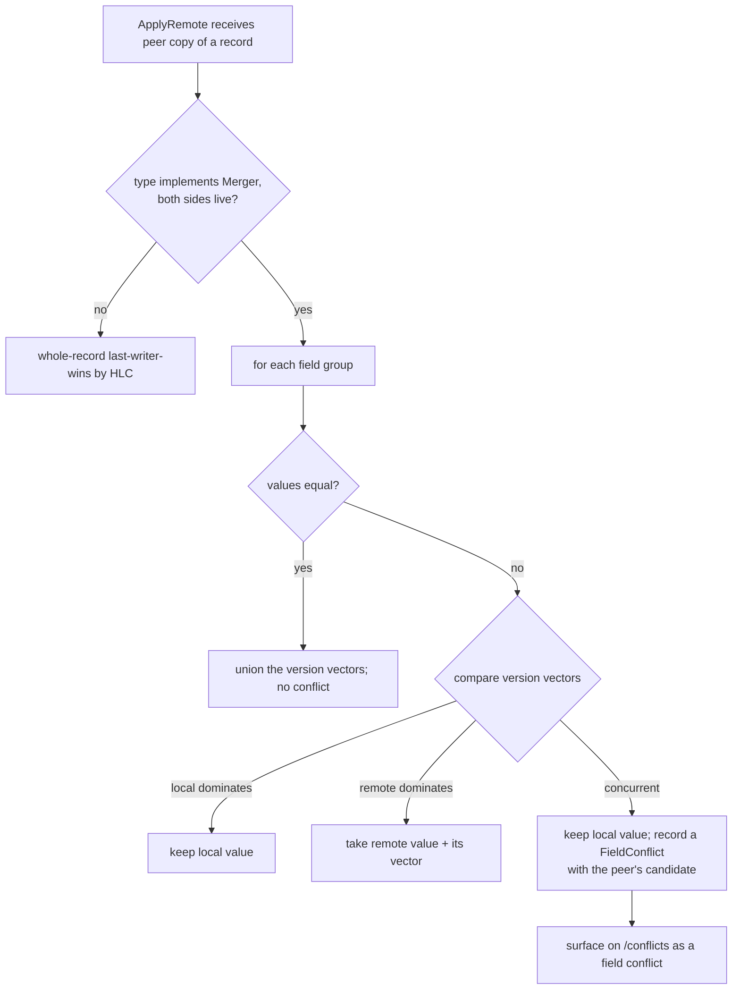

# Replication

This part explains how the peer machines converge on the same records without copying
the database file. For the overview, start at the [architecture index](README.md).

## Contents

- [How replication works](#how-replication-works)
- [Per-field merge](#per-field-merge)
- [Surfacing and resolving a field conflict](#surfacing-and-resolving-a-field-conflict)
- [Records written before per-field merge](#records-written-before-per-field-merge)
- [Linking a machine into the cluster](#linking-a-machine-into-the-cluster)

## How replication works

- **Stamp and log.** Each local change is stamped with a hybrid logical clock (HLC) time
  and appended to this machine's operation log (oplog).
- **Pull.** Every 30 seconds, and when the operator clicks **Sync now**, a machine pulls
  each peer's oplog entries past a stored per-peer watermark (`GET /v1/oplog?since=N`).
  The request carries the transfer key; the channel is plain HTTP whose confidentiality
  comes from the network (see [security](security.md)).
- **Apply.** Pulled entries are applied with last-writer-wins by HLC time, or with
  per-field merge for record types that opt in (below).
- **No echo.** A machine's oplog holds only its own local changes; applying a peer's
  entry does not log it again. So pulling never echoes back, and peers converge without
  loops.
- **Conflicts and deletes.** Independent concurrent edits are resolved the same way on
  every machine, and recorded in the audit log (`replication_conflict`). Deletes travel
  as tombstones.
- **Why no consensus protocol.** With a handful of peers and rare, human-driven writes,
  eventual consistency is enough; there is no Raft or other consensus.

## Per-field merge

Plain last-writer-wins copies a record whole: the newer copy replaces the older one. That
loses data when two machines edit different fields of the same record at the same time,
for example one machine edits a key's note while another rotates the same key. SopsHQ
never loses data silently, so that is not acceptable.

A record type can instead opt in to **per-field merge** by implementing `model.Merger`;
the `Key` record does (see `internal/model/merge.go`). Such a record is split into named
**field groups**, sets of fields that always move together:

| Group     | Fields                                  |
|-----------|-----------------------------------------|
| `name`    | Name                                    |
| `type`    | Type                                    |
| `note`    | Note                                    |
| `keypair` | Recipient, PrivSealed and Generation together, so a rotation never splits |
| `status`  | Status                                  |
| `owner`   | OwnerUserID                             |

Each group carries a small **version vector** in `Meta.FieldVV`: a map from node id to an
update counter. A machine that changes a group raises only its own counter, so the new
value follows the one it replaced, while staying concurrent with any change another
machine made that it has not seen yet.

Applying a peer's copy then works group by group:

- **Values equal:** take the larger counter of each node; nothing else to do.
- **One vector dominates the other:** take the dominant side's value. This is an ordinary
  update, not a conflict.
- **Neither dominates and the values differ:** a real same-field conflict. Keep the local
  value untouched and record a machine-local `FieldConflict` holding the peer's value.
  Never overwrite.

Version vectors capture cause and effect exactly, so an ordinary edit never looks like a
conflict and a real conflict is never mistaken for an ordinary edit. They were chosen
over a clock-and-watermark heuristic because they are provably correct, and this path
decides whether data survives.

## Surfacing and resolving a field conflict

- **Detect.** Both machines find the same divergence on their own, since each applies the
  other's change, and each records its own `FieldConflict`. That record is machine-local
  and never replicates.
- **Show.** Both machines list it on `/conflicts` as a field conflict with the two
  candidate values. A secret group such as `keypair` shows only where each value came
  from and the public key, never the private key.
- **Resolve.** The operator uses the same two-step, double-confirmed pick as for
  duplicate records: choose the winning value, then confirm on a second screen.
- **Converge.** The choice is written with a version vector that dominates both
  candidates, so it replicates, and the other machine adopts it and clears its own record
  with no further prompt. Re-applying any change is harmless.

## Records written before per-field merge

A record written before this feature has no `FieldVV`.

- When a group has no vector on both sides, the merge falls back to whole-record
  last-writer-wins by `Meta.Updated`, so old records load and merge with no reset or
  migration.
- Deletes, tombstones and machine merges also use the whole-record path; per-field merge
  applies only between two live records.

## Linking a machine into the cluster

Sealed private keys replicate byte for byte, and a peer can open them only if both
machines derive the same data key. The vault key is derived from the vault key and a
fixed salt built into SopsHQ, so this needs only **the same vault key on every machine**;
there is no salt or other parameter to exchange (see [security](security.md)).

To link a machine:

1. Use the same vault key as the other machines.
2. Set the same **transfer key**, the shared secret that authenticates the agent, on the
   Machines page (admin). It is stored vault-sealed in `config.jsonc` as
   `transfer_key_sealed`, and takes effect when `serve` restarts.
3. Add each machine on its peers by its Tailscale address (Machines page).

Replication then pulls each peer's oplog over HTTP, authenticated by the transfer key.
