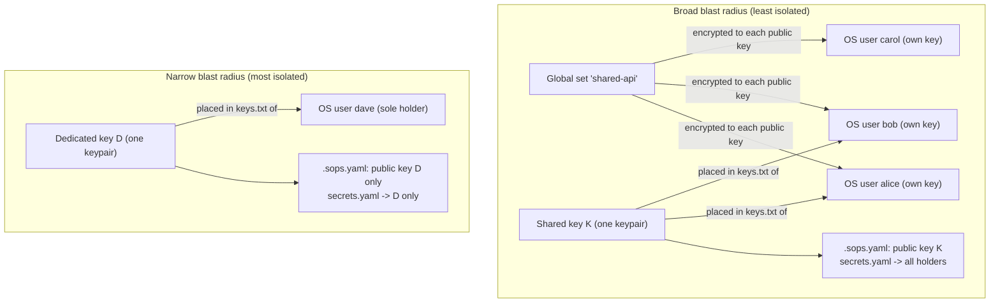

# Key and secret scoping (security models)

This part is a decision aid. It lays out the realistic ways to scope a secret in SopsHQ,
from the **broadest** (many accounts and machines can read it) to the **tightest**
(exactly one). If "key", "public key", "OS user" and "assignment" are new, read the
[everyday flow](keys-rotation-and-flow.md#everyday-flow-define-place-and-use-a-key)
first. For the overview, start at the [architecture index](README.md).

## Contents

- [The one idea: blast radius](#the-one-idea-blast-radius)
- [What is enforced and what is a convention](#what-is-enforced-and-what-is-a-convention)
- [The setups, broadest to tightest](#the-setups-broadest-to-tightest)
  - [Global set, per-user keys as readers](#global-set-per-user-keys-as-readers)
  - [Shared project key across many users](#shared-project-key-across-many-users)
  - [Per-machine key (convention)](#per-machine-key-convention)
  - [Per-OS-user key](#per-os-user-key)
  - [One dedicated key, one holder, one project](#one-dedicated-key-one-holder-one-project)
- [The relationship, drawn](#the-relationship-drawn)
- [The two extremes](#the-two-extremes)
- [Who re-keys and who moves the files](#who-re-keys-and-who-moves-the-files)

## The one idea: blast radius

Everything below is about **blast radius**: if one machine, account or key is
compromised, how many secrets become readable, and by how many principals. A
*principal* is something that can decrypt: a specific **OS user** holding an age
private key in its key store, on a specific **machine**.

Two facts set the radius:

- **A project's `secrets.yaml` is encrypted to every public key of the keys assigned to
  that project.**
  - Each key linked to the project by an **assignment** (key, project, machine and OS
    user) adds its public key to the project's `.sops.yaml`.
  - One assigned key means one public key and the narrowest file; many keys mean a wider
    file. The list of public keys **is** the file's blast radius.
- **A private key is what decrypts, and it lives in an OS user's key store**
  (`<key base>/keys.txt`), never in the project folder. SopsHQ places it there at
  **Apply** time.
  - A **panel user** is only a login to the admin panel. It holds no key and can never
    open a secrets file.

## What is enforced and what is a convention

SopsHQ enforces exactly two key **types**:

- `shared`: one keypair for a project, placed for **several** OS users. Removing a user
  means **rotating** the key, because the old private key is in several stores.
- `per_user`: one keypair **owned by one** OS user, listed among the public keys of
  every project that user can read. Removing that user just **drops their public key**
  and re-keys, with no full rotation.

"Per machine", "global set with every user" and "one dedicated key for one project" are
not separate modes the code enforces. They are **configurations** built from those two
types and from how you write assignments and secret sets. Where a setup below relies on
a convention, it says so.

## The setups, broadest to tightest

"Cost on a membership change" is what the operator must do when someone joins or
leaves.

| Setup | Who can decrypt | Security posture |
|---|---|---|
| Global set, per-user keys as readers | every owner of a selected key | Low |
| Shared project key across many users | every holder of the one private key | Low to medium |
| Per-machine key (convention) | the OS users on one machine per key | Medium |
| Per-OS-user key | one OS user per key | High |
| One dedicated key, one holder, one project | exactly one OS user | Highest |

### Global set, per-user keys as readers

- **What gets a key:** no new key. You select existing `per_user` keys; their owners
  become the set's readers. A **secret set** is a named, project-independent bundle,
  for example a shared `OPENROUTER_API_KEY`.
- **Where the secret lives:** `<key base>/global/<set>/secrets.yaml` in **every**
  reader's key store on one machine. Each copy is opened by that reader's own key.
- **Who can decrypt:** every owner of a selected key. An account whose key is not
  selected cannot read it.
- **Cost on a membership change:** edit the set's readers; SopsHQ re-encrypts the set
  and rewrites the copies. A reader's per-user key is generated on first use if it has
  no keypair yet.

### Shared project key across many users

- **What gets a key:** one `shared` keypair for the project, assigned to several OS
  users, optionally on several machines.
- **Where the secret lives:** the project's own `secrets.yaml`, encrypted to that one
  public key. The one private key is placed in **every** assigned user's key store.
- **Who can decrypt:** every OS user, on every machine, that holds that private key.
- **Cost on a membership change:** a [rotation](keys-rotation-and-flow.md#rotation):
  add the new key, re-key, drop the old. Costly, because the private key is in many
  stores.

### Per-machine key (convention)

- **What gets a key:** a distinct keypair per machine, assigned to that machine's OS
  users. Built from `shared` or `per_user` by how you assign.
- **Where the secret lives:** a project that spans machines lists every machine's public
  key in its `.sops.yaml`, and each machine's `secrets.yaml` copy is re-keyed to that
  list.
- **Who can decrypt:** the OS users on one machine per key.
- **Caveat:** the **sealed** private key replicates into every machine's vault (central
  custody; see [replication](replication.md)). It is **placed** on disk only on its own
  machine. "Never leaves its machine" is true for the key file on disk, not for the
  encrypted vault copy.
- **Cost on a membership change:** adding or removing a machine is a public-key change
  plus `sops updatekeys`, and placing the new key on that machine. No full rotation.

### Per-OS-user key

- **What gets a key:** a `per_user` keypair per OS user, the finest grain.
- **Where the secret lives:** each project the user shares lists that user's public key
  among the others; `secrets.yaml` is encrypted to all of them.
- **Who can decrypt:** one OS user per key.
- **Cost on a membership change:** drop or add that user's public key and run
  `sops updatekeys`. The cheapest change; no rotation.

### One dedicated key, one holder, one project

- **What gets a key:** one keypair, assigned to exactly one OS user on exactly one
  project.
- **Where the secret lives:** that project's `secrets.yaml`, encrypted to only that
  public key.
- **Who can decrypt:** exactly one OS user on one machine; the tightest setup.
- **Cost on a membership change:** membership is fixed at one. Changing the holder means
  reassigning, placing and re-keying. Rare by design.

## The relationship, drawn

Read it as: principals, then keys, then public keys, then `secrets.yaml`. The more keys a
project collects (left), the longer its list of public keys and the more stores hold a
private key that opens it. A single key with a single holder (right) is one public key
and one store.

## The two extremes

- **Broadest** (a global set, or a widely shared key):
  - Convenient: one value, every collaborator reads it, few keys to manage.
  - The cost is blast radius: one leaked key store exposes the value to everyone it was
    shared with.
  - For a `shared` key, removing one person forces a rotation that touches every holder.
- **Tightest** (one dedicated key, one holder, one project):
  - A compromise of any other account or machine cannot read this secret.
  - Revoking the single holder is a local change.
  - The cost is more keypairs, more public keys per project, and more placements to keep
    applied.

## Who re-keys and who moves the files

- **SopsHQ does the re-keying; the operator never runs `sops` by hand.** Apply writes
  each project's `.sops.yaml` from the database and runs `sops updatekeys`, so
  `secrets.yaml` is re-encrypted to the current public keys. Add or drop a public key in
  the panel, Apply, done. Rotation is the two-phase flow in
  [rotation](keys-rotation-and-flow.md#rotation).
- **SopsHQ does not move a project's `secrets.yaml` between machines.**
  - What replicates is **records** (machines, OS users, projects, assignments, keys with
    their sealed private halves) and public keys.
  - The encrypted `secrets.yaml` and `.sops.yaml` travel with the project itself, for
    example committed to git with the code.
  - On each machine that has the project's folder, Apply re-keys the copy already on
    that machine's disk.
  - When the agent asks a peer to re-key, the request carries the folder path and a
    private key that can decrypt the file, never the file's contents.
  - Editing one machine's secrets from another machine's panel is not supported.
