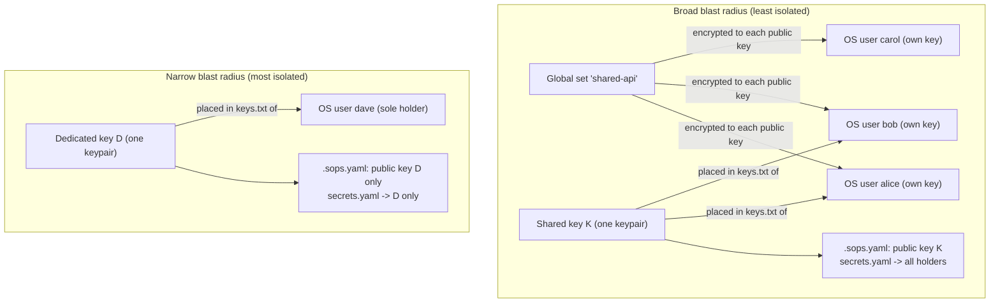

# Key and secret scoping (security models)

This part is a decision aid: it lays out the realistic ways to scope a secret in
SopsHQ, from the **broadest** (many people/machines can read it) to the **tightest**
(exactly one). Read the [everyday flow](keys.md#12-everyday-flow-define-place-and-use-a-key)
first if "key", "public key", "OS user", and "assignment" are not yet familiar; every
term is re-defined here on first use. For the overview, start at the
[architecture index](README.md).

## 17. Key and secret scoping (security models)

### 17.1 The one idea: blast radius

Everything below is about **blast radius** - if one machine, account, or key is
compromised, **how many secrets become readable, and to how many principals**. A
*principal* here is a thing that can decrypt: a specific **OS user** (an
operating-system account, e.g. `alice` on the Linux server) holding an age **private
key** in its key store, on a specific **machine**. Two facts set the radius:

- **A project's `secrets.yaml` is encrypted to ALL public keys of the keys assigned
  to that project.** SopsHQ aggregates them (`keysvc.projectRecipients`): every
  generated key linked to the project by an **assignment** (the join of *key + project +
  machine + OS user*) contributes its **public key** (`age1...`) to the
  project's `.sops.yaml`. One assigned key = one public key = the narrowest file; many
  assigned keys = many public keys = a wider file. So the list of public keys IS the
  blast radius of that file.
- **A private key is what actually decrypts, and it lives in an OS user's key store**
  (`<key base>/keys.txt`), never in the project folder. SopsHQ places it there at
  **Apply** time. A **panel user** is only a login to the admin panel - it holds no
  key and can never open a secrets file; encryption and decryption are about OS users +
  keys, never panel logins.

### 17.2 What is enforced vs. what is a convention

SopsHQ enforces exactly **two** key *types* (`internal/model`):

- `shared` - one keypair for a project, placed for **several** OS users. Removing a
  user means **rotating** the key (the old private is in several stores).
- `per_user` - one keypair **owned by a single** OS user, listed as one of several
  public keys on the projects that user accesses. Removing that user just **drops their
  public key** and re-keys (no full rotation).

"Per-machine", "global set with every user", and "one dedicated key for one project"
are **not separate modes the code enforces** - they are *configurations* you build out
of those two types plus how you write assignments and global sets. Where a row below
relies on a convention rather than an enforced rule, it says so.

### 17.3 The scoping matrix (broadest -> tightest)

Rows run from least isolated (top) to most isolated (bottom). "Operational cost"
is what an operator must do when **membership changes** (someone joins or leaves).

| Setup | What gets a key (granularity) | Where the secret lives / its scope | Who can decrypt (blast radius) | Operational cost on a membership change | Security posture |
|---|---|---|---|---|---|
| **Global set, per-user keys as readers** | No new key type - you SELECT existing `per_user` keys, each owned by an OS user. A **global set** is a named, project-independent bundle (e.g. a shared `OPENROUTER_API_KEY`). The selected keys' OWNERS become the set's readers. | `<key base>/global/<set>/secrets.yaml` written into **every** owner's key store on **one machine**; byte-identical copies, each readable by that user's own key. Scope = the owners of the selected keys. | Every owner of a selected key - i.e. **all of them when you pick all their keys** (the broadest read). A user whose key is *not* selected still cannot read it. | Re-run set creation / edit its readers, then SopsHQ re-encrypts the set and re-syncs the copies (`keysvc.SetGlobalSecret`/`resolveSet`). An owner's per-user key is minted on first use if still defined-only. | Low |
| **Shared project key across many users/machines** | One `shared` keypair for the project, **assigned to several OS users** (optionally on both machines). | The project's own `secrets.yaml`, encrypted to that **one** public key. The **one** private key is placed into **every** assigned user's key store. | Every OS user (on every machine) that holds that one private key. | **Rotation** (two-phase, see [Rotation](keys.md#9-rotation)): add the new key, re-key, drop the old. Costly because the one private is in many stores. | Low-medium |
| **Per-machine key (convention)** | A **distinct** keypair per machine, each assigned to that machine's OS user(s). Built from `shared`/`per_user` by how you assign. | A project that spans both machines lists **both** public keys in its `.sops.yaml`; each machine's `secrets.yaml` copy is re-keyed to that set. | The OS users on **one** machine per key. **Caveat:** the *sealed* private replicates into **both** machines' vaults (central custody, see [Replication](replication.md#10-replication)), so it is *placed* (written to `keys.txt`) only on its own machine - "never leaves its machine" is true for **placement on disk**, not for the encrypted vault copy. | Add/remove a machine = a **public-key change + `sops updatekeys`** (and placing the new key on that machine). No full rotation. | Medium |
| **Per-OS-user key** | A `per_user` keypair **per OS user** (`Key.OwnerUserID` set) - the finest grain. | Each project the user shares lists that user's public key among the others; `secrets.yaml` is encrypted to the union. | That **single** OS user per key. | Add/remove a user = **drop their public key + `sops updatekeys`**. Cheapest membership change (no rotation). | High |
| **One dedicated key, one holder, one project** | A single keypair, assigned to **exactly one** OS user, on **exactly one** project. | That project's `secrets.yaml`, encrypted to **only** that one public key. | **Exactly one** OS user on one machine - the tightest. | Membership is fixed at one; changing the holder = reassign + place + re-key. Rare by design. | Highest |

### 17.4 The relationship, drawn

Read it as: **principals -> keys -> public keys -> `secrets.yaml`.** The more keys a
project aggregates (left), the longer its list of public keys and the more stores hold a
private that opens it. A single key with a single holder (right) is one public key and
one store.

### 17.5 The two extremes, and who moves the files

- **Broadest (a global set or a widely shared key):** convenient - one value, every
  collaborator reads it, the smallest number of distinct keys to manage. The cost is
  blast radius: one leaked key store exposes the value to everyone it was shared with,
  and (for a `shared` key) removing one person forces a rotation that touches every
  holder.
- **Tightest (one dedicated key, one holder, one project):** a compromise of any other
  account or machine cannot read this secret, and revoking the single holder is a
  local change. The cost is multiplicity: more keypairs, more public keys per project,
  and more placements to keep applied.

Two operational facts make either extreme practical:

- **SopsHQ automates the re-keying - the operator never runs `sops` by hand.** Apply
  writes each project's `.sops.yaml` from the database and runs `sops updatekeys` so
  `secrets.yaml` is re-encrypted to the **current** set of public keys (`keysvc.ApplyLocal`
  / `ApplyAll`; rotation is the two-phase flow, see [Rotation](keys.md#9-rotation)). Add
  or drop a public key in the panel, Apply, done.
- **SopsHQ does NOT transport a project's `secrets.yaml` between machines.** What
  replicates is **records** (machines, OS users, projects, assignments, keys - the
  sealed private included) over the oplog, plus public keys. The encrypted
  `secrets.yaml` and `.sops.yaml` are **decrypt-path files that travel with the
  project deployment** (they are committed to git alongside the code). On each machine
  that has the project's local folder, Apply re-keys the copy **already on that
  machine's disk** in place (the agent's `updatekeys` call carries only the directory
  and a decrypting private key, never the file's contents). Editing a machine's
  secrets from another machine's panel is out of scope.
