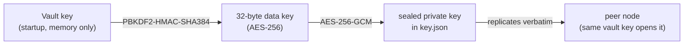
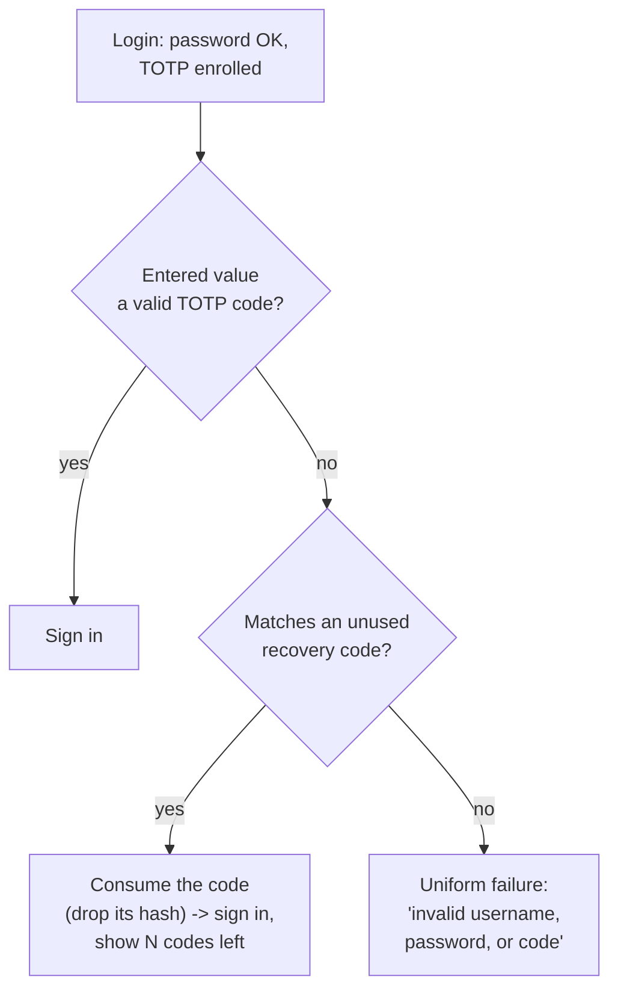

# Security model

This part covers how SopsHQ protects data at rest and in transit, how login and auditing
work, how a lost authenticator never shuts the operator out for good, and how updates
are trusted. For the overview, start at the [architecture index](README.md).

## Contents

- [Overview](#overview)
- [At rest](#at-rest)
- [In transit](#in-transit)
- [Login and sessions](#login-and-sessions)
- [Audit and boot](#audit-and-boot)
- [Two-factor recovery](#two-factor-recovery)
  - [Recovery codes](#recovery-codes)
  - [Other ways back in](#other-ways-back-in)
- [Updates and release signing](#updates-and-release-signing)

## Overview

The age key pairs SopsHQ manages are X25519, which is **classical** cryptography, not
post-quantum. That is separate from SopsHQ's own sealing at rest (AES-256-GCM with a
SHA-384 based key derivation) and from the transport described below.

## At rest

- Private keys are sealed with AES-256-GCM.
- On top of that, all the machine's stored data (the record store `*.json`, the
  replication oplog and the audit log) is sealed with AES-256-GCM under a store key
  derived from the vault key (HKDF-SHA-384).
- So the disk reveals neither secret values nor the shape of the setup.
- The data is readable only after the vault unlocks, and the vault never unlocks at
  boot. See [encryption at rest](storage-backup-recovery.md).

## In transit

**Machine to machine:**

- Plain HTTP with the shared **transfer token** in an `Authorization: Bearer` header.
  The token is compared in constant time; a wrong or missing token is rejected.
- There is no TLS in the app. Confidentiality comes from the network: the agent binds
  loopback or a Tailscale address (WireGuard-encrypted, tailnet only).
- The oplog snapshots that cross the wire carry only vault-sealed private keys, never
  plaintext.

**Browser to panel:**

- The panel is served over plain HTTP, bound to loopback (reach it through an SSH
  tunnel) or a Tailscale address. There are no certificates and no trust warnings.
- The session cookie's `Secure` flag is set only over TLS, so it is off on this plain
  HTTP panel. That is safe on loopback or Tailscale.
- Secret entry fields are kept away from password managers; see "Form field identity"
  in [system shape](system-shape.md).

## Login and sessions

- **Password:** hashed with PBKDF2-HMAC-SHA384.
- **Second factor:** a TOTP code, or a one-time recovery code.
- **Session cookie:** HttpOnly and SameSite=Strict, `Secure` only over TLS. A session
  lasts 12 hours.
- **CSRF:** every request that changes something carries a CSRF token.
- **Lockout:** after 5 failed logins in a row for one username, that username is locked
  for 60 seconds and the lockout event fires. The counters live only in memory.

## Audit and boot

- **Audit:** actions are logged by name or UUID only and secrets are never recorded. The
  log is sealed with AES-256-GCM under the store key.
- **Boot:** the vault never unlocks on its own; the operator supplies the vault key.

## Two-factor recovery

A lost authenticator must never shut the operator out for good. Every way back in rests
on one fact: the login flow sends any user whose two-factor is **not enrolled** to the
enrollment page. So "reset two-factor" simply clears the enrolled flag and lets the user
enroll again.

### Recovery codes

- **Created at every enrollment:** ten one-time codes, for example `abcd-2345-wxyz`,
  from `crypto/rand` over an alphabet without look-alike characters.
- **Shown once,** beside the QR code. Enrollment completes only after the user confirms
  "I have saved these".
- **Stored as hashes only** (PBKDF2-HMAC-SHA384) on the user record. The plain code is
  never shown again and never logged.
- **At login:** if the entered value is not a valid TOTP code, SopsHQ tries the recovery
  codes. A match is **used up** (its hash is removed), the user signs in, and the page
  shows how many codes remain.
- **Uniform failure:** the error message never reveals which factor was wrong.

### Other ways back in

- **Self re-enroll:** a signed-in user opens **Account** and enrolls again. A new TOTP
  secret and a new set of recovery codes replace the old ones at once.
- **Admin reset:** on the **Users** page an admin resets another user's two-factor. The
  user enrolls again at next login.
- **CLI two-factor reset:** `sopshq reset-2fa -user NAME` opens the store with the vault
  key and does the same. It covers a sole admin with no recovery code left.
- **CLI full recovery:** `sopshq reset-admin -user NAME` is the way back in when the
  **password** is lost too.
  - It opens the store with the vault key and asks for a new password twice, never
    echoed.
  - It restores the named panel login, or creates it if it is gone, sets the new
    password and clears two-factor. The user then signs in with the password and
    enrolls a new authenticator.
  - A panel login belongs to one machine and is never replicated, so this affects only
    the machine it runs on.

Every recovery event is audited by event name and username only:
`login_recovery_code`, `totp_reenroll_start`, `reset_2fa_admin`, `reset_2fa_cli`,
`reset_admin_cli`, `reset_admin_cli_restored`.

## Updates and release signing

**This snapshot embeds no release signing key, so `sopshq update` refuses every update
until a fork embeds its own key.** How a fork makes a key, signs releases and points
installs at its repository is in [releasing](../releasing.md). The trust model is:

- **What is trusted:** a release only when its `SHA256SUMS` carries a valid ML-DSA-65
  signature (`crypto/mldsa`) from a public key built into the running binary, and the
  binary's SHA-256 matches its line in that file. Nothing in the download folder, the
  GitHub account or the release tag is trusted on its own.
- **No replay:** the version is inside the signed bytes, and the updater refuses an
  equal or older version.
- **A known limit:** there is no signed "latest version" manifest, so an attacker who
  can withhold releases can keep an install on an old version without it noticing.
- **Key rollover:** the binary embeds a primary and an optional next public key and
  accepts a signature from either, so the signing key can change without stranding
  installs. An empty primary slot refuses every update, whatever the next slot holds.
- **Drafts and unsigned releases:** `sopshq update` ignores draft releases and refuses a
  release with no signature.
- **Root runs only trusted binaries:** before root runs any binary's `version`, the
  binary and every folder above it must be root-owned and not group or world writable.
  System programs such as `systemctl` and `gh` are called at fixed absolute paths, never
  through `PATH`.
- **Privilege drop for the download:** under `sudo`, `gh` runs as the invoking user, so
  root never holds a GitHub token. Root then copies the files into a root-owned folder,
  refusing links, special files and oversized files, and verifies the copies.
- **The vault stays locked:** an update restarts the service, which starts locked. The
  command never asks for or stores the vault key.
- **A failed start rolls back:** the old binary is backed up first and restored
  automatically if the new one does not start and report its version.

See [updating](../deployment.md#updating-linux) for the operator's view.
