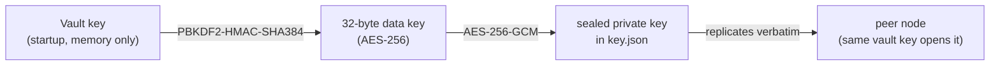
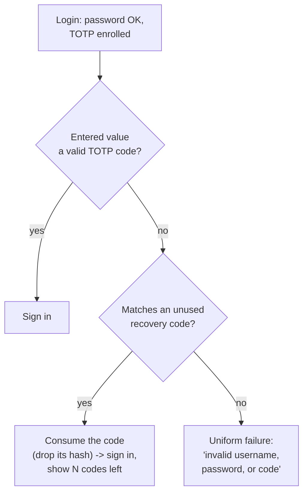

# Security model

This part covers how SopsHQ protects data at rest and in transit, how login and
auditing work, and how a lost authenticator never shuts the operator out for good. For
the overview, start at the [architecture index](README.md).

## 7. Security model

- **At rest:** private keys are AES-256-GCM sealed; on top of that, the whole
  machine-local persisted data - the record store (`*.json`), the replication
  oplog, and the audit log - is itself AES-256-GCM sealed under a vault-derived
  store key (HKDF-SHA-384 over the master key), so the disk reveals neither secret
  values nor the shape of the setup. It is only readable after the vault unlocks
  and never auto-unlocks at boot (see
  [encryption at rest](storage-backup-recovery.md#145-encryption-at-rest-sealing-the-on-disk-data)).
- **In transit (machine-to-machine):** plain HTTP carrying the **shared transfer
  token** in an `Authorization: Bearer` header (a constant-time check; a wrong or
  missing token is rejected). There is no app-layer TLS; confidentiality comes from
  the network - the agent binds loopback or a Tailscale address (WireGuard-encrypted,
  tailnet-only). The oplog snapshots that cross the wire carry only vault-SEALED
  private keys, never plaintext.
- **In transit (browser-to-panel):** the admin panel is served over plain HTTP, bound
  loopback (reach it through an SSH tunnel) or a Tailscale address. There are no
  certificates and no trust warnings; the session cookie's `Secure` flag is simply off
  over HTTP, which is safe on loopback/Tailscale. Login (password + TOTP) and CSRF
  still gate every request.
  Secret entry fields are kept out of password-manager reach; see "Form field identity" in
  [system-shape.md](system-shape.md).
- **Auth:** PBKDF2-HMAC-SHA384 passwords + TOTP; HttpOnly, SameSite=Strict session
  cookies (Secure only over TLS, so off on the plain-HTTP panel); CSRF tokens on mutating requests. Repeated failed logins for a username
  temporarily block sign-in for that username (a short, in-memory, per-process window)
  and fire the lockout event.
- **Audit:** actions logged by name/UUID only; secrets never recorded; the log is
  AES-256-GCM sealed on disk under the vault-derived store key.
- **Boot:** the vault is never auto-unlocked; the operator supplies the vault key.

The age key pairs SopsHQ manages are X25519, which is **classical** cryptography (not
post-quantum). That is separate from SopsHQ's own at-rest sealing (AES-256-GCM +
SHA-384 KDF) and from the machine-to-machine transport posture above.

### 7.1 2FA recovery (no permanent sign-in block)

A lost authenticator must never shut the operator out for good. Four mechanisms,
all leaning on the same fact: the login flow already sends any user whose 2FA is
**not enrolled** to the enrollment page, so "reset 2FA" simply means clearing the
`TOTPEnabled` flag and letting them re-enroll.

- **Recovery codes.** At **every** enrollment, SopsHQ generates ten one-time codes
  (e.g. `abcd-2345-wxyz`, from `crypto/rand` over an unambiguous alphabet), shows
  them **once** beside the QR, and requires an "I have saved these" confirmation
  before enrollment completes. Only the PBKDF2-HMAC-SHA384 **hashes** are stored on
  the user (`PanelUser.RecoveryCodes`). At login, if the entered value is not a
  valid TOTP code, SopsHQ tries the recovery codes; on a match it **consumes** that
  code (drops its hash, persists) and signs in, showing how many remain. The login
  failure message stays uniform so it never reveals which factor was wrong.
- **Self re-enroll.** A logged-in user opens **Account** and re-enrolls: a fresh
  TOTP secret is sealed, a new QR and a new recovery-code set are shown, and the old
  secret and codes are invalidated immediately.
- **Admin reset.** On the **Users** page an admin can reset another user's 2FA,
  rotating their TOTP secret and clearing their recovery codes so they re-enroll at
  next login.
- **CLI escape hatch (two-factor).** `sopshq reset-2fa -user NAME` opens the store with
  the vault key and does the same for the sole-admin-with-no-backup-code case.
- **CLI full recovery (password + two-factor).** `sopshq reset-admin -user NAME` is the
  guaranteed way back in when the **password itself** is lost and no recovery code works.
  It opens the store with the vault key, prompts for a new password twice (never echoed),
  and restores the named panel login (or creates it if it is gone), setting the new
  password and clearing two-factor - so the next sign-in is password-only and the
  operator re-enrolls an authenticator. It writes through the sealed store and audits by
  username only (`reset_admin_cli` / `reset_admin_cli_restored`); no secret is printed.
  Because a panel login is a per-machine credential that is never replicated, this only
  affects the machine it is run on.

Recovery codes are credentials: only their hashes are stored, the plaintext is
shown exactly once and never re-displayable, and a code value is never logged or
written to an audit row (audited by event - `login_recovery_code`,
`totp_reenroll_start`, `reset_2fa_admin`, `reset_2fa_cli`, `reset_admin_cli` - only).

### 7.2 Updates and release signing

`sopshq update` replaces the installed binary while running as root, so it is the one
place SopsHQ executes downloaded code with privilege. Why it is built the way it is:

- **Trust model.** A release is trusted only if `SHA256SUMS` carries a valid ML-DSA-65
  signature (`crypto/mldsa`) from a public key built into the running binary, and the
  binary's SHA-256 matches its line in that file. Nothing in the download folder, the
  GitHub account or the release tag is trusted on its own. The version is inside the
  signed bytes, and the updater refuses an equal or older version, so an old signed
  release cannot be replayed. A limit that remains: a signed "latest" or "minimum
  version" manifest does not exist, so an attacker who can withhold releases can keep an
  install on an old version without it noticing.
- **One key, with a rollover slot.** The binary embeds a primary public key and an
  optional next key and accepts a signature from either, so the signing key can be
  rotated without stranding installed binaries. An empty primary slot refuses every
  update, whatever the next slot holds. The private seed lives only on the
  operator's machine and is never given to GitHub or CI: CI builds a draft release, and
  the operator signs it locally with `releasesign publish`, which refuses a seed that
  matches neither embedded key, a release that is not a draft, one already signed, and
  one whose signed version differs from its tag. The signer trusts that the draft is what
  CI built, so the operator looks at the workflow run before signing. `sopshq update`
  ignores draft releases and refuses a release with no signature.
- **Root runs only verified or root-owned binaries.** Before root runs any binary's
  `version`, the binary and every folder above it up to `/` must be root-owned and not
  group or world writable. The staged release is run only after signature and checksum
  pass, and from a root-owned staging folder. System programs (`systemctl`, `gh`) are
  called at fixed absolute paths, never through `PATH`.
- **Privilege drop for the download.** Under `sudo`, `gh` runs as the invoking user with
  root's privileges, groups and environment dropped, so root never holds or forwards a
  GitHub token. Root copies the downloaded files into a root-owned folder (refusing
  links, non-regular files and oversized files) and verifies the copies.
- **The vault stays locked.** An update restarts the service, which starts locked. The
  command never asks for, receives or stores the vault key and never unlocks.
- **A failed start rolls back.** The old binary is backed up first and restored
  automatically if the new one does not start and report its version on the status
  socket. Termination signals are ignored while the service is stopped.

See [Updating](../deployment.md#updating-linux) for the operator view.
