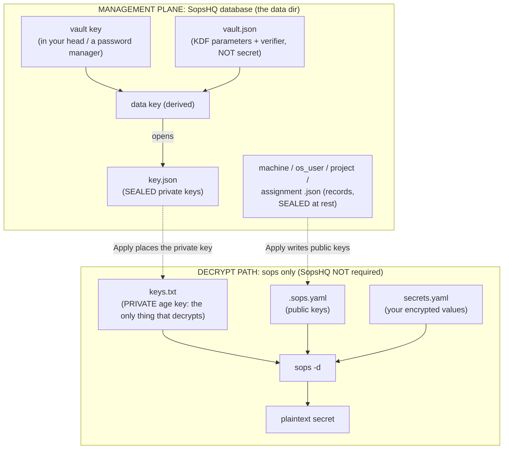
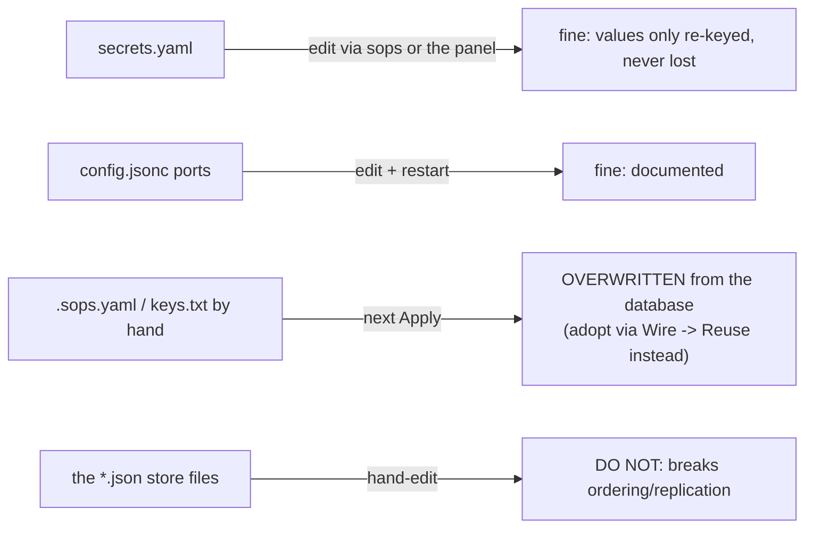
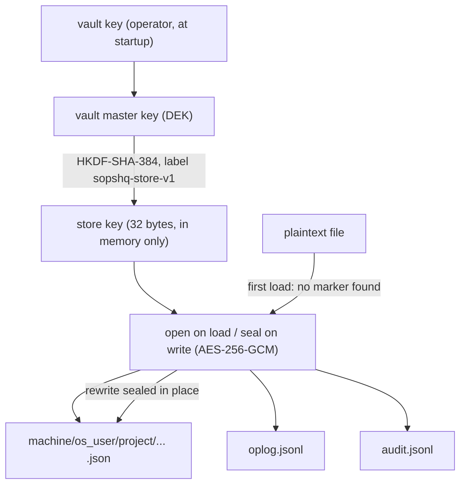
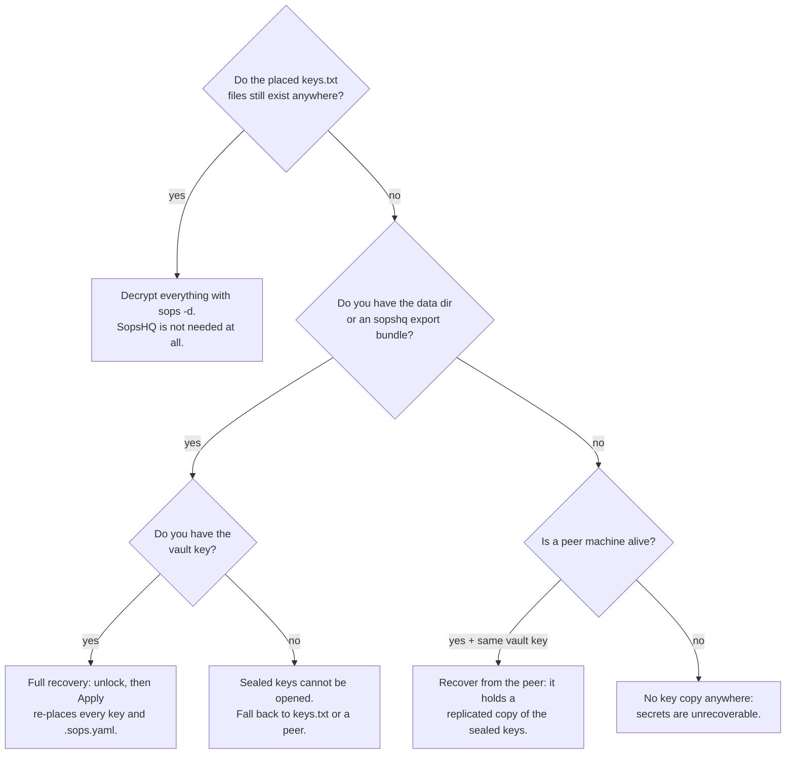
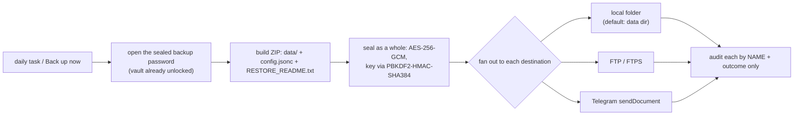

# Storage, backup, and recovery

This part maps every file SopsHQ and `sops` use: where it lives, whether it is secret,
what you may change by hand, what to back up, and what is safe to lose because it can be
re-created. It then explains how the on-disk data is sealed, what you can recover from
what survives, and the scheduled self-backup. For the overview, start at the
[architecture index](README.md).

## Contents

- [The two worlds](#the-two-worlds)
- [The sops files (decrypt path)](#the-sops-files-decrypt-path)
- [The SopsHQ files (management database)](#the-sopshq-files-management-database)
  - [Identity and custody](#identity-and-custody)
  - [Operational records](#operational-records)
  - [Logs, tokens and state that can be rebuilt](#logs-tokens-and-state-that-can-be-rebuilt)
- [What you can change, and what you must not](#what-you-can-change-and-what-you-must-not)
- [Encryption at rest](#encryption-at-rest)
- [What to back up](#what-to-back-up)
- [Recovery: what survives decides what you can do](#recovery-what-survives-decides-what-you-can-do)
- [Scheduled self-backup](#scheduled-self-backup)
  - [What a backup is](#what-a-backup-is)
  - [The backup password](#the-backup-password)
  - [The schedule and the destinations](#the-schedule-and-the-destinations)
  - [Security posture](#security-posture)

## The two worlds

There are two separate sets of files; the split explains everything else.

- The **decrypt path** (left) is all you need to read a secret; it does not involve
  SopsHQ.
- The **management plane** (right) is SopsHQ's database. Its job is to produce and
  maintain the decrypt-path files when you click **Apply**.

## The sops files (decrypt path)

These live wherever your keys and projects are, outside the SopsHQ data folder.

| File | Where (example) | Secret? | What it is | Hand-edit? | Recreatable? |
|---|---|---|---|---|---|
| `keys.txt` | `<key base>/keys.txt` | **YES (private)** | The age private keys, one per line: the ONLY thing that can decrypt. | Apply rewrites it; a key SopsHQ does not know is dropped. [Adopt it instead](#what-you-can-change-and-what-you-must-not). | Only if a copy exists (the vault, a peer, a backup). **Lose every copy and the secrets are gone.** |
| `keys.pub` | `<key base>/keys.pub` | no | The public keys. Documentation only. | yes (harmless) | Yes: `age-keygen -y` derives it. |
| `.sops.yaml` | `<project>/.sops.yaml` | no | Which public keys a project encrypts to. Committed to git. | Apply rewrites it (unless Reuse was chosen). | Yes: Apply rewrites it. |
| `secrets.yaml` | `<project>/secrets.yaml` | values encrypted | Your secrets, encrypted. Committed to git. | yes, with `sops` or the panel | No: this IS your data. |
| discovery (`SOPS_AGE_KEY_FILE`, `~/.config/sops/age/keys.txt`, `%USERPROFILE%\.sops` junction) | environment and home | no | How sops *finds* `keys.txt`. | yes | Yes: Apply re-creates it. |

The one irreplaceable file here is `keys.txt`.

## The SopsHQ files (management database)

An install has one **data base** folder (on Linux `/srv/sopshq` by default). It holds
`config.jsonc` and the **data folder** `data/`, where everything else lives. The location
pointer is the one file outside it.

In the tables, "Delete it?" says whether the app rebuilds the file or whether deleting it
loses something for good. "Sealed at rest" means the file holds no secret value but is
encrypted on disk all the same (see [encryption at rest](#encryption-at-rest)).

**Sealed on disk:** every record file below, the oplog, the audit log, the audit archive
and the permission-map files.

**Not sealed:** `config.jsonc` (it holds only a sealed transfer key), `vault.json`, the
ingest token, the usage log, the content stamps, the replication state files and the shim
scripts. They carry no infrastructure layout, or are needed before the vault is unlocked.

### Identity and custody

The irreplaceable core: back these up.

| File | Secret? | What it is, and what writes it | Delete it? |
|---|---|---|---|
| `config.jsonc` (data base, next to `data/`) | holds one sealed value | Node config; see the list below. Written by `sopshq init` and the panel; ports may be edited by hand. Included in every export and backup archive. | **Avoid.** If it is lost, `init` writes a new one with a **new `node_id`**, which breaks replication identity, and the ports, paths and transfer key are lost. Back it up. |
| `data/key.json` | **YES: sealed** | Key records, each holding the age **private key sealed** with AES-256-GCM (SopsHQ's custody copy). Written on Generate, Rotate and adopt. | **No: critical.** The app never rebuilds your keys. With no backup, peer, or placed `keys.txt`, losing it makes the secrets undecryptable. |
| `data/vault.json` | no | The vault's KDF parameters (the salt, which is fixed in SopsHQ, and the iteration count) and a sealed **verifier** that checks the vault key. Not the vault key and not any derived key. Written by `sopshq init`. | Avoid, but recoverable: the same vault key derives the same key on any install, so a re-init with it writes an equivalent file. |
| `data/panel_user.json` | **hashes and sealed** | Panel logins: password and recovery-code **hashes** (PBKDF2-HMAC-SHA384) and the **vault-sealed TOTP secret**. Written by first-run setup and the Users page. Never replicated. | No: deleting it removes every login; you would redo first-run setup and enrol two-factor again. |

What `config.jsonc` holds:

- `node_id` (this machine's replication identity) and `node_name`;
- `local_machine_id` (which Machine record is this machine);
- `panel_listen` and `agent_listen`;
- `data_dir` and `vault_dir`;
- `keybase_root` (optional; see [keys](keys.md));
- `transfer_key_sealed` (the vault-sealed transfer key);
- `audit_retention`, `permission_map` and `release_repo`.

Peers are Machine records in the store, not config entries. Backup and notification
settings are database records too.

### Operational records

Your data: re-entered by hand if lost, not rebuilt.

| File | Secret? | What it is, and what writes it | Delete it? |
|---|---|---|---|
| `data/machine.json` | sealed at rest | This machine and its peers, with each peer's Tailscale address and agent port. Machines page. | No: you would re-add machines. |
| `data/os_user.json` | sealed at rest | Which account holds keys on which machine, and its key-store base. An **empty** base means "under the keys root": `<keybase_root>/<username>` from THIS machine's config. OS users page. | No: re-enter. |
| `data/project.json` | sealed at rest | Name, note, and folder per machine. Projects page. | No: re-enter. |
| `data/assignment.json` | sealed at rest | Which key is granted to which project, machine and OS account. Project page. | No: re-enter. |
| `data/global_set.json` | sealed at rest | A global set's name and reader accounts (not the values, which live in `<keybase>/global/<set>/secrets.yaml`). Global page. | No: re-create the set; the encrypted value files are separate. |
| `data/backup_settings.json` | sealed at rest | Each machine's backup schedule, sealed backup password and sealed destination credentials. Settings page. | No: you would set backups up again. |
| `data/notification_settings.json` | sealed at rest | Each machine's alert channels (sealed tokens) and event choices. Settings page. | No: you would set alerts up again. |
| `data/map_view.json` | sealed at rest | Custom Map views (name, grouping order, leaf). Map editor. | Yes: the built-in views still work; you lose only custom views. |
| `data/distinct_ack.json` | sealed at rest | "Keep both" decisions from the Conflicts page. | Yes, but the duplicates they covered are listed again. |
| `data/field_conflict.json` | sealed at rest | Open same-field conflicts. Machine-local, never replicated. | Avoid: an open conflict disappears from the Conflicts page, and the peer's value it held is lost on this machine. |

### Logs, tokens and state that can be rebuilt

| File | Secret? | What it is, and what writes it | Delete it? |
|---|---|---|---|
| `data/oplog.jsonl` | sealed at rest | This machine's append-only replication log, in HLC order. Written on every change. | Current state survives in the `*.json` files, but replication history is lost and a peer may need a full re-sync. Avoid unless resetting replication. |
| `data/audit.jsonl` | sealed at rest | Append-only audit history: who did what, to which target, with what outcome (by name or id, never a value). Appended on every action. | Yes: a fresh log starts; past history is lost. |
| `data/audit-archive/` (with export-then-purge retention) | sealed at rest | Audit entries the retention policy removed, archived first. | Yes: history only. |
| `data/permmap/latest.jsonl.gz.sealed`, `data/permmap/baseline.jsonl.gz.sealed` (only when the permission auditor is on) | sealed at rest | The latest filesystem permission scan and the drift baseline. Machine-local, never replicated. | Yes: re-scan; re-set the baseline. |
| `data/ingest.token` | semi | A random token that authorizes the usage-shim ingest endpoint. Written by `serve` if missing. | Yes: regenerated on the next start; the shim reads it from this file. |
| `data/usage.jsonl` (once a shim reports a decrypt) | no | Best-effort per-machine key-usage log. | Yes: history only. |
| `data/shim/sops` (Linux), `data/shim/sops.cmd` and `data/shim/sops-wrapper.ps1` (Windows) | no | The usage-shim wrapper scripts; your `PATH` points at this folder (on Linux through a marked block in `~/.bashrc`). Written by **Install usage shim** on the Usage page. | Yes: reinstall the shim to count usage again. |
| `data/stamps.json` | no | SHA-384 stamps of each managed file, for the change guard (hashes and secret names, never values). Machine-local. | Yes: the next write re-stamps; one round of change detection is lost. |
| `data/peers_ack.json`, `data/watermarks.json` | no | Which peers this machine has acknowledged, and how far it has pulled each peer's oplog. | Yes: rebuilt; a peer may be pulled again in full. |
| `data/serve.lock`, `data/sopshq.pid`, `data/serve.log` | no | The single-instance lock, and the pid file and log of a background `sopshq start`. | Yes, when SopsHQ is not running. |
| location pointer (outside the data base) | no | Where the install lives, so a bare `sopshq` run finds it. See below. | Yes: setup recreates it. |

The location pointer:

- **Per user:** `%AppData%\sopshq\location` on Windows, `~/.config/sopshq/location` on
  Linux. Written only when it lands outside the data base.
- **Machine-wide (Linux system install):** `/etc/sopshq/location`. A system install whose
  service account has its home set to the data base uses this one, because a per-user
  pointer would sit on the locked data volume.

## What you can change, and what you must not

- **Safe to change:**
  - `secrets.yaml`: values are only re-encrypted, never destroyed;
  - the ports in `config.jsonc`: edit, then restart.
- **Will be overwritten:** `.sops.yaml` and `keys.txt`. Apply rewrites them from the
  database, and a key added by hand that SopsHQ does not know is dropped on the next
  Apply. To keep it, adopt it: set the project's folder and choose **Wire, then Reuse**.
  That reads the private key on disk, seals it into the vault, and leaves the file
  byte-identical, so existing secrets still decrypt.
- **Never edit by hand:** the `*.json` store files and `oplog.jsonl`. They are sealed,
  time-stamped and replicated; use the panel.

## Encryption at rest

The vault seals the **private keys**. The other store records, the oplog and the audit log
hold no secret *values*, but they reveal the **shape** of your setup: machine names,
Tailscale hosts, project and folder paths, OS account names, key-store locations. SopsHQ
seals them too, so reading the disk alone reveals nothing.

- **The key.** When the operator unlocks the vault at startup, SopsHQ derives a separate
  32-byte **store key** from the vault master key with **HKDF-SHA-384** under a fixed label
  (`sopshq-store-v1`).
  - It is stable across runs: the same vault key always gives the same store key.
  - It is different from the key that opens private keys, so a leak of one is not the
    other.
  - It lives only in memory after unlock, so the data **never unlocks at boot**.
- **The seal.** Each file is sealed as a whole with **AES-256-GCM**, the same
  authenticated cipher the vault uses: a fixed ASCII marker, a random nonce, then the
  ciphertext and tag.
  - Reads decrypt in memory after unlock; every atomic write (temporary file and rename)
    seals again.
  - The audit log and oplog are append-only, so an append reads and decrypts the file,
    adds the line, and rewrites the sealed file. That is cheap at SopsHQ's human-driven
    volume.
- **Plaintext files are sealed on first load.** A sealed file starts with the marker, so a
  loader can tell it from a plaintext one. A plaintext file found at load is rewritten
  sealed in place, with no operator action and no way back.
- **Unlock before open.** Every command that opens the store or the audit log unlocks the
  vault first: `serve` (and a background `start`) before opening anything, and
  `reset-2fa` and `reset-admin` before they touch the store. Opening a sealed file without
  the vault key fails loudly rather than returning garbage.
- **Independent of sync.** Each machine seals its own data with its own store key. The
  oplog format peers exchange, and the agent and replication protocol, do not depend on
  it. A restored backup opens on a new machine because the same vault key gives the same
  store key there.

## What to back up

1. **The vault key.** It is in no file; keep it in a password manager.
2. **A backup archive.** One AES-256-GCM-encrypted ZIP holding the whole data folder
   (sealed keys, records, `vault.json`, oplog, audit log), `config.jsonc`, and a plain
   `RESTORE_README.txt`.
   - Make one with `sopshq export`, or with the [scheduled self-backup](#scheduled-self-backup).
   - Restore with `sopshq restore -in FILE -dir DEST` and the **backup password**.
   - Keep that password in your password manager too: it is never stored in the clear and
     cannot be recovered from the archive.
3. **The placed `keys.txt` files, offline.** The last-resort way to decrypt, independent
   of SopsHQ.

## Recovery: what survives decides what you can do

**The vault key alone recovers nothing.** Opening a sealed private key needs the sealed
copy (`key.json`, or an export) together with the vault key. `vault.json` is needed too,
or a re-init with the same vault key, which writes an equivalent one.

| You still have | What you can do |
|---|---|
| Only the vault key | **Nothing**: the sealed copy is needed too. |
| Any copy of `keys.txt` | **Decrypt every secret** with `sops -d`; SopsHQ is not required. |
| An export archive, its backup password, and the vault key | **Full restore**: management and decrypt. |
| The data folder (`key.json` and `vault.json`) and the vault key | **Full SopsHQ recovery**; Apply places the keys again. |
| A live peer and the same vault key | **Recover from the peer**, which holds a replicated copy of the sealed keys. |

**Rule of thumb:** if you back up only one thing, back up `keys.txt` offline. For full
management recovery, also keep a backup archive and the vault key, stored separately.

## Scheduled self-backup

SopsHQ can back **itself** up automatically, so a lost machine does not lose its keys,
store and config.

### What a backup is

A backup is a **single encrypted file**. Before encryption it is an ordinary **ZIP**
holding:

- `data/...`: the whole data folder (the vault-sealed private keys, the store, the oplog
  and the audit log);
- `config.jsonc`: the configuration at backup time;
- `RESTORE_README.txt`: a plain-language restore guide, generated by SopsHQ, so the
  archive explains itself.

How it is sealed:

- The ZIP is sealed **as a whole** with **AES-256-GCM**, under a key derived from the
  **backup password** with **PBKDF2-HMAC-SHA384**.
- The file on disk is an opaque encrypted blob, not a readable ZIP: nobody can list its
  contents without the password.
- ZIP's own encryption is not used: the old ZipCrypto scheme is weak, and AES-ZIP is not
  in the Go standard library.
- Manual `sopshq export` and the scheduled backup use the same format.
- Private keys end up encrypted **twice**: each key by the vault, and the archive by the
  backup password.

### The backup password

Every archive is encrypted, so a **backup password is required**. The operator sets it
**once**, in **Settings, Backups** (admin only).

- **Stored sealed.** SopsHQ never stores the plaintext. It seals the password with the
  vault and saves only the ciphertext, in the machine's `BackupSettings` record (not in
  `config.jsonc`).
- **Daily run.** SopsHQ runs with the vault already unlocked in memory, so the scheduled
  run opens the sealed password and encrypts the ZIP unattended.
- **Restore on a fresh machine.** There is no unlocked vault on a bare machine, so the
  password cannot be recovered from the backup itself. The operator types it from their
  password manager; that is why the panel reminds them to save a copy there.

### The schedule and the destinations

All backup settings live in the machine's `BackupSettings` record, managed from
**Settings, Backups**: the schedule, the sealed password, the destinations and the file
name pattern.

- **Per machine.** The record replicates like any record, but each machine runs only its
  own. Because a peer can read the store, the destination credentials (FTP password,
  Telegram bot token) are vault-sealed too.
- **File name.** A base name and a chosen date format, placed before or after it, ending
  in `.bk`.
- **When it runs.** A daily task inside `serve` runs at the configured local time;
  **Back up now** runs the same thing on demand. Backups run only while `serve` is up.
- **The schedule is read when `serve` starts.** After turning backups on or changing the
  time in the panel, restart `serve`. **Back up now** works without a restart.
- **Fan out.** A run builds the archive **once** and sends it to every destination. One
  destination failing is recorded but does not stop the others, and a failed run never
  stops `serve`.

| Destination | What it does | Notes |
|---|---|---|
| `local` | writes the sealed file into a folder (temporary file and rename, mode 0600) | the folder defaults to the data folder |
| `ftp` | uploads over FTP, or explicit **FTPS** (`AUTH TLS`) when its FTPS box is ticked | standard library `net` and `crypto/tls`; passive mode and `STOR` |
| `telegram` | uploads as a document with the Bot API `sendDocument` | standard library `net/http`, multipart over HTTPS |

### Security posture

- **Always encrypted.** The password is required, so no plaintext archive ever leaves the
  machine.
- **Secrets never leak.** The backup password and the destination credentials are never
  logged, echoed, returned to the page, or written to an audit entry. Each run audits each
  destination by name and outcome only.
- **No identifying metadata.** The Telegram and FTP uploads send only the credential and
  the file: no app name, owner, host, `Referer`, or custom `User-Agent`.
- **Encrypted at rest and in transit.**
  - AES-256-GCM and PBKDF2-HMAC-SHA384 seal the archive. AES-256 is considered safe
    against known quantum attacks.
  - Telegram uploads use HTTPS.
  - FTP uses explicit FTPS only when the destination's FTPS box is ticked; there is no
    fallback in either direction. Without it the FTP login password crosses the network
    in clear (the archive itself is sealed either way). With it, a server that refuses
    `AUTH TLS` makes the upload fail.
