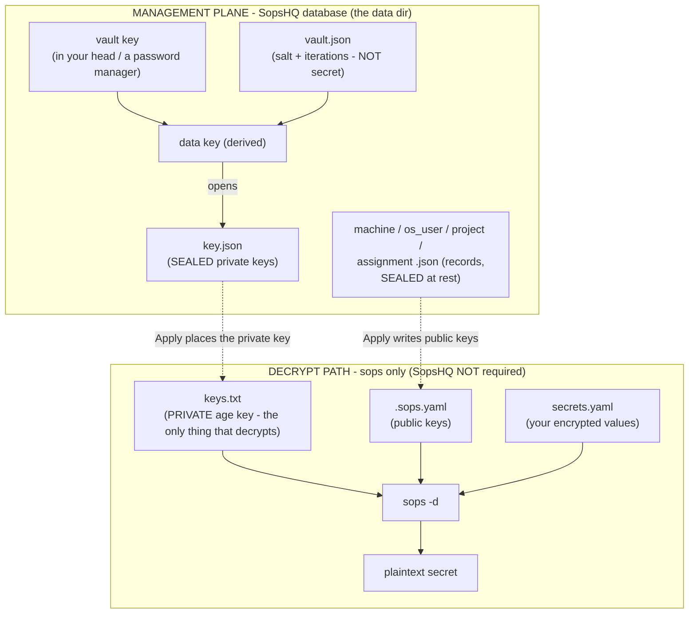
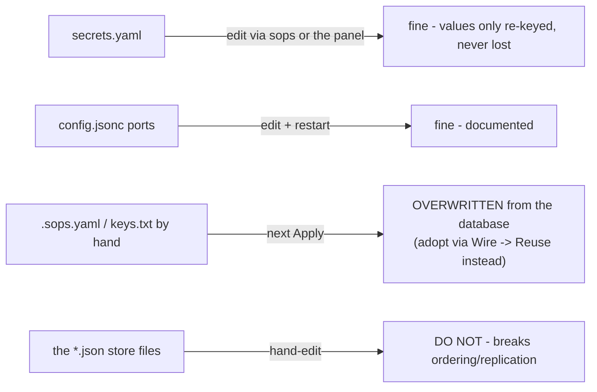
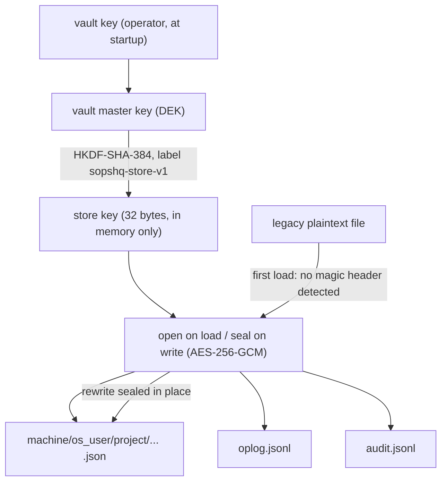
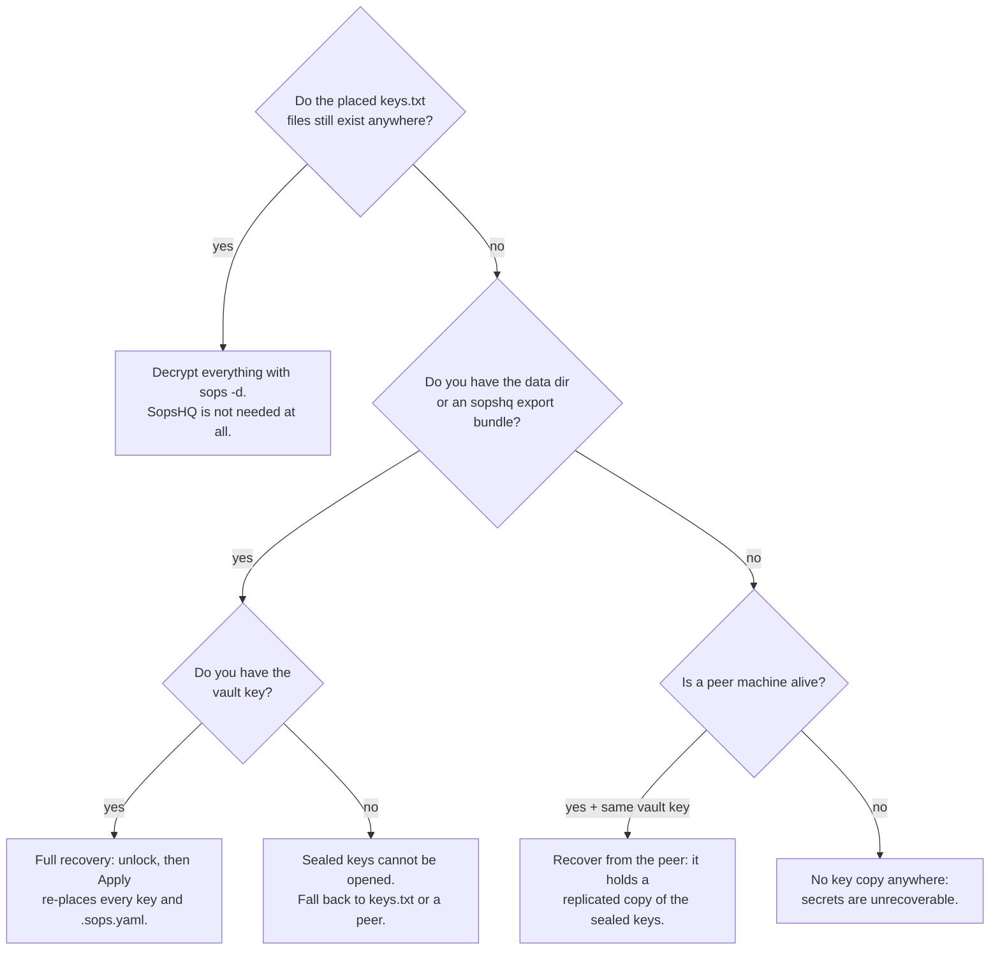
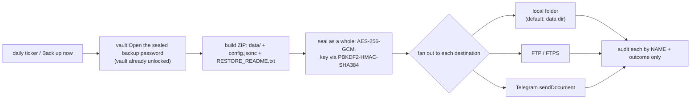

# Storage, backup, and recovery

This part maps every file SopsHQ and `sops` use, explains how the on-disk data is
sealed, what to back up, and what you can recover from what survives - then describes
the scheduled self-backup. For the overview, start at the
[architecture index](README.md).

## 14. Storage, backup, and recovery

This section maps **every file** SopsHQ and `sops` use: where it lives, whether it is
secret, what you may change by hand and what you must not, what to back up, and what
is safe to lose because it can be re-created.

### 14.1 The two worlds

There are two separate sets of files; understanding the split is the key to
everything else.

The **decrypt path** (left) is all you need to read a secret; it does not involve
SopsHQ. The **management plane** (right) is SopsHQ's database; its job is to produce
and maintain those decrypt-path files when you click **Apply**.

### 14.2 The sops world (decrypt path)

These live wherever your keys and projects are - outside the data dir.

| File | Where (example) | Secret? | What it is | Hand-edit? | Recreatable? |
|---|---|---|---|---|---|
| `keys.txt` | `<key base>/keys.txt` | **YES (private)** | The age private key(s) - the ONLY thing that can decrypt. May hold several keys (one per line). | Adds are overwritten by Apply unless the key is known to SopsHQ - adopt instead (14.4). | Only if a copy exists (the vault, a peer, a backup). **Lose every copy = secrets gone.** |
| `keys.pub` | `<key base>/keys.pub` | no | The public key(s). Documentation only. | yes (harmless) | Yes - `age-keygen -y` derives it. |
| `.sops.yaml` | `<project>/.sops.yaml` | no | Which public keys a project encrypts to. Committed to git. | Overwritten by Apply (unless Reuse chosen). | Yes - Apply rewrites it. |
| `secrets.yaml` | `<project>/secrets.yaml` | values encrypted | Your secrets, encrypted. Committed to git. | yes, via `sops` or the panel | No - this IS your data. |
| discovery (`SOPS_AGE_KEY_FILE`, `~/.config/sops/age/keys.txt`, `%USERPROFILE%\.sops` junction) | env / home | no | How sops *finds* `keys.txt`. | yes | Yes - Apply re-creates it. |

The one irreplaceable file here is `keys.txt`.

### 14.3 The SopsHQ world (management database)

Everything below lives inside the **data dir** (`<install>/data/`), except `config.jsonc`
(one level up, the install root) and the location pointer (in your user-config dir). This
is the file list a running install creates. "Created / edited by" says what
writes the file; "Delete it?" says whether the app rebuilds it or whether deleting it
loses something for good.

**Encryption at rest.** Every machine-local persisted JSON/JSONL file that holds
revealing data - the record store files (`machine.json`, `os_user.json`,
`project.json`, `assignment.json`, `global_set.json`, `map_view.json`,
`key.json`, `panel_user.json`, the settings records), the replication oplog
(`oplog.jsonl`), and the audit log (`audit.jsonl`) - is **sealed on disk with
AES-256-GCM** under a key derived from the unlocked vault (HKDF-SHA-384 over the
vault master key, see 14.5). So even the "no secret values" records (machine
names, Tailscale hosts, folder paths, OS usernames) are unreadable as plaintext
on disk; they are only opened in memory after the operator unlocks the vault at
startup. The vault metadata (`vault.json`), the ingest token, the usage log, and the
shim scripts are NOT sealed (they carry no infrastructure shape, or are needed before
unlock). The "Secret?" column below reads "sealed at rest" for a file that holds no
secret *value* but is sealed on disk all the same.

**Identity + custody (the irreplaceable core - back these up):**

| File | Secret? | What it is, and what writes it | Delete it? |
|---|---|---|---|
| `config.jsonc` *(install root, above `data/`)* | no | Node config: `node_id` (this node's replication identity), node name, listen ports, data/vault paths, an optional machine-local `keybase_root` (a shared directory for all users' key stores; see [Keys](keys.md#shared-keybase-root)), and peers - only what is needed to **start** the app. (Backup settings are NOT here; they live in the per-machine `BackupSettings` database record, managed in the panel.) Written by `sopshq init`; edited by hand for ports. **Included** in a `sopshq export` / scheduled backup archive (alongside `data/`). | **Avoid.** Re-running setup writes a new one, but with a **new `node_id`** (breaks replication identity) and you lose ports/peers. Back it up. |
| `data/key.json` | **YES - sealed** | Key records, each holding the age **private key sealed** with AES-256-GCM (SopsHQ's custody copy). Written by the store on Generate / Rotate / adopt. | **No - critical.** The app never rebuilds your keys. With no backup, peer, or on-disk `keys.txt`, losing this makes secrets undecryptable. |
| `data/vault.json` | no | The vault's KDF parameters - a FIXED app-wide **salt**, the iteration count, and a sealed **verifier** that confirms the vault key. NOT the vault key itself and NOT any derived key. Written by `sopshq init`. Because the salt is a fixed constant (not random), the key depends only on your vault key. | Avoid, but recoverable: the same vault key derives the same key on any install, so a re-init reproduces an equivalent file. Keep it to avoid confusion. |
| `data/panel_user.json` | **hashes + sealed** | Panel logins: PBKDF2-HMAC-SHA384 password & recovery-code **hashes** and the **vault-sealed TOTP secret**. Written by first-run setup and the Users page. | No - deleting it removes all logins; you would redo first-run setup and re-enroll 2FA. |

**Operational records (your data - re-entered by hand if lost, not auto-rebuilt):**

| File | Secret? | What it is, and what writes it | Delete it? |
|---|---|---|---|
| `data/machine.json` | sealed at rest | Machine records: this node and its peers, including each peer's Tailscale address + agent port. Written by the store via the Machines page. | No - you would re-add machines. |
| `data/os_user.json` | sealed at rest | OS-user records: which account holds keys on which machine, and its key-store base. A record with an **empty** key-store base is "root-derived": its store is computed as `<keybase_root>/<username>` from THIS machine's config (never replicated), so the same record resolves to each machine's own root. Written via the OS users page. | No - re-enter. |
| `data/project.json` | sealed at rest | Project records: name, note, and per-machine folder paths. Written via the Projects page. | No - re-enter. |
| `data/assignment.json` | sealed at rest | Assignment records: which key is granted to which project + machine + OS user (drives public keys and placement). Written via the project page. | No - re-enter. |
| `data/global_set.json` | sealed at rest | Global secret **set** records: a set's name + its reader OS-account IDs (NOT the values - those live in the encrypted `<keybase>/global/<set>/secrets.yaml` files). Written via the Global page. | No - re-create the set (the encrypted value files are separate). |
| `data/map_view.json` | sealed at rest | Custom **Map** view records: a view's name + its ordered group-by attribute keys + leaf key (no record references, no secret). Written via the Map editor. | Yes - the built-in default Map views still work; you only lose any custom views. |

**Logs, tokens, and the shim (safe to delete - rebuilt or history-only):**

| File | Secret? | What it is, and what writes it | Delete it? |
|---|---|---|---|
| `data/oplog.jsonl` | sealed (mirrors records) | This node's append-only replication log (HLC-ordered). Written by the store on every change. | Current state survives in the `*.json` files, but deleting loses replication **history/continuity** (a peer may need a full re-sync). Avoid unless resetting replication. |
| `data/audit.jsonl` | sealed at rest | Append-only audit history - who did what, to which target, with what outcome (by NAME/UUID only, never a value). Written by `audit.Open` on every action. | Yes - the app starts a fresh empty log; you only lose past history. |
| `data/ingest.token` | semi | A random token authorizing the usage-shim ingest endpoint. Written on `serve` if missing. | Yes - regenerated on next start; the shim reads it from this file, so it picks up the new value. |
| `data/usage.jsonl` *(appears once a shim reports a decrypt)* | no | Best-effort per-node key-usage log. Written when the usage shim reports a `sops` decrypt. | Yes - history only, no functional impact. |
| `data/permmap/latest.jsonl.gz.sealed`, `data/permmap/baseline.jsonl.gz.sealed` *(only when the permission auditor is enabled)* | **sealed at rest** | The latest filesystem permission scan and the operator-set drift baseline (gzip-JSONL, vault-sealed). Machine-local; **never replicated** (the map reveals the whole filesystem layout). Written by a scan / Set baseline on the Permissions page and the daily drift ticker. | Yes - the latest is rebuilt by re-scanning; deleting the baseline just means re-setting it. |
| `data/shim/sops` (Linux), `data/shim/sops.cmd` and `data/shim/sops-wrapper.ps1` (Windows) | no | The materialized **usage-shim** wrapper scripts; your `PATH` points at this folder so `sops` calls are counted (on Linux through a marked block in the user's `~/.bashrc`). Written by **Install usage shim** (`internal/usageshim`) on the Usage page. | Yes - re-created by running Install usage shim again; deleting them just disables usage counting until reinstalled. |
| `data/stamps.json` | no | SHA-384 stamps of each managed file, for the external-change guard (hashes and secret names, never values). Machine-local. | Yes - the next write re-stamps; you lose one round of change detection. |
| `data/peers_ack.json`, `data/watermarks.json` | no | Which peers this machine has acknowledged, and how far it has pulled each peer's oplog. | Yes - rebuilt; a peer may be re-pulled in full. |
| `data/audit-archive/` *(with export-then-purge retention)* | sealed at rest | Audit entries the retention policy removed, archived first. | Yes - history only. |
| `serve.lock`, `sopshq.pid`, `serve.log` | no | The single-instance lock, and the PID file and log of a background `sopshq start`. | Yes - when SopsHQ is not running. |
| `location` pointer *(not in this dir: `%AppData%\sopshq\location` / `~/.config/sopshq/location`)* | no | Records where the data dir lives so a bare `sopshq` run finds this install. Written only when it lands OUTSIDE the data base; a system install whose service account has HOME set to the data base skips this per-user pointer (it would sit on the locked data volume) and is found through the machine-wide pointer (`/etc/sopshq/location`) instead. | Yes - setup recreates it trivially. |

### 14.4 What you can change, and what you must not

- **Safe to change:** `secrets.yaml` (values are only re-encrypted, never destroyed);
  `config.jsonc` ports (edit + restart).
- **Will be overwritten:** `.sops.yaml` and `keys.txt` - Apply rewrites them from the
  database. A key/public key added by hand that SopsHQ does not know about is dropped
  on the next Apply. To keep it, adopt it: set the project's folder and **Wire ->
  Reuse**, which reads the on-disk private key, seals it into the vault, and leaves
  the file byte-identical (so existing secrets still decrypt).
- **Never hand-edit:** the `*.json` store files and `oplog.jsonl` (atomic,
  time-stamped, replicated). Use the panel.

### 14.5 Encryption at rest (sealing the on-disk data)

The vault has always sealed the **private keys**. The store records, the oplog,
and the audit log used to sit next to them as **plaintext JSON** - they hold no
secret *values*, but they reveal the **shape** of your setup (machine names,
Tailscale hosts, project and folder paths, OS usernames, key-store locations).
SopsHQ now seals those too, so reading the disk alone leaks nothing.

**The key.** When the operator unlocks the vault at startup, SopsHQ derives a
separate 32-byte **store key** from the vault master key with **HKDF-SHA-384**
under a fixed label (`sopshq-store-v1`). It is stable across runs (the same
vault key always yields the same store key) but distinct from the key that opens
private keys - a leak of one is not the other. No second vault key exists, and
the store key only lives in memory after unlock, so the data **never
auto-unlocks at boot**.

**The seal.** Each file is sealed as a whole with **AES-256-GCM** (the same
authenticated cipher the vault uses): the on-disk layout is a fixed ASCII magic
header, then a random nonce, then the ciphertext+tag. Reads decrypt in memory
after unlock; every atomic write (temp file + rename) re-seals. The audit log and
oplog are append-only, so an append reads+decrypts the current file, adds the new
line, and rewrites the sealed file - cheap at SopsHQ's human-driven volume.

**Self-identifying + one-way migration.** Because a sealed file starts with the
magic header, a loader can tell a sealed file from a legacy plaintext one. On the
first run after upgrading, each plaintext file is read once and **rewritten
sealed** in place - no operator action, and there is no downgrade path.

**Unlock before open.** Every command that opens the store or audit log unlocks
the vault first: `serve` (and a background `start`) prompt for or receive the vault key
before opening anything, and `reset-2fa` and `reset-admin` unlock before they touch the store.
Opening a sealed file without the vault key fails loudly rather than returning garbage.

**At-rest sealing is independent of sync.** Each machine seals its **own** data with
its **own** store key, derived from the vault key. The oplog **wire format** peers
exchange and the HTTP agent/replication protocol are independent of this on-disk
sealing. A restored backup round-trips because the same vault key re-derives the
same store key (the fixed-salt vault key) on the new machine.

### 14.6 What to back up

1. **The vault key** - it is in no file; store it in a password manager.
2. **A backup archive** - one AES-256-GCM-encrypted ZIP holding the whole data dir
   (sealed keys, records, `vault.json`, oplog, audit), the **config** (`config.jsonc`),
   and a plain `RESTORE_README.txt`. Make one with `sopshq export` (manual) or the
   scheduled self-backup (section 15). Restore with `sopshq restore -in FILE -dir DEST`
   and the **backup password**. Keep that password in your password manager - it is
   never stored in the clear and is not recoverable from the archive.
3. **The placed `keys.txt` files, offline** - the ultimate decrypt fallback,
   independent of SopsHQ.

### 14.7 Recovery: what survives decides what you can do

The blunt truth: **the vault key ALONE recovers nothing.** Opening a sealed
private key needs THREE things together - the sealed blob (`key.json`/export),
`vault.json` (the salt), and the vault key.

| You still have | What you can do |
|---|---|
| Only the vault key | **Nothing** (needs the sealed blob AND `vault.json` too). |
| Any copy of `keys.txt` | **Decrypt all secrets** with `sops -d` - SopsHQ not required. |
| `export` bundle + its backup key + the vault key | **Full restore** - management and decrypt. |
| The data dir (`key.json` + `vault.json`) + the vault key | **Full SopsHQ recovery**; Apply re-places keys. |
| A peer machine alive + the same vault key | **Recover from the peer** (replicated sealed keys + its `vault.json`). |

**Rule of thumb:** if you back up only one thing, back up `keys.txt` offline. For full
management recovery, also keep a backup archive (section 15) plus the vault key,
stored separately.

## 15. Scheduled self-backup

SopsHQ can back **itself** up automatically so a lost machine does not lose its keys,
store, and config. This section explains the format, the password, the schedule, and the
destinations - in plain terms, then the security posture.

### 15.1 What a backup is (the format)

A backup is a **single encrypted file**. Inside, before encryption, it is an ordinary
**ZIP** (a standard compressed archive) holding three things:

- `data/...` - the whole **data directory** (the vault-sealed private keys, the JSON
  store, the replication oplog, and the audit log);
- `config.jsonc` - the **configuration** at backup time;
- `RESTORE_README.txt` - a plain-language **restore guide**, generated by SopsHQ so the
  archive explains itself.

That ZIP is then **sealed as a whole** with **AES-256-GCM** (a strong, authenticated
cipher), using a key derived from the **backup password** with **PBKDF2-HMAC-SHA384** (a
slow, salted key-stretching function). "Sealed as a whole" means the on-disk artifact is
an **opaque encrypted blob**, not a readable ZIP - you cannot list its contents without
the password. ZIP-native encryption is deliberately *not* used (the legacy ZipCrypto
scheme is weak, and AES-ZIP is not in the Go standard library). This reuses the exact
sealing path of the manual `sopshq export`, so manual and scheduled backups are the same
format. Private keys end up encrypted **twice**: each key by the vault, and the whole
archive by the backup password.

### 15.2 The backup password (set once, vault-sealed)

Every archive is encrypted, so a **backup password is compulsory**. The operator sets it
**once** in the panel (Settings -> Backups, admin only). SopsHQ does **not** store the
plaintext anywhere: it **vault-seals** it (the same `vault.Seal` used for TOTP secrets and
age private keys) and saves only the **ciphertext** in the **per-machine `BackupSettings`
database record** (not in `config.jsonc`).

- **Daily run (unattended):** SopsHQ runs all day with the vault already unlocked in
  memory, so the ticker simply `vault.Open`s the sealed password and encrypts the ZIP.
- **Restore (fresh machine, no unlocked vault):** the sealed copy cannot be opened
  without the vault, and the vault is not available on a bare machine - so the password is
  **not recoverable from the backup itself**. The operator types it from their **password
  manager**, where they saved it when they set it. (This is why the panel reminds them to
  save a copy there.)

### 15.3 The schedule and the destinations (sinks)

All backup settings live in a **per-machine `BackupSettings` record** in the database
(schedule, the vault-sealed password, the destinations, and the filename pattern), managed
entirely from **Settings -> Backups** in the panel - `config.jsonc` holds none of it. The
record replicates like any record, but each node executes only its **own**; because it can
reach a peer's store, the destination credentials (FTP password, Telegram bot token) are
**vault-sealed** too, never plaintext. The archive name is built from a base name + a chosen
datetime format placed as a prefix or suffix, ending in `.bk`.

When the record's schedule is enabled, a **daily ticker** goroutine inside the running
`serve` process fires once per day at the configured local time. A **Back up now** button
runs the same thing on demand. (Trade-off: backups only run while
the panel process is up - acceptable because it normally is.) A run is built **once** and
then **fanned out** to every configured **destination** ("sink"); one sink failing is
recorded but does **not** stop the others, and a failed run never crashes `serve`.

| Sink | What it does | Notes |
|---|---|---|
| `local` | writes the sealed file into a folder (atomic temp+rename, 0600) | folder defaults to the data dir |
| `ftp` | uploads over FTP, or explicit **FTPS** (`AUTH TLS`) when enabled | stdlib `net`/`crypto/tls`; PASV + `STOR` |
| `telegram` | uploads as a document via the Bot API `sendDocument` | stdlib `net/http` multipart over HTTPS |

### 15.4 Security posture

- **Always encrypted.** The password is compulsory, so no plaintext archive ever leaves
  the machine - nothing extra to enforce per destination.
- **Secrets never leak.** The backup password and the destination credentials (FTP
  password, Telegram bot token) are never logged, echoed, returned to the page, or written
  to an audit row. Each run audits each destination by **name and outcome only**.
- **No identifying metadata off-machine.** The Telegram and FTP paths send only the
  credential and the file - no app name, owner, host, `Referer`, or `User-Agent` override.
- **Encrypted at rest and in transit.** AES-256-GCM + PBKDF2-HMAC-SHA384 seal the
  archive (AES-256 is considered safe against quantum attacks); Telegram uploads ride
  HTTPS; FTP uploads use **FTPS** (not plain FTP) when the
  server supports it.
