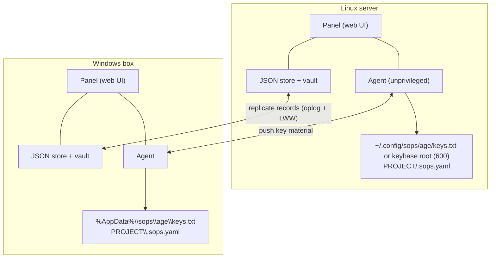
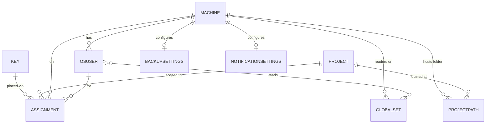

# System shape, packages, and data model

This part shows the cluster picture, the setup and serve lifecycle, every Go package and
what it is responsible for, and the records SopsHQ stores. The web interface has its own
part, [the admin panel](panel.md). For the overview, start at the
[architecture index](README.md).

## Contents

- [The cluster](#the-cluster)
- [Unprivileged by design](#unprivileged-by-design)
- [The Linux install layout](#the-linux-install-layout)
- [Setup and serve lifecycle](#setup-and-serve-lifecycle)
- [Packages](#packages)
- [Data model](#data-model)

## The cluster

The diagram shows two machines, the common deployment. SopsHQ is a peer-to-peer cluster
of any number of machines, and every machine talks to every other peer the same way.

Between any pair of peers there are two logical channels:

- **Replication** keeps every peer's database logically identical (see
  [replication](replication.md)).
- **Placement** lets one machine's panel ask a peer's agent to write or rotate a key
  locally, and to **inspect**: report drift between the desired state and what is on
  that machine's disk, using only public keys, never a private key. The panel uses the
  inspect call to drive a "changes need applying" alert that spans every peer.

Both channels are plain HTTP, authenticated by a shared transfer key on every request.

- By default the panel and the agent bind loopback (`127.0.0.1`).
- A loopback setting binds the machine's Tailscale address instead when one is present,
  so peers reach each other over the tailnet, whose WireGuard tunnel provides
  confidentiality.
- The reasons for this posture are in the [security model](security.md).

## Unprivileged by design

The **panel and agent split** exists so each machine places keys on its OWN disk: a
peer's panel asks that peer's agent to write, because only the machine itself can touch
its own filesystem. It is not a privilege split.

- **No root, no sudo.** SopsHQ runs as a dedicated, unprivileged service account
  (recommended: `sopshq`) and needs neither root nor sudo for its normal work.
- **Placing a key for another account is unprivileged too.** The service account owns a
  shared **keybase root**, created once by a root bootstrap (`mkdir`, `chown sopshq`,
  `chmod 0711`).
- **Access by ACL.** It grants each account read access to its own key with POSIX ACLs
  (`setfacl`, which the owner runs without root).
- **Other homes are never touched.** Placement for another account writes the key store
  and the ACL only. The home-side sops discovery wiring (the `~/.bashrc` export and the
  `~/.config/sops/age` symlink) is done only for the account SopsHQ itself runs as.

See [keys](keys.md) for the shared keybase root and discovery.

## The Linux install layout

The recommended Linux deployment uses three paths, owned as follows:

| Path | Holds | Owner and mode |
|---|---|---|
| `/opt/sopshq/sopshq` | the binary | `root:root 0755` |
| `/srv/sopshq` (data base) | config, vault, store, oplog, audit log, sealed keys | `sopshq:sopshq 0700` |
| `/srv/sopshq-keys` (keybase root) | each account's key store | `sopshq:sopshq 0711` |

Both writable trees sit on a neutral path outside any user home; an encrypted mount is
recommended.

- `sudo sopshq setup` (a root-only subcommand) stands this up. It installs a systemd
  unit (`User=sopshq`, not enabled at boot) from an embedded template, then hands off to
  the binary for the interactive vault-key setup.
- `serve` refuses to run as root, or from a data folder it does not own.
- `sopshq install` is the one install command on both systems. On Linux it runs `setup`.
  On Windows, which has no root-only installer, it sets the vault key and registers a
  Startup-folder launcher for the current user.

The [Linux deployment guide](../deployment.md) and the
[Windows deployment guide](../deployment-windows.md) walk through each.

## Setup and serve lifecycle

Setup and serve are built so a re-install can never leave a half-live install behind.
This section describes Linux unless it says otherwise.

### Idempotent setup

Before writing any file, `setup` reconciles the running state:

- It stops the systemd unit.
- It scans `/proc` for any `sopshq serve` still running. Each one is identified
  positively, by resolving `/proc/<pid>/exe` and reading its arguments, never by a
  guessed name or pid.
- It shows each one's data path, pid and command line, and after the operator confirms,
  stops them and verifies none remain.

This prevents an old `serve` from staying alive on a previous data path after setup
moved the install, which would later receive the vault key from `unlock` and then crash
on its deleted folder.

### Path-permission review

Setup then walks every path component from `/` down to the data folder and the keybase
root, and tests whether the service account can traverse each.

- **At a blocking folder** it offers two remedies, and the operator picks each time:
  change the folder's group, or add a persistent POSIX ACL (`setfacl`, an access entry,
  plus a default entry on the last folder only).
- **Guardrails:**
  - the root folder, any first-level folder and mount points (including the encrypted
    mount root) are reported but never weakened;
  - nothing is applied recursively;
  - a filesystem without ACL support is reported;
  - re-running is idempotent, and every applied grant is verified.

### Single instance

A running `serve` takes a process-lifetime exclusive lock on `serve.lock` in its data
folder, and binds its panel port eagerly.

- A second `serve` on the same data folder, or a port already in use, is refused up front
  with a message naming the holder.
- The lock holds however `serve` was started (directly, as a service, or via `start`),
  and the operating system drops it if the process dies.
- Linux uses an `flock` advisory lock; Windows opens the lock file with no sharing
  (`FILE_SHARE_NONE`).

### Preflight and the unlock guard

Before the vault key is ever requested, `serve` checks that its data folder, vault folder
and keybase root exist and are writable, and stops with an error naming the path.

- **Linux.** It tells a missing folder ("directory does not exist: `<path>`", with a
  not-mounted hint) apart from a genuinely read-only one. Without this, the systemd
  `ProtectSystem=strict` sandbox turns a missing folder into a misleading read-only
  filesystem error.
- **Windows.** It is a plain exists-and-writable check. It also checks the unlock-socket
  runtime folder (below) and creates it if missing, because `serve` creates that folder
  itself rather than the operator.
- **Unlock guard.** The locked service advertises its data folder over the status
  socket, and `sopshq unlock` refuses to deliver the vault key to a process whose data
  path does not match the current install.

### Unlock-socket runtime folder

The locked service listens for `sopshq unlock` on a socket file,
`<runtime dir>/unlock.sock`.

- **Linux:** `/run/sopshq`, from systemd's `RuntimeDirectory=sopshq` (the same path is
  used off systemd).
- **Windows:** `%LOCALAPPDATA%\sopshq\run`. It is Local rather than the Roaming
  `%AppData%`, because the socket is state for this host and profile only and must never
  follow the user's profile to another machine.

### Footprint

After a successful run, `setup` prints every path it created or modified and points at
`uninstall.sh` for removal (run `sudo ./uninstall.sh --dry-run` first). Every write uses
a temporary file and a rename, so no `.tmp` file is left behind.

`scripts/test_uninstall.sh` tests `uninstall.sh`.

## Packages

| Package | Responsibility |
|---|---|
| `cmd/sopshq` | the binary and its CLI; `sopshq help` lists every command |
| `cmd/releasesign` | release signing for forks that publish releases: `keygen`, `sums`, `sign`, `publish` (see [releasing](../releasing.md)) |
| `internal/vault` | PBKDF2 and AES-256-GCM seal and open of private keys |
| `internal/seal` | whole-file authenticated encryption for the store, oplog and audit log |
| `internal/hlc` | hybrid logical clock (ordering for last-writer-wins) |
| `internal/model` | domain records and the replication envelope |
| `internal/store` | JSON store, oplog, ids, last-writer-wins and per-field apply |
| `internal/audit` | append-only audit log and its retention |
| `internal/config` | JSONC config and node identity |
| `internal/totp` | RFC 6238 TOTP |
| `internal/auth` | password and recovery-code hashing (PBKDF2-HMAC-SHA384), sessions, roles |
| `internal/web` | HTTP handlers, templates, CSRF, folder browser, secret reveal, the cached cross-machine pending-changes state |
| `internal/keys` | key generation, `.sops.yaml`, `sops updatekeys`, secret set, unset and list |
| `internal/keysetup` | where an OS account's key store goes and how setup prepares it |
| `internal/place` | the placement contract (Linux and Windows), non-destructive inspect, and the shared-keybase-root POSIX ACLs (Linux) |
| `internal/stamps` | machine-local SHA-384 content stamps per managed file, for the change guard (hashes and secret names only, never replicated) |
| `internal/keysvc` | the service layer: generate, apply, rotate, the secrets editor, safe project wiring, drift, reconcile and conflict resolution |
| `internal/transport` | Tailscale address detection and the loopback check used to auto-bind and advertise a reachable address |
| `internal/agent` | the machine-to-machine HTTP server and client (place, inspect, oplog), gated by the transfer key |
| `internal/repl` | pulls each peer's oplog and applies it, with per-peer watermarks |
| `internal/backup` | encrypted export and restore, and the scheduled self-backup with local, FTP and Telegram destinations |
| `internal/usage` | best-effort, per-node key-usage log |
| `internal/usageshim` | installs and removes the optional `sops` usage-reporter shim |
| `internal/access` | "can this OS account read this folder?" pre-flight: uid, gid, mode and parent traversal on Unix; best-effort `icacls` read on Windows |
| `internal/mapview` | the pure tree builder behind the **Map** page |
| `internal/permmap` | the read-only Linux filesystem permission auditor behind the **Permissions** page |
| `internal/notify`, `internal/slack`, `internal/telegram` | event notifications and their two channels |
| `internal/sdnotify` | the systemd readiness message the locked service sends |
| `internal/unlock` | delivers the vault key to a locked service over the unlock socket, and reports its status |
| `internal/update` | release verification, versions and backups for `sopshq update` |

## Data model

Every stored record embeds a **Meta** envelope used for replication:

- `uuid`: the stable id;
- `updated`: the hybrid-logical-clock time of the last write;
- `origin`: the node that wrote it;
- `deleted`: the soft-delete tombstone.

Records that replicate:

- **Machine**: a node (name, OS, Tailscale host, agent port, last seen), plus its cluster
  peer identity fields; see [cluster peer identity](peer-identity.md).
- **OSUser**: an OS account that holds private keys (machine, username, key-store base).
- **Project**: a logical project with a folder path per machine.
- **Key**: an age key pair: the public key in clear, the sealed private key, type,
  generation and status.
- **Assignment**: the join of key, project, machine and OS account. It drives both the
  `.sops.yaml` public-key list and which accounts receive the private key.
- **GlobalSet**: a named shared secret set: its name, its machine, and its reader
  accounts. The values live only in encrypted files; see [secret values](secrets.md).
- **BackupSettings**: one machine's self-backup schedule, sealed password and
  destinations; see [storage, backup, and recovery](storage-backup-recovery.md).
- **NotificationSettings**: one machine's alert channels and event choices; see
  [notifications](notifications.md).
- **MapView**: a custom Map page layout: a name, an ordered list of group-by attributes
  and a leaf attribute. It holds no record reference and no secret.
- **DistinctAck**: the operator's "keep both" decision for a duplicate; see
  [conflict resolution](conflict-resolution.md).

Records that stay on one machine and never replicate:

- **PanelUser**: a panel login (username, password hash, sealed TOTP secret, recovery-code
  hashes, role). Each machine has its own logins; see
  [cluster peer identity](peer-identity.md#panel-logins-are-not-cluster-records).
- **FieldConflict**: a same-field divergence found while merging a peer's copy; see
  [replication](replication.md#surfacing-and-resolving-a-field-conflict).
