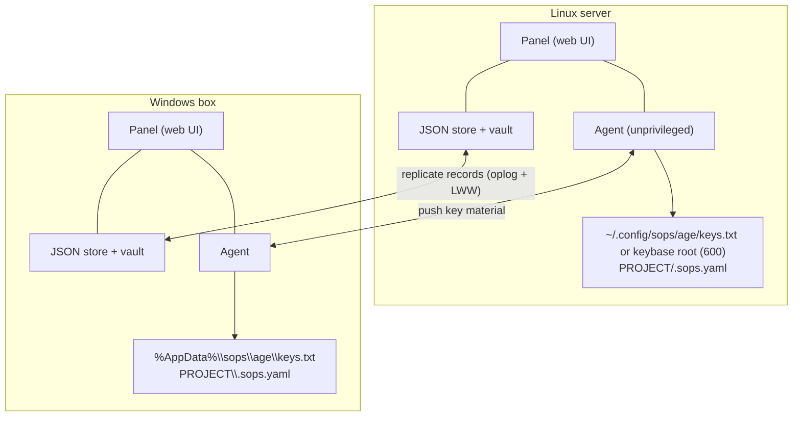
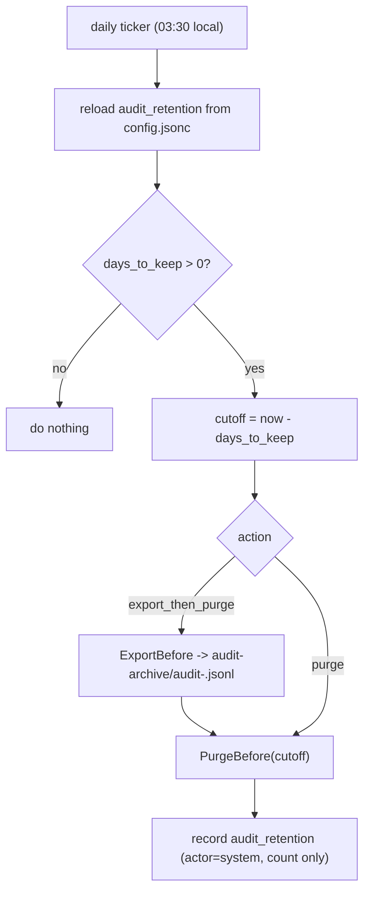
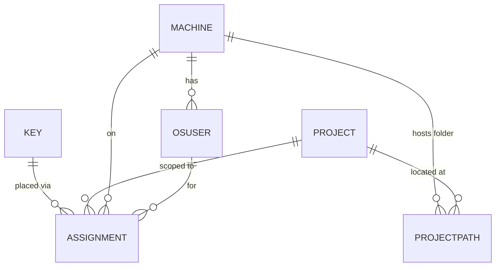

# System shape, packages, and data model

This part shows the cluster picture, lists every Go package and what it is
responsible for, and describes the records SopsHQ stores. For the overview, start at
the [architecture index](README.md).

## 4. System shape

The diagram above shows two machines (a Windows box and a Linux server), the common
deployment - but SopsHQ is a peer-to-peer cluster of any number of machines, and every
machine talks to every other peer the same way. There are two logical channels between
any pair of peers, both plain HTTP authenticated by a shared transfer key and both
bound to the Tailscale interface (WireGuard provides confidentiality):

- **Replication** keeps every peer's database logically identical.
- **Placement** lets one machine's panel ask a peer machine's agent to
  write/rotate a key locally, and to **inspect** (report drift between the desired
  state and what is on that machine's disk, using only public keys - never a
  private key). The panel uses the inspect call to drive a "changes need applying"
  alert that spans every peer.

The **panel/agent split** exists so each machine places keys on its OWN disk: a
peer's panel asks that peer's agent to write locally, because only the machine
itself can touch its own filesystem. It is NOT a privilege split - SopsHQ runs as a
dedicated **unprivileged** service account (recommended: a dedicated `sopshq`
account) and needs no root and no sudo for its normal work. Placing a key for
ANOTHER local user is unprivileged too: that account owns a shared **keybase root**
it created once (a one-time root bootstrap - `mkdir` + `chown sopshq` + `chmod 0711`),
and it grants each user read access to their own key with POSIX ACLs (`setfacl`,
which the owner runs without root). Cross-user placement writes the key store + ACL
and never reads or writes another user's home; the home-side sops discovery wiring
(`~/.bashrc` export + `~/.config/sops/age` symlink) is done only for the account
SopsHQ itself runs as. See [keys](keys.md) for the shared keybase root and discovery.

The recommended Linux deployment is a **three-path layout** owned by the dedicated
`sopshq` service account: the **binary** at `/opt/sopshq/sopshq` (root:root 0755), the
**data base** at `/srv/sopshq` (sopshq:sopshq 0700 - config, vault, store,
oplog, audit, sealed keys), and the **keybase root** at `/srv/sopshq-keys`
(sopshq:sopshq 0711). Both writable trees sit on a neutral path outside any user home;
an encrypted mount is recommended. `sudo sopshq setup` (a root-only subcommand of the binary) stands this up:
it installs a systemd unit (`User=sopshq`, not enabled at boot) from an embedded
template and hands off to the binary for the interactive vault-key setup; `serve`
additionally refuses to run as root or from a data directory it does not own. See the
[deployment guide](../deployment.md) for the full walkthrough.

### Setup and serve lifecycle (robustness)

Setup and serve are built so a re-install can never leave a half-live install behind.

**Idempotent setup.** Before writing any file, `setup` reconciles the running state: it
stops the systemd unit, then scans `/proc` for any `sopshq serve` still running
(identifying each positively by resolving `/proc/<pid>/exe` and reading its arguments -
never by guessed name or pid), SHOWS each one's data path, pid, and command line, and -
after the operator confirms - stops them and verifies none remain. This closes the
failure mode where a re-`setup` rewrote the unit to a new data path but left the OLD
`serve` alive on the previous path, so a later `unlock` handed the vault key to a process
that then crashed on its now-deleted directory.

**Path-permission review.** Setup then walks every path component from `/` down to the
data dir and the keybase root and tests whether the service account can traverse each. At
a blocking junction it offers two remedies - change the directory's group, or add a
persistent POSIX ACL (`setfacl`, access + a default entry only on the leaf) - and the
operator picks each time. Guardrails: the root, any first-level directory, and mount
points (including the encrypted mount root) are reported but never weakened; nothing is
applied recursively; a filesystem without ACL support is reported; re-running is
idempotent; and every applied grant is verified.

**Single instance.** A running `serve` takes a process-lifetime exclusive lock on a
`serve.lock` file inside its data dir and binds its panel port eagerly, so a second
`serve` on the same data dir, or a port already in use, is refused up front with a message
naming the holder. The lock holds regardless of how `serve` was started (directly, as a
service, or via `start`), and the OS drops it if the process dies. It is real on both
supported platforms: an `flock` advisory lock on Linux, and an exclusive-share
(`FILE_SHARE_NONE`) open of the lock file on Windows.

**Preflight and the unlock guard.** Before the vault key is ever acquired, `serve` checks
that its data dir, vault dir, and keybase root exist and are writable, stopping with a
truthful, path-naming error. On Linux it also distinguishes a MISSING directory
("directory does not exist: `<path>`", with a not-mounted hint) from a genuinely read-only
one - which the systemd `ProtectSystem=strict` sandbox otherwise blurs into a misleading
read-only-filesystem error. On Windows (which has no such sandbox) it is a plain
exists-and-writable check; the Windows preflight additionally probes the unlock-socket
runtime directory (see below), creating it if it does not exist yet, since - unlike the
data/vault/keybase directories the operator creates ahead of time - `serve` creates it
lazily on first lock. The locked service advertises its data dir over the status socket,
and `sopshq unlock` refuses to deliver the vault key to a process whose data path does
not match the current install (a stale process).

**Unlock-socket runtime directory.** The locked service listens for `sopshq unlock` on a
socket file, `<runtime dir>/unlock.sock`. On Linux the runtime dir is `/run/sopshq`
(from systemd's `RuntimeDirectory=sopshq`, or that same path off systemd). On Windows -
which has no `/run` - it is `%LOCALAPPDATA%\sopshq\run` (via `os.UserCacheDir()`):
Local, not the Roaming `%AppData%` the per-user location pointer uses, because the
runtime socket is host- and profile-local state, never something meant to follow the
user's profile to another machine.

**Footprint.** After a successful run, `setup` prints every path it created or modified
and the exact commands for a full manual uninstall; all writes use temp-file-plus-rename,
so no `.tmp` residue survives.

---

## 5. Packages

| Package | Responsibility |
|---|---|
| `internal/vault` | PBKDF2 + AES-256-GCM seal/open of private keys |
| `internal/hlc` | Hybrid Logical Clock (ordering for LWW) |
| `internal/model` | domain records + replication envelope |
| `internal/store` | JSON store, oplog, UUIDs, LWW apply |
| `internal/audit` | append-only audit log |
| `internal/config` | JSONC config + node identity |
| `cmd/sopshq` | the binary and its CLI; `sopshq help` lists every command |
| `cmd/releasesign` | release signing for forks that publish releases: `keygen`, `sums`, `sign`, `publish` (see [releasing](../releasing.md)) |
| `internal/keysetup` | where an OS account's key store goes and how setup prepares it |
| `internal/notify`, `internal/slack`, `internal/telegram` | event notifications and their two channels |
| `internal/sdnotify` | the systemd readiness message the locked service sends |
| `internal/seal` | whole-file authenticated encryption for the store, oplog and audit log |
| `internal/unlock` | delivers the vault key to a locked service over the unlock socket, and reports its status |
| `internal/update` | release verification, versions and backups for `sopshq update` |
| `internal/usageshim` | installs and removes the optional `sops` usage-reporter shim |
| `internal/totp` | RFC 6238 TOTP |
| `internal/auth` | password + recovery-code hashing (PBKDF2-HMAC-SHA384), sessions, RBAC |
| `internal/web` | HTTP handlers, templates, CSRF, folder browser, secret reveal, cached cross-machine pending-changes (drift) state |
| `internal/keys` | keygen (+ `RecipientFor` for adoption), `.sops.yaml`, `sops updatekeys`, secret set/unset/list |
| `internal/place` | placement contract (Linux + Windows) + non-destructive `Inspect`/`ReadPrivateKey` + shared-keybase-root POSIX ACLs (`setfacl`/`getfacl`, Linux) |
| `internal/stamps` | machine-local SHA-384 content stamps per managed file (external-change guard; hashes + secret names only, never values, never replicated) |
| `internal/keysvc` | service: generate/apply/rotate + secrets editor + safe project wiring (inspect, adopt, reuse/re-create) + write-time external-change guard & reconcile |
| `internal/transport` | Tailscale IP detection + loopback-host check (used to auto-bind and advertise a peer-reachable address) |
| `internal/agent` | HTTP place/sopsyaml/updatekeys/inspect/oplog server + client, gated by the shared transfer key |
| `internal/repl` | pull peer oplog, apply (LWW), per-peer watermarks |
| `internal/backup` | encrypted export/restore + scheduled self-backup: ZIP (data + config + restore guide) sealed as a whole, with local/FTP/Telegram sinks |
| `keysvc.DriftLocal` | compare desired vs on-disk state |
| `internal/usage` | best-effort, per-node key-usage (decrypt) log |
| `internal/access` | "can this OS user read this folder?" pre-flight: rigorous uid/gid/mode + parent traversal on Unix; best-effort DACL read via built-in `icacls` on Windows |
| `internal/mapview` | pure tree-builder for the **Map** page: denormalizes the record relations into rows and groups them by an ordered list of attributes into a nested node tree (names + ids only) |
| `internal/permmap` | read-only Linux filesystem permission auditor: a pure getfacl/getcap parser + octal-mode reconstruction + flag rules (world-writable / has-acl / acl-override / dangerous), a Linux-only `find`/`getfacl`/`getcap` collector run as a dedicated scan user, vault-sealed gzip-JSONL machine-local snapshot storage (latest + baseline, never replicated), a baseline diff, and the query/filter/tree helpers behind the **Permissions** page |

**Panel UI.** The admin panel is server-rendered Go `html/template` styled with
**Bootstrap 5**. Bootstrap (CSS + its bundled JavaScript with Popper) is vendored as local
static assets under `internal/web/static/vendor/` and served by the panel itself - **no CDN**
(the panel may be offline) and **no build step** (it is the precompiled dist, not compiled
from source). These are JS/CSS assets, not Go modules, so the stdlib-only Go rule is intact.
Bootstrap supplies every component (cards, forms, buttons, badges, alerts, dropdowns,
tables) and the built-in **light/dark theme**; `internal/web/static/app.css` adds only the
app-shell layout plus a few small helpers (the `.info-i` tooltip dot, a `.mono` class, a
`.hidden` JS-toggle helper, and the folder-picker modal). Progressive-enhancement scripts
are `app.js` (sidebar, theme toggle, confirm dialogs, folder browser, secret reveal, the
reuse picker, and the quick-add / backup-destination field toggles) and `dt.js` (tables).
The layout is fluid and responsive (the viewport is `width=device-width`).

**Form field identity.** Only the sign-in and first-run setup forms use `type="password"`
or a site-login `autocomplete` token, so a browser or password manager offers to save
nothing else. Every other secret (transfer key, tokens, webhook, FTP and backup secrets,
secret values) is a `type="text"` field drawn as dots by the `.secret-field` class in
`app.css`, with autocomplete off and `data-1p-ignore`. Every field has an id unique on its
page and a label. `internal/web/form_fields_test.go` enforces these rules over every
template, so a new field that breaks them fails the build.

The chrome is an **app-shell**: a **fixed top header** (a Bootstrap navbar) and a **fixed,
full-height left sidebar** (Bootstrap `nav-pills`), with the page content pushed to the
right of the sidebar by a left margin (so the sidebar **narrows the body rather than
overlaying it**). On a phone (<=768px) the sidebar becomes an **off-canvas overlay** that
slides in over the content and closes on an outside click. The header has three zones: a
**hamburger button** (left) that toggles the sidebar - on desktop it collapses the sidebar
off-screen and reclaims the width; on a phone it opens/closes the overlay - the **brand**
(centered), and (right) a **theme toggle** plus a Bootstrap **account dropdown**. Any flash
message renders as a Bootstrap alert at the top of the content area. The sidebar holds the
icon-per-item links (Dashboard, Quick add, DB, Map, Keys, Projects, Secrets, Global, Machines,
OS users, Users, Usage, Drift, Conflicts, Permissions, Settings, Audit, Help); the active page's link gets the Bootstrap
`active` pill and `aria-current="page"` (set in `app.js`). The account dropdown holds the
username, the Security page (`/account`), and Sign out. Icons are inline SVG drawn with
`currentColor` (no Unicode glyphs, per the ASCII-only source rule).

For sortable/searchable tables the panel also vendors **jQuery + DataTables.net + Select2**
plus the **DataTables Bootstrap 5 integration** (so tables match the Bootstrap theme,
including dark mode). Any table marked `class="... dt"` becomes a DataTable with column
sorting, a global search box, and per-column Select2 filters - header cells opt out of
sorting with `no-sort`, or gain a dropdown filter with `filter`; `dt.js` wires this up, and
each data table is wrapped in a Bootstrap card + `.table-responsive`.

**DB browse view.** A dedicated **DB** page (`/db`, handler `internal/web/handlers_db.go`) is a
**read-only** place to browse every record type at once. It renders Bootstrap tabs - one
`dt` DataTable per type: Keys, Projects, Machines, OS users, and Assignments, plus Users and
Secrets for admins only. The handler gathers each table from the SAME existing store list
reads the individual pages use (and the value-free `keysvc.SecretsCatalog` for the Secrets
tab), so there is no second source of truth; it gathers the Users and Secrets data only when
the viewer is an admin, so a developer's response never carries them. Like every panel
surface, the tables show **names and metadata only** - never a key, the passphrase, a TOTP
secret, or a decrypted secret value (the Secrets tab has no value column and no reveal
button). Because a DataTable that starts on a hidden Bootstrap tab measures a zero width, an
`app.js` page-scoped block re-runs `columns.adjust()` on each tab's table when that tab is
first shown, so columns size correctly.

**Map view.** A **Map** page (`/map`, handler `internal/web/handlers_map.go`) is a custom
nested-tree explorer of how the records relate, complementing the flat DB tables. Where DB
shows one table per record type, Map shows a **drill-down folder tree**: every **view** is a
chosen grouping order (for example *Project -> Machine -> Path -> Secret name*), and the same
records can be browsed in whatever order is useful. The page is a **two-pane** Bootstrap
layout that stacks on narrow screens - a left tree pane (expand/collapse folders, click a leaf
to select it) and a right **read-only** detail pane (a project leaf links to its own page).

- **Built-in views** (Projects, Machines, Users, Keys, Secrets) are seeded constants, not
  stored records, so the page is useful immediately. **Custom views** are operator-defined and
  stored as a replicated `MapView` record (see the data model); the **Map editor** (admin-only)
  names a view, orders the grouping levels, and picks the leaf level. Custom views can be
  renamed, re-ordered, and deleted.
- **The tree-builder is pure** (`internal/mapview`). It takes the current records (gathered by
  the handler from the SAME store reads the other pages use, plus value-free secret NAMES from
  `keysvc.ListSecrets`/`ListGlobalSecrets` only when a view groups by Secret-name) and a view
  definition, denormalizes the relations (project<->path<->machine; project<->key<->os-user<->
  machine via Assignment; secret-name belongs to a project's secrets.yaml; global set<->
  reader accounts) into flat rows, then groups them level by level. It is robust to ANY
  attribute ordering: a level with no valid join from its prefix is skipped (collapsed) rather
  than failing, so an odd ordering yields a smaller tree, never a crash.
- **Routes + security.** `GET /map` renders the page and `GET /map/tree?view=<id>` returns the
  built tree as JSON; both are login-gated. The editor POSTs (`POST /map/views`,
  `/map/views/{id}`, `/map/views/{id}/delete`) are admin-only and CSRF-protected. Like every
  panel surface the tree carries **names and record ids only** - never a private key, the vault
  key, a TOTP secret, or a decrypted secret value (a Secret-name node shows the NAME
  only), so the tree JSON is safe to log. An interactive node-**graph** mode is not built; the
  tree is the only Map visualization, and the detail pane is read-only.

**Permission auditor.** A **Permissions** page (`/permmap`, handler
`internal/web/handlers_permmap.go`) is an **admin-only**, read-only audit of who can access
what across this Linux machine's filesystem. It is the whole-server counterpart to the
per-path access pre-flight in `internal/access`: where that answers "can THIS user read THIS
folder," the auditor maps EVERY path under chosen roots.

- **Collector (`internal/permmap`, Linux-only).** It execs the standard tools - `find -printf`
  (entry type), `getfacl -R -p` (owner, owning group, mode, special bits, access + default
  ACLs), `getcap -r` (file capabilities) - decodes their output as UTF-8 (paths are data, not
  ours), and merges by path. A pure block-parser reconstructs the octal mode and derives the
  flags: `world_writable`, `has_acl` (any named principal), `acl_override` (a named principal
  beyond owner/owning-group), `suid_sgid`, and `dangerous` (setuid/setgid OR a world-writable
  path that is not a sticky directory). The parser, mode reconstruction, and flag rules are
  pure and unit-tested on every platform; only live collection needs Linux.
- **Off by default, gated on a dedicated scan user.** The feature is disabled until the
  operator provisions a locked-down Linux user (no login, no SSH) allowed via a tight
  `sudoers` rule to run **only** the three collectors. The page prints the exact
  `useradd`/sudoers commands; **Enable** is refused (`CheckScanUser`) unless the user exists
  and can run the collectors, and the scan then runs as that user (`sudo -n -u <user> ...`).
- **Sealed, machine-local, never replicated.** `internal/permmap.Store` writes the latest scan
  and the operator-set baseline as gzip-JSONL, **vault-sealed** with the same store key as the
  at-rest sealing, under `<data dir>/permmap`. The map reveals the full filesystem layout, so
  it never flows through the replicating record store and is read into memory + filtered in Go.
- **Routes + security.** All routes are admin-only and (for POSTs) CSRF-protected: `GET
  /permmap` (page), `GET /permmap/data` (filtered flat list, capped with a true-total count),
  `GET /permmap/tree` (lazy directory children), `GET /permmap/diff` (changed-since-baseline),
  and `POST /permmap/{scan,baseline,enable,disable,config}`. Scans and diffs are audited by
  **counts only**, never by path; the map is never logged.
- **Drift.** A daily ticker (`enforcePermmapDrift` in `cmd/sopshq`, Linux-only, re-reads config
  each run) re-scans, stores the latest, and - once a baseline is set - diffs and sends a
  count summary through the notifier (`perm_drift`, off by default). It is read-only and never
  auto-remediates; the baseline only changes when the operator clicks **Set baseline**.

The **theme** is driven by Bootstrap's `data-bs-theme` attribute on `<html>` (a sun/moon
toggle in the header). It follows the operating-system preference by default
(`prefers-color-scheme`); the toggle lets the operator override it, persisting the choice in
`localStorage` (`sopshq-theme`) and applying it before first paint (so there is no flash of
the wrong theme). The sidebar's collapsed/expanded choice persists the same way
(`sopshq-sidebar`, applied pre-paint). The content area has no max-width cap (just padding);
the only intentionally narrow surface is the centered Bootstrap card used by the auth
screens (login, first-run setup, authenticator enrollment).

A separate **Settings** page (`/settings`) holds machine-local configuration that is not
day-to-day operation: the **paths this machine uses** (where the config, data dir, vault,
audit log, and the `sops`/`age-keygen` binaries live), the **backup** panel (schedule,
whether a backup password is set, destinations by name, last run, and the admin-only set-
password / back-up-now controls), and the **audit-retention** policy (see below). The
**Dashboard** keeps the resource counts and the apply
controls, and renders a **detailed per-item results panel** below the buttons: every
run/apply/sync reports each key placed, project wired, secret file re-keyed, and skip (with
its reason) - a dry run shows exactly what an apply *would* do. The "Apply to this machine"
and "Push to all machines" buttons are **disabled when nothing is pending**; every action
button carries an on-hover tooltip, and Force re-apply confirms first.

**Audit-log retention.** The audit log (`data/audit.jsonl`) is append-only and can grow
without bound, so SopsHQ can trim it. The engine lives in `internal/audit`: `PurgeAll` and
`PurgeBefore(t)` atomically rewrite the JSONL (temp file + rename, mode 0600), `ExportBefore`
writes the entries a purge would remove to a destination file first, and `PurgeAllBy` /
`PurgeBeforeBy` record the purge itself (actor + count, never a value). Two surfaces use it:

- **Manual** - the Audit page has an admin-only card with **Purge all**, **Purge up to a
  date** (parsed to the end of that local day), and a client-side from/to **date-range
  filter** on the Time column (it only hides rows; it deletes nothing).
- **Automatic** - the Settings page stores a per-machine retention policy in `config.jsonc`
  under `audit_retention` (`days_to_keep`, `action`). A daily in-process ticker in
  `runServer` (alongside the backup ticker) re-reads that policy and, when `days_to_keep`
  is positive, removes entries older than the cutoff. With `export_then_purge` (the default)
  it first archives the removed entries to `<data dir>/audit-archive/audit-<timestamp>.jsonl`;
  with `purge` it deletes outright. A failed run is logged to stderr and the schedule
  continues, so a bad archive write never stops serve. The policy is per-machine (each node
  keeps its own history), which is why it lives in the config file rather than the replicated
  store.

---

## 6. Data model

Every stored record embeds a **Meta** envelope used for replication:
`uuid` (stable id), `updated` (HLC timestamp of last write), `origin` (node that
wrote it), and `deleted` (soft-delete tombstone).

- **Machine** - a node (name, OS, Tailscale host, agent port, last seen). It also
  carries its cluster peer identity: `canonical` marks a node's own record (whose id is
  that node's stable identity), `pending` holds a newly-noticed peer until the operator
  confirms it is new or a reinstall, `confirmed` records that decision on the replicated
  record so every node sees it, and `merged_into` redirects a record that was merged into
  another. See [cluster peer identity](peer-identity.md).
- **OSUser** - an OS account that holds private keys (machine, username, key-store base).
- **PanelUser** - a login account (username, PBKDF2 hash, sealed TOTP secret,
  PBKDF2 hashes of one-time recovery codes, role). It is a **per-machine credential**:
  stored locally and **never replicated**, so one machine's admin never appears on
  another. `sopshq reset-admin` restores or resets it if the operator is locked out.
- **Project** - a logical project with a folder path per machine.
- **Key** - an age keypair: public key (clear) + sealed private key, type,
  generation, status.
- **Assignment** - the join (key + project + machine + OS user) that drives both the
  `.sops.yaml` public-key list and which users receive the private key.
- **MapView** - a custom **Map** page layout: a name plus an ordered list of group-by
  attribute keys and a leaf attribute key (from the fixed vocabulary Project, Machine,
  OSUser, Path, Key, SecretName, GlobalSet). It holds only those short ASCII keys and a
  name - no record references and no secret - so it replicates like any record.
- **DistinctAck** - the operator's "keep both" decision for a
  [conflict](conflict-resolution.md): an entity-kind string plus the record UUIDs declared
  intentionally distinct. It carries no secret and replicates like any record, so both
  machines converge on the decision and the Conflicts page stops flagging that group.

The panel also has a **Conflicts to resolve** page (`/conflicts`, in `internal/web`): it
lists the duplicate records the lossless reconcile pass leaves intact and resolves each by
a double-confirmed **merge** or a replicated **keep both** (see
[conflict resolution](conflict-resolution.md)).
