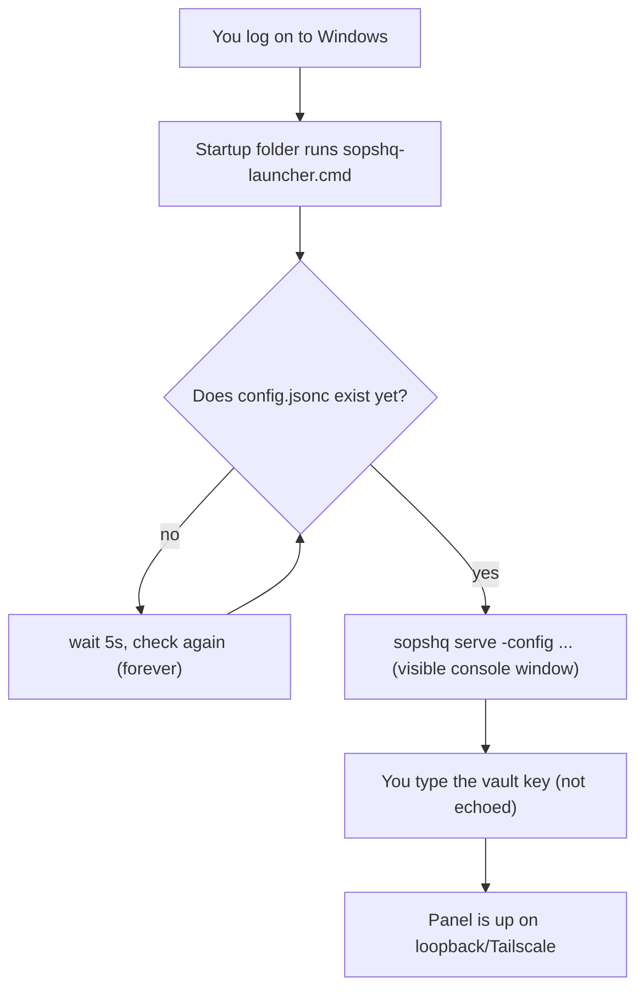

# Deploying SopsHQ on Windows

This guide installs and runs SopsHQ on a Windows dev box. Linux has its own guide:
[deployment.md](deployment.md).

- **No service account, no systemd.** SopsHQ runs as your own Windows user.
- **No Windows Service.** A small Startup-folder launcher starts SopsHQ after each logon.
- **The vault never unlocks on its own.** You type the vault key in a console window.

## Contents

- [Install and first run](#install-and-first-run)
- [Run automatically at every logon](#run-automatically-at-every-logon)
- [Keeping keys in their own folder](#keeping-keys-in-their-own-folder)
- [Uninstall](#uninstall)

The interactive menu (`sopshq menu`) works on Windows too; see
[deployment.md](deployment.md#interactive-menu).

## Install and first run

`sopshq setup` is Linux-only. On Windows, `install` runs two steps against the same
paths: `init` (vault setup), then `install-launcher` (the Startup-folder launcher).

```powershell
sopshq install -dir C:\SopsHQ
```

This:

- writes `C:\SopsHQ\config.jsonc`;
- creates the vault in `C:\SopsHQ\data` and asks you to **choose a vault key** (typed
  twice, never echoed);
- records this install as your per-user default in `%AppData%\sopshq\location`, so a
  later bare `sopshq` finds it;
- registers the Startup-folder launcher script.

To try it at once, without waiting for the next logon, run it in the foreground. It asks
for the vault key and serves the panel until you press Ctrl-C:

```powershell
sopshq serve -config C:\SopsHQ\config.jsonc
```

**Scripted install.** `install` takes the same flags as `init`, so nothing beyond the
vault key is asked:

```powershell
sopshq install -dir C:\SopsHQ -name my-windows-box            # name this node
sopshq install -dir D:\OtherSopsHQ -set-default                # a 2nd install; make it the default
sopshq install -dir C:\SopsHQ -keys D:\SopsHQKeys               # keep keys in a separate folder (see below)
```

- `-set-default` makes the bare `sopshq` dashboard, and `serve`'s auto-discovery, use
  this folder, even if another install was the default before.
- Re-running `install` on a folder that already has a config and vault is safe. It
  reports what exists, skips the vault-key prompt, and re-registers the launcher.

**The two steps separately.** `init` and `install-launcher` remain commands of their
own. For example, re-register the launcher after moving the binary, without touching the
vault:

```powershell
sopshq init -dir C:\SopsHQ                          # vault setup only
sopshq install-launcher -config C:\SopsHQ\config.jsonc   # launcher registration only
```

## Run automatically at every logon

A Windows session always has a logged-in user to type the vault key, so the launcher has
one job: start `serve` once you are logged in and your data folder is available. The
data folder may sit on a volume you decrypt and mount by hand after logging in.

`sopshq install` registers the launcher for you. To register it again on its own:

```powershell
sopshq install-launcher -config C:\SopsHQ\config.jsonc
```

This writes one script, `sopshq-launcher.cmd`, into your own Startup folder
(`%AppData%\Microsoft\Windows\Start Menu\Programs\Startup`). No administrator prompt is
needed, because that folder is inside your user profile. From your next logon, Windows
runs the script:

1. It **checks every 5 seconds, forever,** until `config.jsonc` exists at the path you
   gave. So it waits if your data folder is on a volume you have not mounted yet.
2. It then runs `sopshq serve -config <path>` in a **visible console window**. SopsHQ
   asks for the vault key there, without echo. The launcher never supplies the key.
3. If `serve` exits (you close it, it fails, or you stop it), the window pauses with
   "Press any key to continue..." so you can read what happened.



Re-running `install-launcher` is safe: it overwrites the same script.

`sopshq start` and `sopshq stop` (run detached in the background) also work on Windows,
but the launcher is the usual way.

## Keeping keys in their own folder

`keybase_root` works on Windows as a plain keys folder:

- **Same layout as Linux:** each OS user's key store is
  `<keybase_root>\<username>\keys.txt`. A local OS user with no keystore path of its own
  uses it automatically.
- **No per-user ACLs:** on Linux the service account owns the root and POSIX ACLs gate
  each store. On Windows one account runs SopsHQ and owns the whole tree through ordinary
  NTFS inheritance. A multi-user `icacls` layout is not available.
- **Create the folder before you install.** `serve` only prints a warning when it is
  missing, and key placement then fails.

Set it at install time:

```powershell
sopshq install -dir C:\SopsHQ -keys D:\SopsHQKeys
```

This records `D:\SopsHQKeys` in `config.jsonc` as `keybase_root`, separate from
`data_dir`, which holds the vault, store, oplog and audit log.

## Uninstall

There is no Windows Service and no system-wide registration. An uninstall touches only:

- the per-user Startup launcher;
- the per-user default pointer `%AppData%\sopshq\location`;
- the folder that holds `sopshq.exe`;
- the install folder on your user `PATH`, if you accepted that offer in `sopshq menu`;
- the usage shim's values under `HKCU\Environment`, if you installed the shim from the
  panel's Usage page. Remove the shim there first.

Data and keys are left in place. Remove them only if you are sure, and only after you
export a backup or copy the keys out.

```powershell
sopshq uninstall-launcher                                    # removes the Startup script only
del "%AppData%\sopshq\location"                               # this machine's per-user default pointer
rmdir /s /q C:\Path\To\SopsHQ-install                          # wherever you placed sopshq.exe
# Data and keys stay. Remove them only if you are sure:
#   rmdir /s /q C:\SopsHQ
#   rmdir /s /q D:\SopsHQKeys
```

`sopshq uninstall-launcher` deletes only the script `install-launcher` wrote. It never
reads or touches your data folder, vault or key files.
