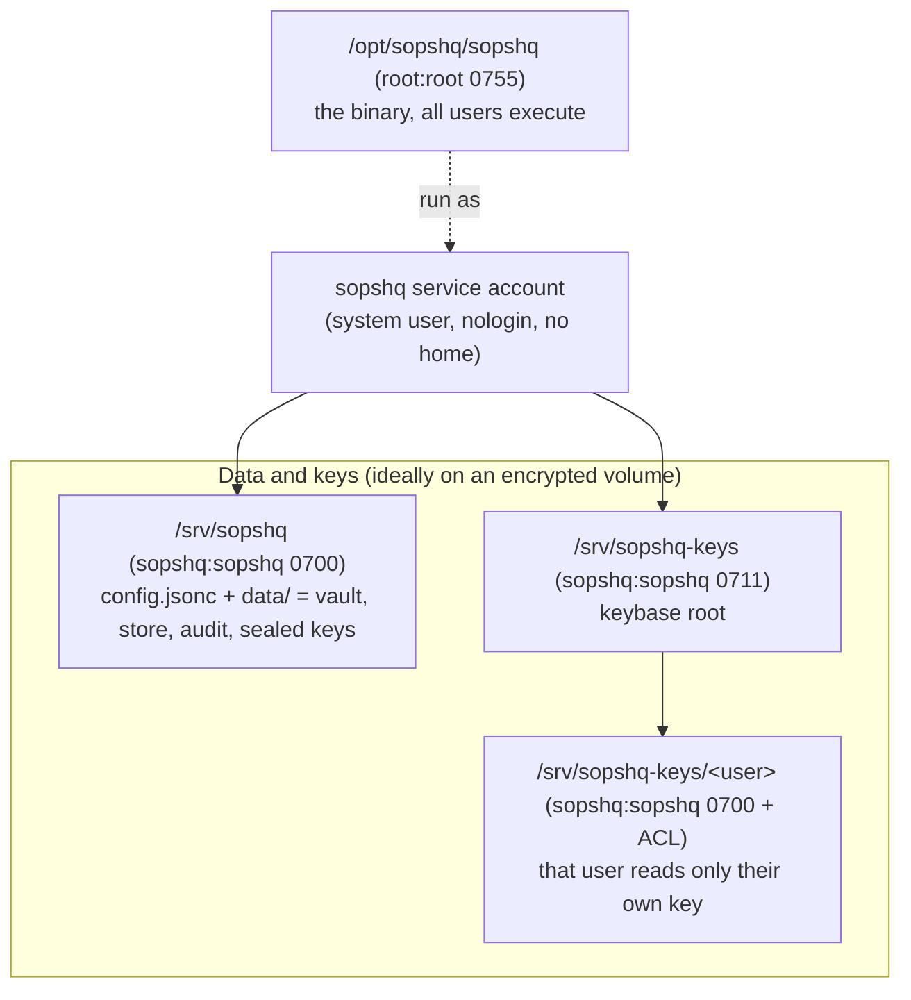
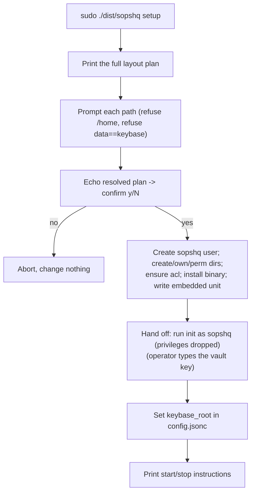
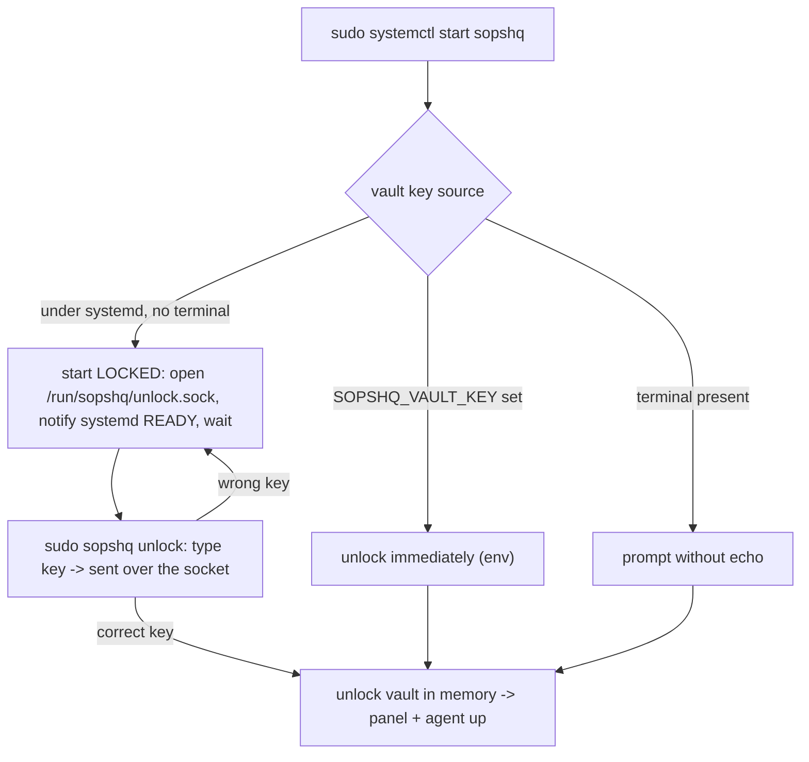

# Deploying SopsHQ on Linux

This guide installs and runs SopsHQ on a Linux server. Windows has its own guide:
[deployment-windows.md](deployment-windows.md).

- **The Linux way:** a dedicated, unprivileged service account, a neutral folder layout
  outside any user home, and a systemd unit. An encrypted volume for the data is
  recommended, not required.
- **Who it is for:** a non-technical reader can follow every step; an engineer gets the
  exact commands and the reasons.

## Contents

- [Terms](#terms)
- [Why this layout](#why-this-layout)
- [The folder layout](#the-folder-layout)
- [Install (once, as root)](#install-once-as-root)
- [First run (setting the vault key)](#first-run-setting-the-vault-key)
- [Everyday start and stop (systemd)](#everyday-start-and-stop-systemd)
- [Updating (Linux)](#updating-linux)
- [Other ways to run it](#other-ways-to-run-it)
- [Calling SopsHQ from your own decrypt automation](#calling-sopshq-from-your-own-decrypt-automation)
- [The built-in serve guard and pre-flight](#the-built-in-serve-guard-and-pre-flight)
- [The systemd unit and its sandbox](#the-systemd-unit-and-its-sandbox)
- [Uninstall](#uninstall)
- [Interactive menu](#interactive-menu)

## Terms

- **SopsHQ:** a self-hosted control plane that generates and places SOPS/age keys. It is
  a *management plane*: it never sits in the decrypt path.
- **Service account:** a Linux user created only to run a program, with no login and no
  home directory. Here it is called `sopshq`.
- **Vault key:** the passphrase that unlocks SopsHQ's encrypted store of private keys.
  The operator types it; SopsHQ never stores it and never unlocks on its own.
- **Keybase root:** one directory that holds every OS user's key store. The `sopshq`
  account owns it, so SopsHQ can manage every user's keys without root.
- **systemd:** the standard Linux service manager (`systemctl start ...`).
- **POSIX ACL:** a fine-grained file permission (set with `setfacl`) that grants one
  named user access to one file, on top of the normal owner, group and other bits.
- **Unlock socket:** a private Unix socket (`/run/sopshq/unlock.sock`) that the running
  but locked service listens on. `sopshq unlock` sends the vault key across it, and the
  key never touches disk. Only `root` and the `sopshq` account can reach it.

## Why this layout

SopsHQ runs as a neutral, unprivileged account and keeps its data on a neutral path
**outside any human's home directory**:

- **No root for placement.** A home directory is typically `0750`, so the `sopshq`
  account cannot enter another user's home, and placing a key there would need root. A
  neutral keybase root at mode `0711` (traverse only) avoids root entirely.
- **A neutral owner.** The private keys belong to a service identity, not to one
  person's account.
- **Encryption at rest is your choice.** An encrypted volume (for example LUKS or
  VeraCrypt, mounted at `/mnt/encrypted`) keeps everything unreadable until you unlock
  it. The defaults, `/srv/sopshq` and `/srv/sopshq-keys`, are not encrypted; pass
  `--data` and `--keybase` to put them on your encrypted volume.
- **Mount the volume before you run setup.** Setup creates any missing folder in the
  path, so on an unmounted volume the data lands, unencrypted, on the disk underneath.
- **A small blast radius.** A non-root process limits the damage if it is ever
  compromised. Root is used only for the one-time install.

## The folder layout

| Path | Owner | Perms | Purpose |
|---|---|---|---|
| `/opt/sopshq/sopshq` | `root:root` | `0755` | the binary; every user may execute it |
| `/usr/local/bin/sopshq` | `root:root` | symlink | `-> /opt/sopshq/sopshq`, so `sopshq` is on `PATH` |
| `/srv/sopshq/` | `sopshq:sopshq` | `0700` | data base; only `sopshq` may enter |
| `/srv/sopshq/config.jsonc` | `sopshq:sopshq` | `0600` | configuration |
| `/srv/sopshq/data/` | `sopshq:sopshq` | `0700` | vault, record store, oplog, audit log, sealed keys |
| `/srv/sopshq-keys/` | `sopshq:sopshq` | `0711` | keybase root (traverse only) |
| `/srv/sopshq-keys/<user>/` | `sopshq:sopshq` | `0700` + ACL | one user's key store; that user reads only their own key, through a POSIX ACL |

**The `PATH` link.** The install prefix (`/opt/sopshq`) is not on `PATH`, so setup also
creates `/usr/local/bin/sopshq`. That directory is on `PATH` and on `sudo`'s
`secure_path`, so `sudo sopshq unlock` and the other commands work without the full
path. Setup handles an existing entry like this:

- a link that already points at the binary is left alone;
- a link that points elsewhere is repointed;
- a real file at that path is left alone, with a warning to add `/opt/sopshq` to `PATH`
  or remove the file.

**Two folders, two modes.** The data base (`/srv/sopshq`, `0700`) and the keybase root
(`/srv/sopshq-keys`, `0711`) are separate directories. Setup refuses to let them be the
same path.

**Why the keybase root is `0711`:**

- `0711` lets an enrolled user pass through to their own subfolder, but nobody can list
  the root and learn every enrolled username.
- Each key file stays owned by `sopshq` with mode `0600`. SopsHQ grants each user read
  on only their own key with a POSIX ACL.
- That is why the `acl` package (`setfacl`, `getfacl`) is a prerequisite; setup
  installs it when it is missing.



## Install (once, as root)

Install is a subcommand of the binary; there is no separate installer script. Build the
binary (it lands in `dist/sopshq`), then run `sopshq install` as root. `sopshq setup` is
the same command under its original name.

```sh
./build.sh
sudo ./dist/sopshq install
```

Install is Linux-only and requires root, the mirror of `serve`, which refuses root. It
runs these steps:

1. **Prints the full plan first:** every path, owner, permission and purpose, before it
   asks anything.
2. **Prompts for each path,** with the defaults above. The prompts are skipped under
   `--yes`, `--unattended` and `--dry-run`, and when stdin is not a terminal. It refuses
   a path under `/home/*` (unless you pass `--force-home`), refuses the data base and the
   keybase root being equal, and requires absolute paths.
3. **Echoes the resolved plan** and asks one `y/N` confirmation before it changes
   anything.
4. **Makes the changes, idempotently:**
   - creates the `sopshq` system user if it is missing;
   - creates the directories and sets their owners and modes;
   - installs the `acl` package if it is missing (apt, dnf, zypper, pacman or yum);
   - installs the running binary into the prefix and links it onto `PATH`;
   - writes the machine-wide install pointer `/etc/sopshq/location`, which holds only
     the data path;
   - writes the systemd unit, embedded in the binary and not enabled at boot.
5. **Reviews path permissions** (see below).
6. **Hands off to the binary:** runs `sopshq init` once as the `sopshq` account on your
   terminal, so you set the vault key, then writes `keybase_root` into the config.

**Path-permission review.** Setup walks every folder from `/` down to the data base and
the keybase root:

- Where the service account cannot pass through, it offers to change that folder's
  group or add a POSIX ACL, and you choose each time.
- The root folder, top-level folders and mount points are never changed.
- Setup does not record what it changed, so note it if you will want to undo it.

Useful flags:

- `--prefix PATH`, `--data PATH`, `--keybase PATH`, `--user NAME`: set a path or the
  service account instead of accepting the default.
- `--force-home`: allow a data or keybase path under `/home/*`.
- `--yes` or `--unattended`: skip the per-path prompts and the `y/N` confirmation.
- `--dry-run`: print the preview and the resolved plan, then exit without changes. It
  runs as a normal user, so you can preview the layout before installing.

Re-running setup is safe. It converges to the same state and skips the vault-key step
once the vault exists.



## First run (setting the vault key)

Setup's last step runs `sopshq init` as the `sopshq` account and asks you to **choose a
vault key** (typed, never echoed). This key:

- encrypts the private keys SopsHQ holds;
- is never written to disk, so you type it every time SopsHQ starts;
- must be the same on every machine in a cluster, which is what lets peers read each
  other's keys.

The **transfer key** (the shared secret that authenticates machine-to-machine sync) is
not needed on a single machine. Set it in the panel once a second machine joins.

## Everyday start and stop (systemd)

The service is installed but **not enabled at boot**, because SopsHQ never unlocks its
vault on its own. Starting it is two steps: start the service, then unlock it.

```sh
sudo systemctl start sopshq     # starts LOCKED, then waits for the vault key
sudo sopshq unlock              # type the vault key (no echo); brings the panel up
sudo sopshq status              # shows locked/unlocked and the panel URL
journalctl -u sopshq -f         # follow the logs
sudo systemctl stop sopshq
```

**Why two steps.** The service account has no terminal to type the vault key on, so:

1. When systemd starts it, `serve` opens a private unlock socket, tells systemd it is up
   and waits. It serves no panel and holds no key.
2. `sudo sopshq unlock` asks for the vault key without echo and sends it across that
   socket.
3. `serve` checks the key, unlocks the vault in memory, and only then starts the panel
   and the machine-to-machine agent. A wrong key is rejected and the service stays
   locked, so you can try again.

**Who can reach the socket.** The socket is `/run/sopshq/unlock.sock`:

- systemd creates its directory, `/run/sopshq`, owned by `sopshq` with mode `0700`;
- the socket file itself is `0600`;
- only `root` and `sopshq` can reach it, so run `unlock` and `status` with `sudo`;
- the vault key travels over this socket and is never written to disk or a log.

After a reboot you start and unlock again the same way.

**Other sources of the vault key:**

- `SOPSHQ_VAULT_KEY` (for automation): when it is set, `serve` unlocks at once and never
  waits on the socket.
- A terminal: when you run `serve` by hand with a real terminal, it asks for the key
  there instead of using the socket.



## Updating (Linux)

Rebuild from source and run install again:

```sh
git pull && ./build.sh
sudo ./dist/sopshq install
```

What a re-run of install does:

- stops the running service and any stray `serve` first;
- replaces the binary;
- keeps your config, data and keys, and skips the vault-key step.

Start and unlock the service again afterwards. Install keeps no copy of the old binary,
so keep your previous build if you may want to go back.

`sopshq update` installs a signed release, keeps the old binary in
`/opt/sopshq/backups/`, and restores it if the new one fails to start. It is switched off
in this repository: no release signing key is embedded, so it refuses every update, and
no releases are published. [releasing.md](releasing.md) explains how a fork turns it on.

## Other ways to run it

systemd is the recommended way to run a Linux install, but the same binary offers more
commands. `serve` and `start` run the serve guard below, so run them as the `sopshq`
account, never as root. Run the dashboard, `unlock` and `status` with `sudo`: only root
and `sopshq` can reach the unlock socket.

**Status dashboard: `sudo sopshq` (no arguments).** It changes nothing. It shows:

- the state: `stopped`, `running (LOCKED)`, or `running (UNLOCKED)` with the panel URL;
- every path this machine uses: config, data dir, keybase root, binary, unlock socket,
  systemd unit, PID file and log file;
- the exact command for each action, marked `(needs sudo)` where it applies.

Run it as root, because it reads the machine-wide install pointer
(`/etc/sopshq/location`) and queries the `sopshq`-only unlock socket.

**Foreground:** `sudo -u sopshq /opt/sopshq/sopshq serve -config /srv/sopshq/config.jsonc`
asks for the vault key on your terminal and runs until Ctrl-C.

**Background without systemd:** `sudo -u sopshq sopshq start`.

- It launches `serve` detached, writes `<data dir>/sopshq.pid` and logs to
  `<data dir>/serve.log`.
- It starts LOCKED, because it has no terminal; follow it with `sudo sopshq unlock`.
- It refuses to start a second instance, and clears a stale PID file left by a dead
  process.
- `sudo -u sopshq sopshq stop` stops it.
- Where systemd is present, prefer systemd, so the process is supervised.

## Calling SopsHQ from your own decrypt automation

If you have your own script that unlocks and mounts an encrypted volume (opened by hand
or by a systemd unit you wrote), it can start SopsHQ once the data folder is mounted and
readable. Such hooks usually run as root, and `start` refuses root, so drop to the
service account:

```sh
runuser -u sopshq -- sopshq start -config /srv/sopshq/config.jsonc
```

- This is the background `start` described above. It starts **LOCKED**.
- Run `sopshq unlock` afterwards, by hand or from a later step that has the vault key.
- The vault never unlocks on its own: your script may start the process the moment the
  volume is available, but a person (or an explicit `SOPSHQ_VAULT_KEY`) supplies the key.
- For an interactive one-off run instead, use
  `runuser -u sopshq -- sopshq serve -config /srv/sopshq/config.jsonc`, which asks for
  the vault key right there.

On Windows there is no such decrypt hook, so the Startup-folder launcher script polls for
the data folder instead; see [deployment-windows.md](deployment-windows.md).

## The built-in serve guard and pre-flight

`serve` (and `start`, which runs it) refuses to run in two unsafe situations,
independently of systemd:

- **As root.** It exits and tells you to run as the `sopshq` account (systemd
  `User=sopshq`, or `runuser -u sopshq -- sopshq serve`).
- **From a data directory it does not own.** It exits and tells you to run as the owning
  account or fix the ownership. This catches a start as the wrong user before it writes
  records or sealed keys with the wrong owner.

Before it asks for the vault key, `serve` also checks that the data folder (and the
keybase root, when one is set) exists and is writable. If not, it stops with a message
naming the path, and adds a hint when the folder sits on a volume that is not mounted.
So a start with an unmounted volume fails loudly instead of writing to the wrong disk.

## The systemd unit and its sandbox

The installed unit (`/etc/systemd/system/sopshq.service`) runs `sopshq serve` as the
`sopshq` user and group, after `network-online.target`, with these settings:

- `Type=notify`, `NotifyAccess=main`: `serve` tells systemd it is up (`READY=1`) once it
  listens on the unlock socket, still locked. So `systemctl start` returns promptly.
- `RuntimeDirectory=sopshq`, `RuntimeDirectoryMode=0700`: systemd creates `/run/sopshq`
  for the unlock socket and removes it on stop.
- `WorkingDirectory` and `Environment=HOME` both point at the data base, so anything the
  service writes relative to its home lands inside the managed tree.
- `NoNewPrivileges=yes`: the process can never gain privileges, so no `sudo`.
- `ProtectSystem=strict`: the whole filesystem is read-only except the paths below.
- `ProtectHome=yes`: user home directories are hidden. Setup writes `no` only when you
  place data or keys under `/home/*` with `--force-home`.
- `PrivateTmp=yes`: a private `/tmp`.
- `ReadWritePaths=<data base> <keybase root>`: the only writable locations.
- `Restart=no`: a crash never restarts into an unattended, locked and waiting loop. You
  start and unlock by hand.

> [!IMPORTANT]
> `ProtectSystem=strict` makes everything else read-only. If SopsHQ writes a project's
> `secrets.yaml` or `.sops.yaml` into a folder outside the data base and keybase root
> (for example a project under `/srv`), add that folder to `ReadWritePaths` in the
> unit, or the write is denied. The optional permission-map scanner uses `sudo`, which
> `NoNewPrivileges=yes` blocks: leave that feature off, or run its scans outside the
> sandbox.

## Uninstall

`uninstall.sh`, in the root of this repository, removes an install that `sopshq setup`
made. Run it as root, and look at the plan first:

```sh
sudo ./uninstall.sh --dry-run   # asks every question, prints every command, changes nothing
sudo ./uninstall.sh
```

It finds the install from the systemd unit, the machine pointer and the config, and
prints every path and account it found. Then it asks, with no default answer:

- **Whether to continue.** First turn off anything else that starts or unlocks SopsHQ,
  such as a hook that runs when an encrypted volume opens.
- **For the install prefix, the data base and the keybase root, one at a time:** move it
  aside (to `<path>.removed-<UTC time>`), delete it, or keep it. Before the keybase root
  question it lists every key file in it. A delete needs the full path typed.
- **For each folder moved aside:** whether to make it root-owned and strip its ACLs.
- **For parent folders that carry an ACL entry for the service account:** whether to
  remove those entries.
- **For the permission-scan account and its sudoers file,** if either exists: whether to
  remove them.
- **For each `~/.bashrc` that SopsHQ wrote a key line or usage block into:** remove the
  block, keeping a backup copy beside the file, or leave it.

Nothing changes until you type `proceed`. It then:

1. stops the service and removes the unit, the `PATH` link and the machine pointer;
2. handles the folders as you chose;
3. removes the service account last;
4. lists anything left behind. If it stops part-way, it prints which steps finished and
   which did not.

> [!WARNING]
> The data base and the keybase root may hold the only copy of your private keys and
> your vault. Export a backup, or copy the key files out, before you delete them.

**Folders it keeps instead of moving or deleting.** It refuses a path that is the root,
a top-level folder, the top of a mounted volume (for example `/mnt/data`), a system
folder, inside a home folder, a symlink, or not owned by the service account. Such a
folder is left for you to remove by hand.

**Also left for you:** a group change the path-permission review made on a parent folder
(the original group is not recorded), and `~/.config/sops/age/keys.txt` links.

## Interactive menu

`sopshq menu` offers the commands as a numbered menu, on Linux and Windows, for when you
would rather answer prompts than look up flags.

```sh
sopshq menu
```

- **Items:** install, export, restore, reset-2fa, reset-admin, serve, start, stop,
  unlock, status, install-launcher, uninstall-launcher. `init`, `setup`, `update` and
  `version` are command-line only.
- **Inputs:** choosing an item asks for that item's own inputs (a path, a username, a
  yes or no).
- **Confirmations:** reset-admin and uninstall-launcher ask `y/N` before they run;
  restore asks when the destination folder is not empty. Install gets no extra
  confirmation from the menu, because setup already asks its own `y/N`.
- **Root:** on Linux, choosing install when you are not root re-runs the binary under
  `sudo`. Every other item runs directly, as if you had typed its flags.
- **The vault key** is typed fresh each time a command needs it. The menu never keeps it
  for a later item.
