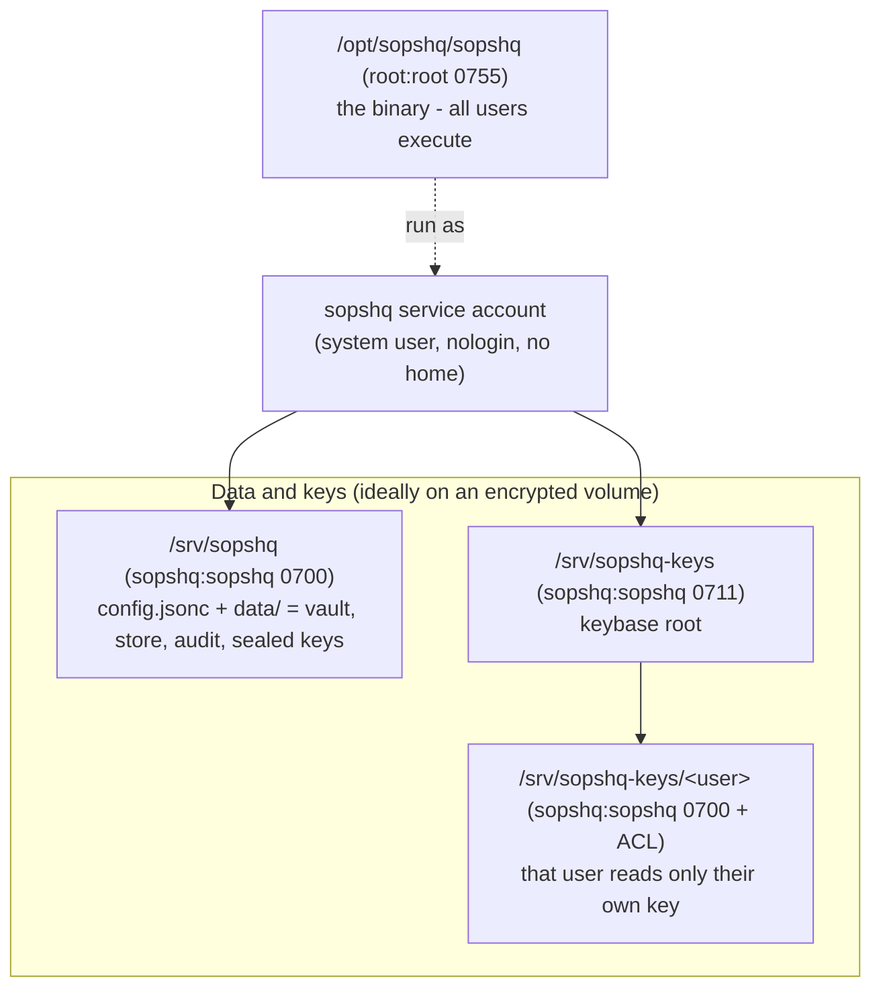
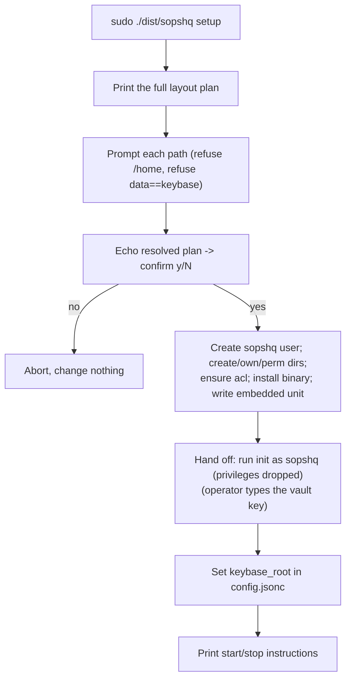
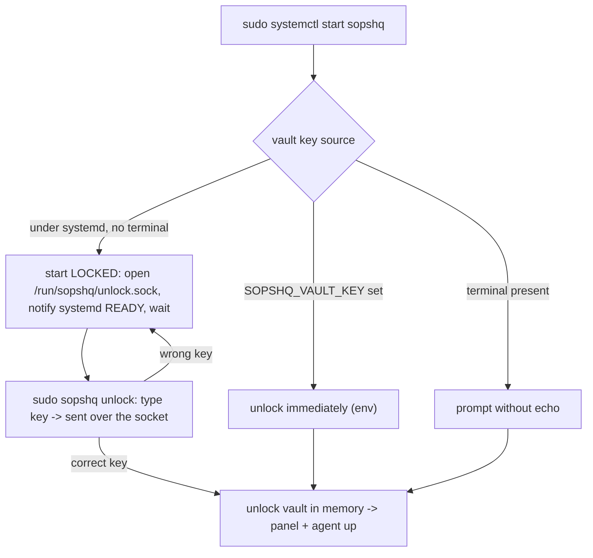
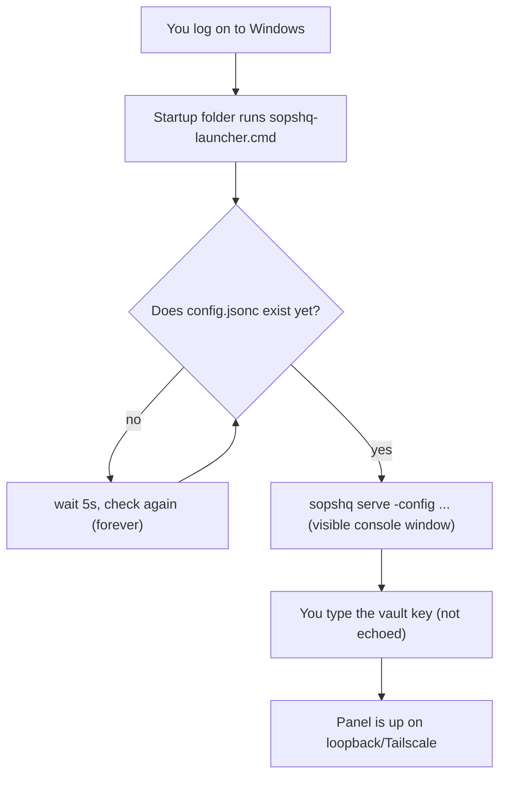

# Deploying SopsHQ (install, first run, everyday start)

This guide covers both platforms SopsHQ runs on today. It explains how to install
SopsHQ on a **Linux server** the recommended way - as a dedicated, unprivileged service
account with a neutral folder layout outside any user home (an encrypted mount is
recommended, not required), run under systemd - and how to run it on a **Windows dev
box**, where there is no service account or systemd: SopsHQ runs as your own Windows
user, and a small Startup-folder launcher (see "Windows: run automatically at every
logon" below) gets it going after each login. It is written so a non-technical reader
can follow every step, while giving an engineer the exact commands and reasons.

## Contents

- [Why this layout](#why-this-layout)
- [The folder layout](#the-folder-layout)
- [Install (once, as root)](#install-once-as-root)
- [First run (setting the vault key)](#first-run-setting-the-vault-key)
- [Everyday start and stop (systemd)](#everyday-start-and-stop-systemd)
- [Updating (Linux)](#updating-linux)
- [Other ways to run it (dashboard, foreground, background)](#other-ways-to-run-it-dashboard-foreground-background)
- [Calling SopsHQ from your own decrypt automation (Linux)](#calling-sopshq-from-your-own-decrypt-automation-linux)
- [The built-in serve guard](#the-built-in-serve-guard)
- [The systemd unit and its sandbox](#the-systemd-unit-and-its-sandbox)
- [Uninstall (Linux)](#uninstall-linux)
- [Interactive menu (`sopshq menu`, both platforms)](#interactive-menu-sopshq-menu-both-platforms)
- [Windows: install and first run](#windows-install-and-first-run)
- [Windows: run automatically at every logon (Startup-folder launcher)](#windows-run-automatically-at-every-logon-startup-folder-launcher)
- [Windows: keeping keys in their own folder](#windows-keeping-keys-in-their-own-folder)
- [Windows: uninstall](#windows-uninstall)

Terms used here, defined once:

- **SopsHQ** - a self-hosted control plane that generates and places SOPS/age keys. It
  is a *management plane*: it never sits in the decrypt path.
- **Service account** - a Linux user created only to run a program, with no login and
  no home directory. Here it is called `sopshq`.
- **Vault key** - the passphrase that unlocks SopsHQ's encrypted store of private keys.
  It is typed by the operator; SopsHQ never stores it and never unlocks on its own.
- **Keybase root** - one directory that holds every OS user's key store, owned by the
  `sopshq` account, so SopsHQ can manage all users' keys without root.
- **systemd** - the standard Linux service manager (`systemctl start ...`).
- **POSIX ACL** - a fine-grained file permission (via `setfacl`) that grants one named
  user access to one file, on top of the normal owner/group/other bits.
- **Unlock socket** - a private Unix socket (`/run/sopshq/unlock.sock`) the running-but-
  locked service listens on. `sopshq unlock` sends the vault key across it; the key never
  touches disk. Only `root` and the `sopshq` account can reach it.

## Why this layout

SopsHQ runs as a neutral, unprivileged account and keeps its data on a neutral path
**outside any human's home directory** (an encrypted mount is recommended, not required):

- A home directory is typically `0750`, so the `sopshq` account cannot traverse into
  another user's home - placing a key there would need root. A neutral **keybase root**
  at mode `0711` (traverse only) avoids root entirely.
- The private keys belong to a neutral service identity, not to one person's account.
- An **encrypted mount** (for example a LUKS or VeraCrypt volume mounted at
  `/mnt/encrypted`) is **recommended, not required**: it keeps everything unreadable at
  rest until you unlock the volume. Any neutral path outside a home works. The defaults,
  `/srv/sopshq` and `/srv/sopshq-keys`, are not encrypted; pass `--data` and `--keybase`
  to put them on your encrypted volume.
- Mount the volume BEFORE you run setup. Setup creates any missing folder in the path, so
  on an unmounted volume the data lands, unencrypted, on the root disk underneath it.
- Running as a **non-root** account limits the blast radius if the process is ever
  compromised. Root is used ONLY for the one-time install.

## The folder layout

| Path | Owner | Perms | Purpose |
|---|---|---|---|
| `/opt/sopshq/sopshq` | `root:root` | `0755` | the binary; every user may execute it |
| `/usr/local/bin/sopshq` | `root:root` | symlink | `-> /opt/sopshq/sopshq`, so `sopshq` is on `PATH` |
| `/srv/sopshq/` | `sopshq:sopshq` | `0700` | data base; only `sopshq` may enter |
| `/srv/sopshq/config.jsonc` | `sopshq:sopshq` | `0600` | configuration |
| `/srv/sopshq/data/` | `sopshq:sopshq` | `0700` | vault, record store, oplog, audit log, sealed keys |
| `/srv/sopshq-keys/` | `sopshq:sopshq` | `0711` | keybase root (traverse only) |
| `/srv/sopshq-keys/<user>/` | `sopshq:sopshq` | `0700` + ACL | one user's key store; that user gets read on their OWN key via a POSIX ACL |

The install prefix (`/opt/sopshq`) is not on `PATH`, so `sopshq setup` also creates a
symlink `/usr/local/bin/sopshq -> /opt/sopshq/sopshq`. That directory *is* on `PATH`
(and on `sudo`'s `secure_path`), so `sudo sopshq unlock`, `sopshq status`, and the other
commands below resolve without typing the full path. The symlink is idempotent: setup
leaves it if it already points at the binary, repoints it if it points elsewhere, and (if
a real file - not a symlink - is already at that path) leaves that file alone and prints a
warning telling you to add `/opt/sopshq` to `PATH` or remove the file.

The **data base** (`/srv/sopshq`) and the **keybase root** (`/srv/sopshq-keys`)
are two DISTINCT directories with different permissions (`0700` vs `0711`). `sopshq
setup` refuses to let them be the same path.

The keybase root is `0711`, not `0755`: `0711` lets an enrolled user *traverse into
their own subfolder* to reach their key, but nobody can `ls` the root and learn every
enrolled username. Each key file stays owned by `sopshq` (`0600`); SopsHQ grants each
user read on ONLY their own key with a POSIX ACL. That is why the `acl` package
(`setfacl`/`getfacl`) is a prerequisite `sopshq setup` ensures is present.



## Install (once, as root)

Install is a built-in subcommand of the binary - there is no separate installer script.
Build the binary first (produces `dist/sopshq`), then run `sopshq install` as root
(`sopshq setup` is the same command under its original name - both run the identical
code, so use whichever you prefer):

```sh
./build.sh
sudo ./dist/sopshq install
```

`sopshq install`/`sopshq setup` is Linux-only and requires root (it is the mirror of
`serve`, which refuses root). It:

1. **Prints the full plan first** - every path, owner, permission, purpose, and the
   "why not a home (an encrypted mount is recommended)" reasoning - BEFORE it asks
   anything.
2. **Prompts for each path** with the neutral defaults above. It refuses a path under
   `/home/*` (unless you pass `--force-home`), refuses the data base and keybase root
   being equal, and requires absolute paths.
3. **Echoes the resolved plan** and asks for a single `y/N` confirmation before it
   changes anything.
4. **Executes idempotently** - creates the `sopshq` system user if missing, creates and
   owns/permissions the directories, ensures the `acl` package is installed (detecting
   apt / dnf / zypper / pacman / yum), installs the running binary to the prefix, links
   it onto `PATH` (`/usr/local/bin/sopshq`), writes the machine-wide install pointer
   (`/etc/sopshq/location`, which holds only the data path), and writes the systemd unit
   (embedded in the binary; not enabled at boot).
   It also runs a **path-permission review**: it walks every folder from `/` down to the
   data base and keybase root, and where the service account cannot pass through, it
   offers to change that folder's group or add a POSIX ACL (you choose each time). The
   root folder, top-level folders and mount points are never changed. Setup does not
   record what it changed, so note it if you will want to undo it.
5. **Hands off to the binary** - runs `sopshq init` ONCE as the `sopshq` account on your
   terminal (privileges dropped to that account), so you set the vault key
   interactively, then wires `keybase_root` into the config.

Useful flags:

- `--prefix PATH` / `--data PATH` / `--keybase PATH` / `--user NAME` - pre-seed a path
  or the service account instead of accepting the default.
- `--force-home` - allow a data or keybase path under `/home/*` (refused by default).
- `--yes` / `--unattended` - skip the per-path prompts and the `y/N` confirmation.
- `--dry-run` - print the preview and the resolved plan, then exit making NO changes.
  It runs as a normal user, so you can preview the layout before installing.

Re-running setup is safe: it converges to the same state and skips the interactive
vault-key step once the vault already exists.



## First run (setting the vault key)

Setup's final step runs `sopshq init` as the `sopshq` account. You are asked to
**choose a vault key** (typed, never echoed). This key:

- encrypts the private keys SopsHQ holds,
- is never written to disk - you type it every time SopsHQ starts,
- must be the SAME on every machine in a cluster (that is what lets peers read each
  other's keys).

The **transfer key** (the shared secret that authenticates machine-to-machine sync) is
NOT required on a single machine. Set it later in the panel once a second machine joins.

## Everyday start and stop (systemd)

The service is installed but **not enabled at boot**, because SopsHQ never auto-unlocks
its vault. Starting it is **two steps**: start the service, then unlock it.

```sh
sudo systemctl start sopshq     # starts LOCKED, then waits for the vault key
sudo sopshq unlock              # type the vault key (no echo); brings the panel up
sudo sopshq status              # shows locked/unlocked and the panel URL
journalctl -u sopshq -f         # follow the logs
sudo systemctl stop sopshq
```

**Why two steps.** The service runs as the unprivileged `sopshq` account, which has no
terminal to type the vault key on. So when systemd starts it, `serve` opens a **private
unlock socket**, tells systemd it is up, and **waits** - it serves no panel and holds no
key. `sudo sopshq unlock` prompts for the vault key without echo, sends it across that
socket, and `serve` validates it, unlocks the vault in memory, and only then brings up
the panel and the machine-to-machine agent. A wrong key is rejected and the service
stays locked, so you can simply try again.

The unlock socket lives at `/run/sopshq/unlock.sock`. Its directory, `/run/sopshq`, is
created by systemd (`RuntimeDirectory=sopshq`) at mode `0700` and owned by the `sopshq`
account, so only `root` and `sopshq` can reach the socket; the socket file itself is
`0600`. You normally run `unlock` and `status` with `sudo` (root reaches the socket
through that directory). **The vault key travels this socket and is never written to disk
or a log.**

After a reboot, you start and unlock again the same way - there is no auto-unlock.

The vault key can also come from the `SOPSHQ_VAULT_KEY` environment variable (for
automation): when it is set, `serve` unlocks immediately and never enters the locked/wait
state. And when `serve` is run with a real terminal (for example by hand, not via
systemd), it prompts for the vault key directly instead of using the socket.



## Updating (Linux)

Rebuild from source and run install again:

```sh
git pull && ./build.sh
sudo ./dist/sopshq install
```

Install is safe to re-run. It stops the running service and any stray `serve` first,
replaces the binary, and keeps your config, data and keys. It skips the vault-key step
because the vault already exists. Start and unlock the service again afterwards. It keeps
no copy of the old binary, so keep your previous build if you may want to go back.

`sopshq update` also exists. It installs a signed release, keeps the old binary in
`/opt/sopshq/backups/` and restores it if the new one fails to start. It is switched off
in this repository: no release signing key is embedded, so it refuses every update, and
no releases are published. A fork that publishes its own signed releases can turn it on;
[releasing.md](releasing.md) explains how, and how `update` checks a release.

## Other ways to run it (dashboard, foreground, background)

systemd is the recommended way to run this Linux install, but the same binary offers a
few more commands. All of them respect the serve guard (below): run them as the `sopshq`
service account, not root.

- **`sopshq` (no arguments)** prints a **status dashboard**: the state
  (`stopped` / `running (LOCKED)` / `running (UNLOCKED)` with the panel URL), every path
  this machine uses (config, data dir, keybase root, binary, unlock socket, systemd
  unit, PID file, log file), and the exact command for each action - with `(needs sudo)`
  hints. It never changes anything; it is the friendly place to see "what is where and
  how do I start it". Run it as root: `sudo sopshq`. Root reads both the machine-wide
  install pointer (`/etc/sopshq/location`, world-readable, holds the data base path) that
  setup writes so any user can locate the install, and the `sopshq`-only unlock socket it
  queries for the running state.
- **Foreground** - `sudo -u sopshq <prefix>/sopshq serve -config <data>/config.jsonc`
  prompts for the vault key on your terminal and runs until Ctrl-C. Useful for a quick
  manual run without systemd.
- **Background (no systemd)** - `sudo -u sopshq sopshq start` launches `serve` detached,
  writes `<data dir>/sopshq.pid`, and logs to `<data dir>/serve.log`. It starts LOCKED
  (no terminal), so follow it with `sudo sopshq unlock`. `sudo -u sopshq sopshq stop`
  stops it. `start` refuses to launch a second instance while one is already running and
  clears a stale PID file left by a dead process. It is for a Linux host without
  systemd; where systemd is present, prefer it so the run is supervised. (`start` and
  `stop` also work on Windows, where the Startup-folder launcher is the usual way.)

## Calling SopsHQ from your own decrypt automation (Linux)

If you already have your own script that unlocks and mounts an encrypted volume (for
example a LUKS or VeraCrypt volume opened by hand or by a systemd unit you wrote), you
do not need `sopshq setup` or systemd to start SopsHQ once that volume is mounted: have
your script call `sopshq start` directly, passing the config path once it knows the
data folder is mounted and readable:

```sh
sopshq start -config /srv/sopshq/config.jsonc
```

This is the same **background** command described above ("Other ways to run it"): it
launches `serve` detached, writes a PID file and log under the data directory, and -
because it has no terminal to type the vault key on - starts **LOCKED**. Run
`sopshq unlock` afterward (by hand, or from a later step in your own automation that has
the vault key) to deliver the vault key and bring the panel up. The vault is never
auto-unlocked: your script may start the process the moment the volume is available, but
a human (or an explicit `SOPSHQ_VAULT_KEY`) still has to supply the key.

If your script instead wants to run SopsHQ in the foreground and keep a terminal
attached (for example a one-shot interactive session, not a long-running automation),
use `sopshq serve -config /srv/sopshq/config.jsonc` instead - it prompts for the
vault key right there and runs until Ctrl-C, exactly like a manual foreground run.

This is the Linux mirror of the Windows Startup-folder launcher documented below: on
Windows, SopsHQ itself polls for the data folder to appear because there is no
LUKS/VeraCrypt-equivalent decrypt hook to call it from; on Linux, your own decrypt
automation already knows the moment the volume becomes available, so it calls SopsHQ
directly instead of SopsHQ polling for it.

## The built-in serve guard

SopsHQ's `serve` refuses to start in two unsafe situations, independently of systemd,
so a mistake cannot quietly run it wrong:

- **As root.** `serve` exits with a clear message telling you to run as the dedicated
  `sopshq` account (systemd `User=sopshq`, or `runuser -u sopshq -- sopshq serve`).
- **From a data directory it does not own.** If the data directory is owned by a
  different user than the process, `serve` exits and tells you to run as the owning
  account or fix ownership. This catches "started as the wrong user" before it writes
  records and sealed keys with the wrong owner.

## The systemd unit and its sandbox

The installed unit (`/etc/systemd/system/sopshq.service`) runs `sopshq serve` as
`User=sopshq` with these directives:

- `Type=notify` / `NotifyAccess=main` - `serve` tells systemd it is up (`READY=1`) once
  it is listening on the unlock socket (still locked), so `systemctl start` returns
  promptly and `systemctl status` shows `locked` until you run `sopshq unlock`.
- `RuntimeDirectory=sopshq` / `RuntimeDirectoryMode=0700` - systemd creates `/run/sopshq`
  (owned by `sopshq`, mode `0700`) to hold the unlock socket, and removes it on stop.
- `NoNewPrivileges=yes` - the process can never gain privileges (no `sudo`).
- `ProtectSystem=strict` - the whole filesystem is read-only except the paths below.
- `ProtectHome=yes` - user home directories are hidden from the service. (`sopshq setup`
  sets this to `no` only when you deliberately place data or keys under `/home/*` with
  `--force-home`.)
- `PrivateTmp=yes` - a private `/tmp`.
- `ReadWritePaths=<data base> <keybase root>` - the only writable locations.
- `Restart=no` - a crash never auto-restarts into an unattended locked-and-waiting loop;
  matching "the vault never auto-unlocks", you start and unlock by hand.

> [!IMPORTANT]
> Because `ProtectSystem=strict` makes everything else read-only, if SopsHQ writes a
> project's `secrets.yaml`/`.sops.yaml` into a folder OUTSIDE the data base and keybase
> root (for example a project under `/srv`), you must ADD that folder to
> `ReadWritePaths` in the unit, or the write is denied. Likewise, the optional
> permission-map scanner uses `sudo`, which `NoNewPrivileges=yes` blocks; leave that
> feature off, or run its scans outside the sandbox.

## Uninstall (Linux)

`uninstall.sh`, in the root of this repository, removes an install that `sopshq setup`
made. Run it as root, and look at the plan first:

```sh
sudo ./uninstall.sh --dry-run   # asks every question, prints every command, changes nothing
sudo ./uninstall.sh
```

It finds the install from the systemd unit, the machine pointer and the config, and
prints every path and account it found. Then it asks, with no default answer:

- whether to continue. Turn off first anything else that starts or unlocks SopsHQ, such
  as a hook that runs when an encrypted volume opens.
- for the install prefix, the data base and the keybase root, one at a time: move it
  aside (to `<path>.removed-<UTC time>`), delete it, or keep it. It lists every key file
  in the keybase root before that question. A delete needs the full path typed.
- for each folder moved aside: whether to make it root-owned and strip its ACLs.
- whether to remove the permission-scan account and its sudoers file, if either exists.
- for each `~/.bashrc` that SopsHQ wrote a key line or usage block into: remove the
  block, keeping a backup copy beside the file, or leave it.

Nothing changes until you type `proceed`. It then stops the service, removes the unit,
the `PATH` link and the machine pointer, handles the folders, and removes the service
account last. It ends with a list of anything left behind. If it stops part-way, it
prints which steps finished and which did not.

> [!WARNING]
> The data base and the keybase root may hold the only copy of your private keys and
> your vault. Export a backup, or copy the key files out, before you delete them.

It refuses to touch a path that is a mount point, a symlink, a system folder, under
`/home`, or not owned by the service account. Such a folder is left for you to remove by
hand. Also left by hand: a group change the path-permission review made on a parent
folder (the original group is not recorded), and `~/.config/sops/age/keys.txt` links.

## Interactive menu (`sopshq menu`, both platforms)

Every subcommand above (and every Windows one below) can also be driven through one
interactive, numbered menu instead of flags - useful when you would rather answer a few
prompts than look up a flag name:

```sh
sopshq menu
```

It lists install, export, restore, reset-2fa, reset-admin, serve, start, stop, unlock,
status, install-launcher, and uninstall-launcher by number (`init`, `setup`, `update` and
`version` are command-line only); choosing one prompts for that item's own inputs (a
path, a username, a yes/no) instead of requiring them on the command line. reset-admin
and uninstall-launcher ask a `y/N` confirmation before they run, and restore asks when
the destination folder is not empty. Choosing **install** on Linux does not
get a second confirmation from the menu itself: `sopshq setup` (which install runs)
already prints its own plan and asks its own `y/N`, so the menu would otherwise ask
twice for the same thing.

On Linux, choosing **install** while you are not already root re-runs this same binary
under `sudo`, so the root-required steps happen in that elevated process (the setup
code's own root check still fires there too, harmlessly true, as a second line of
defense). Every other menu item - and install itself once you are root - runs directly,
exactly as if you had typed its flags by hand. The vault key (or a new one, at `install`/
`init` time) is always typed fresh at the point each subcommand needs it - the menu never
collects it once and reuses it for a later selection.

---

# Windows

There is no service account and no systemd on Windows: SopsHQ runs as your own Windows
user (a "dev box" run), and the recommended way to keep it running across logons is the
Startup-folder launcher described below - not a Windows Service. This section covers
install, first run, running automatically at every logon, keeping keys in their own
folder, and uninstall.

## Windows: install and first run

Install SopsHQ by running `install` once - there is no root-only installer on Windows
(`sopshq setup` refuses to run outside Linux), so `install` on this platform runs two
things in sequence against the same paths: `init`'s vault setup, then
`install-launcher`'s Startup-folder registration (see below), so SopsHQ starts
automatically at every logon from here on:

```powershell
sopshq install -dir C:\SopsHQ
```

This writes `C:\SopsHQ\config.jsonc`, creates the vault at `C:\SopsHQ\data` (asking you
to **choose a vault key**, typed twice and never echoed), records this install as your
per-user default at `%AppData%\sopshq\location` so a later bare `sopshq` finds it, and
registers the Startup-folder launcher script. Then run it in the foreground any time you
want to try it out without waiting for the next logon:

```powershell
sopshq serve -config C:\SopsHQ\config.jsonc
```

This prompts for the vault key on your terminal and serves the panel until you press
Ctrl-C.

**Flag-driven / scripted install.** `install`'s flags are the same ones `init` accepts,
and fully cover setting up an install without any interactive prompt beyond the vault
key itself, including designating an existing data folder as this machine's default:

```powershell
sopshq install -dir C:\SopsHQ -name my-windows-box            # name this node
sopshq install -dir D:\OtherSopsHQ -set-default                # a 2nd install; make it the default
sopshq install -dir C:\SopsHQ -keys D:\SopsHQKeys               # keep keys in a separate folder (see below)
```

`-set-default` is what to reach for when scripting against an **existing** data folder:
point `-dir` at it and pass `-set-default` to make the bare `sopshq` dashboard (and
`serve`'s auto-discovery) resolve to it, even if a different install was the default
before. Re-running `install` against a folder that already has a config and vault is
safe - it reports what already exists (skipping the vault-key prompt when the vault
already exists) and re-registers the launcher script, changing nothing else.

**Running the two steps separately.** `init` (vault setup only) and `install-launcher`
(Startup-folder registration only) remain available as their own subcommands, exactly as
before, if you want either step without the other - for example, re-registering the
launcher alone after moving the binary, without touching the vault:

```powershell
sopshq init -dir C:\SopsHQ                          # vault setup only
sopshq install-launcher -config C:\SopsHQ\config.jsonc   # launcher registration only
```

## Windows: run automatically at every logon (Startup-folder launcher)

SopsHQ has no notion of "unattended, nobody logged in" on Windows - a Windows session
always has a logged-in user to type the vault key - so the launcher's only job is to get
`serve` running once you are logged in and your data folder (which may sit on a volume
you decrypt and mount by hand after logging in) is actually available.

`sopshq install` (above) registers this launcher for you as its second step, so most
Windows installs never need to run this by hand. Register (or re-register) it on its own
with:

```powershell
sopshq install-launcher -config C:\SopsHQ\config.jsonc
```

This writes one small script, `sopshq-launcher.cmd`, into your own Startup folder
(`%AppData%\Microsoft\Windows\Start Menu\Programs\Startup`) - no administrator prompt is
needed, because that folder lives entirely inside your own user profile. From your next
logon onward, Windows runs that script automatically:

1. It **polls forever** (no timeout) for `config.jsonc` to exist at the path you gave -
   so it waits patiently if your data folder lives on a volume you have not yet unlocked
   and mounted.
2. Once found, it runs `sopshq serve -config <path>` in a **visible console window** -
   SopsHQ prompts for the vault key right there, without echo, exactly like any other
   foreground run. **The vault still never auto-unlocks**: the launcher only gets
   `serve` running and waiting for you to type the key.
3. If `serve` ever exits (you close it, it errors, or you stop it), the window pauses
   with "Press any key to continue..." instead of vanishing, so you can read what
   happened.



Re-running `install-launcher` is safe: it overwrites the same script file, so it never
leaves stale copies behind.

## Windows: keeping keys in their own folder

`keybase_root` works on Windows too, as a plain keys root: each OS user's key store
lives at `<keybase_root>\<username>\keys.txt` - the same layout as Linux - and a
local OS user with no explicit keystore path of their own resolves there
automatically. The difference is what surrounds the files: on Linux the root is
owned by the SopsHQ service account and per-user POSIX ACLs (`setfacl`) gate each
store; on Windows no ACLs are applied - the machine runs SopsHQ as one account,
which owns the whole subtree through ordinary NTFS inheritance. The folder must
exist before `serve` starts. Set it at install time:

```powershell
sopshq install -dir C:\SopsHQ -keys D:\SopsHQKeys
```

This records `D:\SopsHQKeys` in `config.jsonc` as `keybase_root`, distinct from
`data_dir` (which holds the vault, store, oplog, and audit log). A multi-user
Windows ACL layout (the `icacls` counterpart of the Linux ACL step) is not
available.

## Windows: uninstall

There is no Windows Service and no system-wide registration to undo - only the
per-user Startup launcher, the installed binary folder, and two per-user settings SopsHQ
may have written: the install folder on your user `PATH` (if you accepted that offer in
`sopshq menu`), and the usage shim's values under `HKCU\Environment` (if you installed
the shim from the panel's Usage page; remove it there first). **Data and keys are
intentionally left in place**, exactly like the Linux uninstall above; remove them only
if you are sure.

```powershell
sopshq uninstall-launcher                                    # removes the Startup script only
del "%AppData%\sopshq\location"                               # this machine's per-user default pointer
rmdir /s /q C:\Path\To\SopsHQ-install                          # wherever you placed sopshq.exe
# Data and keys are intentionally left in place. Remove them only if you are sure:
#   rmdir /s /q C:\SopsHQ
#   rmdir /s /q D:\SopsHQKeys
```

`sopshq uninstall-launcher` only ever deletes the one script `install-launcher` wrote; it
never reads or touches your data folder, vault, or key files.
