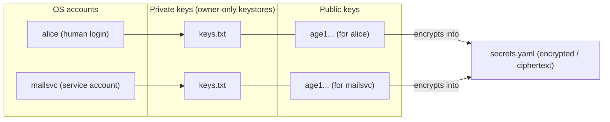

# SopsHQ terminology and how it works

This page explains, in plain language, every word SopsHQ uses and the one rule that
decides whether an account can read a secret. It is written so a non-technical reader
can follow it. Every term is defined the first time it appears, and every file path is
spelled out in full.

If you only remember one thing, remember **the two gates** (explained below).

## The very short version

- A **secret** is a name and a value you want to keep out of plaintext, for example
  `STRIPE_KEY = sk_live_...`.
- SopsHQ encrypts that value so only chosen operating-system accounts can open it.
- An account can open a secret only when it has **both** the right key **and**
  permission to read the encrypted file. Those are the two gates.

## Core objects

- **Secret** - a name plus a value you want kept out of plaintext.
  Example: `STRIPE_KEY = sk_live_...`.
- **age key pair** - a matched pair made by the `age` tool (a small encryption
  program): one **private key** and one **public key**. The two always go together.
  Technically this is an X25519 key pair. X25519 is *classical* cryptography, **not**
  post-quantum.
- **Private key** - the secret half of the pair. It *opens* (decrypts) secrets. It
  lives in a file called `keys.txt`. Guard it the way you guard an SSH private key.
  SopsHQ stores it as an owner-only file (only the owning account can read it).
- **Public key** - the non-secret half of the pair. It looks like `age1...`. You use
  it when *encrypting* a secret, so that the matching private key can later open the
  secret. It is safe to share. (In the sops documentation a public key added to a file
  is called a "recipient"; this is the only place that word appears here, and only so a
  reader who knows sops can map the two names. SopsHQ never uses "recipient" anywhere
  else.)
- **Secrets file** - the file that stores the *encrypted* secret values. It is named
  `secrets.yaml`. Anyone may read this file, because everything inside it is scrambled;
  only a private key can actually open the values.
- **Inner key** - one random key that sops (the tool that reads and writes
  `secrets.yaml`) creates for each secrets file. This inner key scrambles the values.
  Each public key you add gets its own encrypted copy of the inner key, stored in a
  small block at the bottom of the file. So adding a public key is a quick re-encrypt
  of the inner key, not a re-encrypt of every value. (Technically this is the sops
  "data key".)
- **Helper file** - an optional file named `.sops.yaml`. It tells sops which public
  keys to use when *creating* or *updating* a secrets file. It is ignored when
  *opening* one. SopsHQ keeps this file.

## Accounts and folders

- **OS account** - a real operating-system account, which may be a human login (for
  example `alice`) or a service/daemon with no login (for example `mailsvc`). SopsHQ
  places a private key for each OS account it manages. (In the code this is called an
  "OS user".)
- **Keystore folder** - the folder that holds one OS account's private key file
  (`keys.txt`). The default is `~/.config/sops/age` (the standard sops location, where
  `~` means that account's home folder). It may be a symlink (a shortcut) that points
  at the real file on a secure, encrypted drive. (In the code this field is called
  `KeyBase`.)
  - The `~/.config/sops/age` default only resolves for an account that **has** a home
    folder. A homeless service or daemon account (one whose `/etc/passwd` home is
    `/nonexistent` or missing) has no `~` to expand, so the default points nowhere.
    Such an account needs an **explicit, account-owned keystore path** instead - for
    example `/etc/<service>/keys`. SopsHQ creates that folder and makes it owner-only
    (readable and writable only by that account), and the account's program then points
    the `SOPS_AGE_KEY_FILE` environment value at the `keys.txt` inside it.
- **Key file path** - the environment value a running program uses to tell sops which
  private key file to open with. It is the environment variable `SOPS_AGE_KEY_FILE`. If
  it is not set, sops falls back to the default keystore folder under that program's
  home.
- **Discovery** - whether sops (and the apps that call it) can actually FIND an
  account's key. It rests on two pointers: the `SOPS_AGE_KEY_FILE` value above, and a
  shortcut at the default location (on Windows a junction `%USERPROFILE%\.sops`, on
  Linux a symlink `~/.config/sops/age/keys.txt`). SopsHQ can **check** discovery
  (the OS-users page shows a verdict: *sops can find this key*, *NOT wired*, or
  *conflict - points elsewhere*) and **repair** it with the **Fix discovery** button,
  which creates only a missing or broken pointer and never overwrites one you set on
  purpose (that is shown as a conflict for you to resolve).

## Groupings

- **Project** - a *named* grouping that has one folder per machine. SopsHQ writes a
  secrets file into that folder. A project is a SopsHQ record that *points at* a
  physical folder; it is not the folder itself. Example: the project "Webshop" points
  at `~/projects/webshop` on the server and at `D:\code\webshop` on the laptop.
- **Secret set** - a group of secrets that does **not** belong to any project folder.
  Its files are stored under each chosen account's keystore, at
  `<keystore>/global/<set>/secrets.yaml` (where `<keystore>` is that account's keystore
  folder and `<set>` is the set's name). A set is a name that groups the secrets plus
  the OS accounts allowed to open them. A set with just one account is simply "your own
  global secrets". (In the code this is called a "GlobalSet".)
  - **Each account gets its own private copy.** There is **no** shared folder and **no**
    cross-account access. Every account you pick receives its own owner-only copy of the
    encrypted file inside its own keystore, encrypted so that account's own key opens it.
    This is exactly why a set sidesteps the Gate 2 problem (see "The two gates" below):
    because no account ever reads another account's copy, no account needs permission to
    read a folder that belongs to someone else.

## Actions and rules

- **Apply** - the SopsHQ action that does the real work: it makes the keys, places the
  private keys into keystore folders as owner-only files, writes or updates the secrets
  file, and writes the helper file.
- **Import (adopt)** - the action for state that ALREADY exists on disk. Instead of
  making a new key, SopsHQ reads the private key that is already in a keystore, records
  it under its own management (so it shows on the Keys page and can be used), and keeps
  the existing helper file - **without changing any file on disk**. Adding an OS account
  whose keystore already holds a key imports it automatically; an already-set-up project
  offers an **Import the existing setup** button. Importing never drops a public key that
  the current secrets were encrypted to, so no existing reader is locked out.
- **Print-commands** - SopsHQ never runs as the all-powerful root account. Anything
  that needs system privileges (creating an OS account, setting its home folder, or
  writing into another account's folder) is shown to you as the exact `sudo` commands
  to run yourself. Once you have run them, SopsHQ does the rest without privileges. (In
  the design notes this is called "Mode A".)

## The two gates

To **read** a secret, an OS account needs **both** of the following at the same time.
Missing either one means it cannot read the secret.

1. **Gate 1 - the key.** A private key that can open the secret, stored in the
   account's own keystore folder and readable only by that account. SopsHQ always sets
   this up.
2. **Gate 2 - the file.** Permission to read the encrypted secrets file on disk.
   - In a **project folder**, there is **one** shared `secrets.yaml`. Every account you
     pick must be able to read that folder. SopsHQ only *warns* if one likely cannot; it
     does not change folder permissions for you.
   - In a **secret set**, each account gets its **own** private copy of the encrypted
     file inside its own keystore, so no shared-folder permission is needed.

**Rule of thumb:** if the accounts already share the same folder and owner, use a
project folder. If a separate or service account should not live in that folder, use a
secret set.

## Setting up an account's keystore

When you add an OS account, SopsHQ works out where that account's `keys.txt` should
live and how `sops` will find it - and it does this **without ever running as the
all-powerful root account**. It reads harmless facts about the account (does it exist?
what is its home folder?) with the built-in `getent` tool, which needs no privileges.
For anything that only root can do it shows you the exact `sudo` commands to run, then
carries on once you have run them (the "Print-commands" rule above).

- **A normal account with a home folder.** The keystore defaults to
  `~/.config/sops/age`, so `sops` finds the key on its own. Nothing else to do.
- **Storing the key on a secure (encrypted) drive.** Tick the box and give the real
  folder on the drive. The real `keys.txt` lives there, and the default
  `~/.config/sops/age/keys.txt` becomes a shortcut (symlink) to it. If the drive is
  locked, decryption safely fails instead of leaking the key.
- **A service or daemon account with no home.** The `~/.config/sops/age` default does
  not work (there is no home to expand `~` to), so the account needs its own folder,
  for example `/etc/<service>/keys`. SopsHQ prints the commands to create it and hand
  it to the account:
  `sudo mkdir -p /etc/<service>/keys && sudo chown <service>:<service> /etc/<service>/keys && sudo chmod 700 /etc/<service>/keys`.
  The account's program then points `SOPS_AGE_KEY_FILE` at
  `/etc/<service>/keys/keys.txt`.
- **An account that does not exist yet.** SopsHQ prints
  `sudo useradd -m -d /home/<account> <account>` to create it with a home, then the
  keystore commands above.

These account checks are Linux-only (they use `getent`). On Windows the keystore is
just a folder path made readable only by the account, and no Linux commands are shown.

## How the pieces connect

The diagram below reads left to right:

1. Each **OS account** holds a **private key** (`keys.txt`) in its own keystore folder,
   readable only by that account.
2. Each private key has a matching **public key** (`age1...`).
3. A public key is used to **encrypt** a secret into the shared, ciphertext
   **`secrets.yaml`**. The matching private key is what later opens it.

A reader with a private key whose matching public key encrypted a value can open that
value. A reader without such a key sees only ciphertext, even with the file in hand -
which is exactly why Gate 1 (the key) and Gate 2 (reading the file) are separate.
