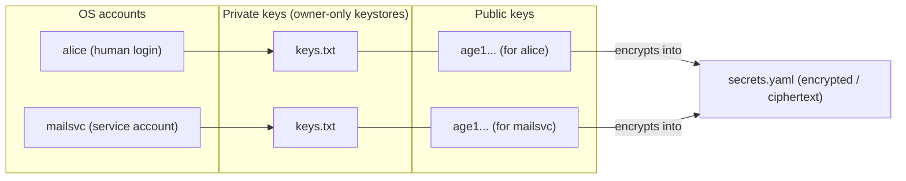

# SopsHQ terminology and how it works

This page explains, in plain language, every word SopsHQ uses and the one rule that
decides whether an account can read a secret. Every term is defined the first time it
appears, and every file path is spelled out in full.

If you only remember one thing, remember **the two gates** (explained below).

## Contents

- [The very short version](#the-very-short-version)
- [Core objects](#core-objects)
- [Accounts and folders](#accounts-and-folders)
- [Discovery](#discovery)
- [Groupings](#groupings)
- [Actions and rules](#actions-and-rules)
- [The two gates](#the-two-gates)
- [Setting up an account's keystore](#setting-up-an-accounts-keystore)
- [How the pieces connect](#how-the-pieces-connect)

## The very short version

- A **secret** is a name and a value you want to keep out of plaintext, for example
  `STRIPE_KEY = sk_live_...`.
- SopsHQ encrypts that value so only chosen operating-system accounts can open it.
- An account can open a secret only when it has **both** the right key **and**
  permission to read the encrypted file. Those are the two gates.

## Core objects

- **Secret:** a name plus a value you want kept out of plaintext.
  Example: `STRIPE_KEY = sk_live_...`.
- **age key pair:** a matched pair made by the `age` tool (a small encryption program):
  one **private key** and one **public key**.
  - Technically this is an X25519 key pair. X25519 is *classical* cryptography, **not**
    post-quantum.
- **Private key:** the secret half of the pair. It *opens* (decrypts) secrets.
  - It lives in a file called `keys.txt`.
  - Guard it the way you guard an SSH private key. SopsHQ stores it as an owner-only
    file.
- **Public key:** the non-secret half of the pair. It looks like `age1...`.
  - You use it when *encrypting* a secret, so the matching private key can later open
    it. It is safe to share.
  - The sops documentation calls a public key added to a file a "recipient". SopsHQ
    does not use that word.
- **Secrets file:** the file that stores the *encrypted* values, named `secrets.yaml`.
  Anyone may read it, because everything inside is scrambled; only a private key can
  open the values.
- **Inner key:** one random key that sops creates for each secrets file. It scrambles
  the values. (Technically this is the sops "data key".)
  - Each public key you add gets its own encrypted copy of the inner key, stored in a
    small block at the bottom of the file.
  - So adding a public key re-encrypts only the inner key, not every value.
- **Helper file:** an optional file named `.sops.yaml`. It tells sops which public keys
  to use when *creating* or *updating* a secrets file, and is ignored when *opening*
  one. SopsHQ keeps this file.

## Accounts and folders

- **OS account:** a real operating-system account. It may be a human login (for example
  `alice`) or a service with no login (for example `mailsvc`). SopsHQ places a private
  key for each OS account it manages. (In the code this is an "OS user".)
- **Keystore folder:** the folder that holds one OS account's `keys.txt`. (In the code
  this field is `KeyBase`.)
  - The default is `~/.config/sops/age`, the standard sops location, where `~` means
    that account's home folder.
  - It may be a symlink (a shortcut) to the real file on a secure, encrypted drive.
  - An account with **no** home folder (its home in `/etc/passwd` is `/nonexistent` or
    missing) has no `~` to expand, so the default points nowhere. It needs an explicit
    keystore it owns, for example `/etc/<service>/keys`. See
    [setting up an account's keystore](#setting-up-an-accounts-keystore).
- **Key file path:** the environment value `SOPS_AGE_KEY_FILE`, which tells sops which
  private key file to use. If it is not set, sops uses the default keystore folder under
  the program's home.

## Discovery

**Discovery** means whether sops, and the apps that call it, can actually **find** an
account's key.

- It rests on two pointers:
  - the `SOPS_AGE_KEY_FILE` value above;
  - a shortcut at the default location: a junction `%USERPROFILE%\.sops` on Windows, a
    symlink `~/.config/sops/age/keys.txt` on Linux.
- **Check:** the OS users page shows a verdict for each account:
  - *sops can find this key*;
  - *NOT wired*;
  - *conflict - points elsewhere*;
  - *n/a - reached via ACL*, for another account's key store under the shared keys root.
    That account reaches its key through a file permission grant, not a pointer.
- **Repair:** the **Fix discovery** button creates only a missing or broken pointer. It
  never overwrites one you set on purpose; that shows as a conflict for you to resolve.

## Groupings

- **Project:** a *named* grouping with one folder per machine. SopsHQ writes a secrets
  file into that folder.
  - A project is a SopsHQ record that *points at* a folder; it is not the folder itself.
  - Example: the project "Webshop" points at `~/projects/webshop` on the server and at
    `D:\code\webshop` on the laptop.
- **Secret set:** a group of secrets that does **not** belong to any project folder.
  (In the code this is a "GlobalSet".)
  - A set is a name that groups the secrets plus the OS accounts allowed to open them.
    A set with one account is simply "your own global secrets".
  - Its files are stored at `<keystore>/global/<set>/secrets.yaml` under each chosen
    account's keystore.
  - **Each account gets its own private copy.** There is no shared folder and no
    cross-account access: each account's copy is encrypted so its own key opens it.
  - That is why a set avoids the Gate 2 problem (see [the two gates](#the-two-gates)):
    no account ever reads a folder that belongs to someone else.

## Actions and rules

- **Apply:** the action that does the real work. It makes the keys, places the private
  keys into keystore folders as owner-only files, writes or updates the secrets file,
  and writes the helper file.
- **Import (adopt):** the action for state that **already** exists on disk.
  - Instead of making a new key, SopsHQ takes the private key already in a keystore
    under its management, so it shows on the Keys page and can be used.
  - It keeps the existing helper file and changes no file on disk.
  - Adding an OS account whose keystore already holds a key imports it automatically.
    An already set-up project offers an **Import the existing setup** button.
  - Importing never drops a public key the current secrets were encrypted to, so no
    existing reader is locked out.
- **Print-commands:** SopsHQ never runs as root. Anything that needs root (creating an
  OS account, setting its home folder, writing into another account's folder) is shown
  to you as the exact `sudo` commands to run yourself. Once you have run them, SopsHQ
  does the rest without privileges. (The design notes call this "Mode A".)

## The two gates

To **read** a secret, an OS account needs **both** of these at the same time. Missing
either one means it cannot read the secret.

1. **Gate 1, the key.** A private key that can open the secret, stored in the account's
   own keystore folder and readable only by that account. SopsHQ always sets this up.
2. **Gate 2, the file.** Permission to read the encrypted secrets file on disk.
   - In a **project folder** there is **one** shared `secrets.yaml`. Every account you
     pick must be able to read that folder. SopsHQ only *warns* if one likely cannot; it
     does not change folder permissions for you.
   - In a **secret set** each account gets its **own** private copy inside its own
     keystore, so no shared-folder permission is needed.

**Rule of thumb:** if the accounts already share the same folder and owner, use a
project folder. If a separate or service account should not live in that folder, use a
secret set.

## Setting up an account's keystore

When you add an OS account, SopsHQ works out where its `keys.txt` should live and how
`sops` will find it.

- It never runs as root.
- It reads harmless facts about the account (does it exist? what is its home folder?)
  with the `getent` tool, which needs no privileges.
- For anything only root can do, it shows you the exact `sudo` commands, then carries on
  once you have run them.

The cases:

- **A normal account with a home folder.** The keystore defaults to
  `~/.config/sops/age`, so `sops` finds the key on its own. Nothing else to do.
- **Storing the key on a secure (encrypted) drive.** Tick the box and give the real
  folder on the drive. The real `keys.txt` lives there, and
  `~/.config/sops/age/keys.txt` becomes a symlink to it. If the drive is locked,
  decryption fails instead of exposing the key.
- **A service account with no home.** The default does not work, so the account needs
  its own folder, for example `/etc/<service>/keys`. SopsHQ shows the commands that
  create it and hand it to the account:
  `sudo mkdir -p /etc/<service>/keys && sudo chown <service>:<service> /etc/<service>/keys && sudo chmod 700 /etc/<service>/keys`.
  The account's program then points `SOPS_AGE_KEY_FILE` at
  `/etc/<service>/keys/keys.txt`.
- **An account that does not exist yet.** SopsHQ shows
  `sudo useradd -m -d /home/<account> <account>` to create it with a home, then the
  keystore commands above.

These account checks are Linux-only, because they use `getent`. On Windows the keystore
is a plain folder path, SopsHQ restricts `keys.txt` to the owning account with `icacls`,
and no Linux commands are shown.

## How the pieces connect

The diagram reads left to right:

1. Each **OS account** holds a **private key** (`keys.txt`) in its own keystore folder,
   readable only by that account.
2. Each private key has a matching **public key** (`age1...`).
3. A public key is used to **encrypt** a secret into the shared, encrypted
   **`secrets.yaml`**. The matching private key later opens it.

A reader whose private key matches a public key the value was encrypted to can open that
value. A reader without such a key sees only ciphertext, even with the file in hand.
That is why Gate 1 (the key) and Gate 2 (reading the file) are separate.
